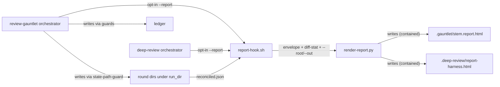
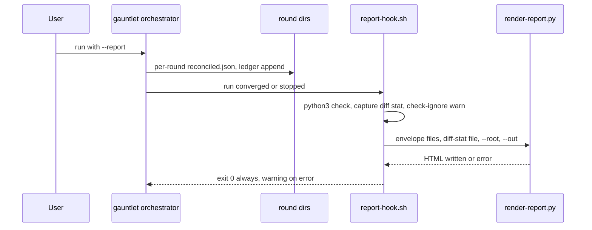
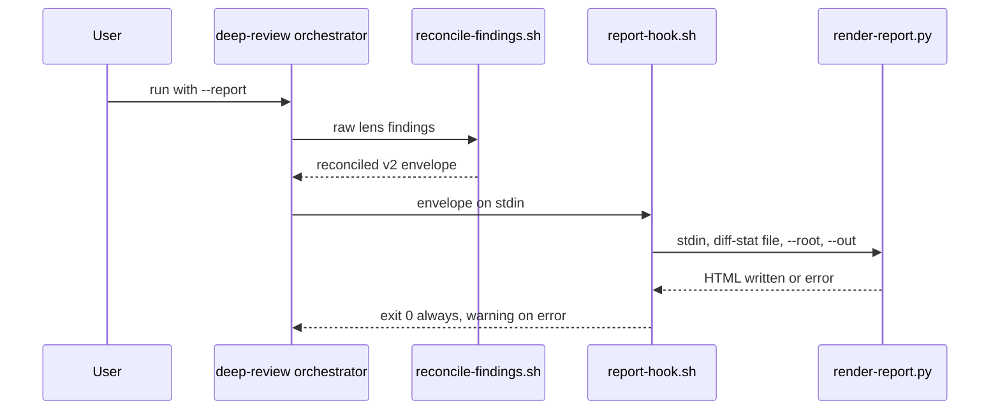

# Task: Review-output formats (plain prose, HTML report, show-me triggers)

**Status**: Not Started
**Component**: review-skills
**Assigned to**: Claude (Codex mirror via codex:rescue)
**Priority**: Medium
**Branch**: feature/karpathy-output-formats
**Created**: 2026-10-08
**Review Gates**: full

## Objective

Make review output faster to read and trust: a plain-prose writing rule for review findings, an opt-in throwaway HTML report (`--report`) for gauntlet and deep-review runs, and wider `show-me` triggers.

## Context

Source: Karpathy's thread (https://x.com/karpathy/status/2105819303471976479). His point: as LLMs do more work, the human job is oversight and understanding. Pick output formats that ease that: controlled-language prose (ASD-STE100 as inspiration), diagrams, HTML pages, throwaway artifacts. Explainer video is out of scope (`docs/explainer-video-idea.md`).

Today no review skill has a writing-style rule. `show-me` has no review, gauntlet or conduct triggers. `plan-view` renders dev-plan corpora only, not findings.

Facts verified during plan review (2026-10-08, two rounds):
- The gauntlet ledger (`lib/convergence-ledger.sh`) stores counts and key lists only (no finding text, no severity). Per-round `reconciled.json` goes to `$run_dir/round-N` (`review-gauntlet/SKILL.md:101,248`), but `$run_dir` is not defined in any skill file.
- deep-review never persists a reconciled envelope; reconcile output is consumed inline (`deep-review/SKILL.md:636-639`). All `.deep-review/` state writes go through `persist-deep-review-state.sh` (`SKILL.md:35,730`).
- `scripts/check-sync.sh` treats each skill's `scripts/` dir as a byte-mirrored bundle of canonical repo-root `scripts/`, declared in `scripts/lib/bundle-map.sh`. `tests/parity/test-applier-bundle-parity.sh:301` checks "bundled == operative" for `.sh` references only.
- `scripts/bundle-appliers.sh:22` lists `plugins/skein-pi` in MIRRORS; Pi gets deep-review and review-plan bundles unless excluded.
- A third mirror exists: `plugins/skein-pi/skills/{review-gauntlet,deep-review,review-plan,show-me}` (Pi-native rewrites; `tests/pi/test_skill_inventory.py:90-99` pins Pi show-me frontmatter).
- `scripts/finding-key.sh` builds the regression key from (file, category, normalized summary).
- The gate-1 (Codex adversarial) prompt is composed by the orchestrator (`review-gauntlet/SKILL.md:118-125`); gate 3 (`security-review`) is external.
- `justfile` `parity-tests` and `gauntlet-tests` list tests by name, no glob. `lint-python` runs ruff over the whole repo; `lint-scripts` covers `tests/*/*.sh` and bundled shell.
- The installed plugin cache (`~/.claude/plugins/cache/skein/skein/`) is 0.8.5; the repo is 0.9.2. The auto-chained gauntlet runs the cached version until the next release refreshes it.
- `conduct` auto-chains `review-gauntlet --plan <plan>` with a fixed argument set (`conduct/SKILL.md:367`).

## Requirements

- R1: Review prose follows a short plain-prose rule (short sentences, one meaning per word, active voice, no filler). It applies to `evidence`, `suggestion` and overall summaries, including the gate-1 adversarial prompt. It must NOT touch the finding `summary` line (feeds `finding-key.sh`), schemas, severity labels, or any machine-read field. Gate 3 (`security-review`) is out of scope: skein does not author it.
- R2: A gauntlet or deep-review run with `--report` emits one self-contained HTML report: findings by severity, round-by-round convergence, diff scope. Opt-in; default output is unchanged. A failing report never changes a run's outcome.
- R3: `show-me` triggers cover review findings, gauntlet convergence, and conduct phase progress, still defer to `plan-view` for plans, and point review findings and gauntlet convergence at the `--report` flag of the review skills (by skill and flag, not by state path).
- Claude and Codex mirrors stay aligned; path anchors (`${CLAUDE_PLUGIN_ROOT}` vs `$SKILL_DIR`) are never collapsed.
- `plugins/skein-pi` is out of scope for R1, R2 and R3, and must receive no copy of the new scripts.
- `just ci` passes.

## Review Focus

- R1 must not alter text that tests or parsers pin (compact/full finding rendering at `deep-review/SKILL.md:761`, `review-plan/SKILL.md:784`) or any input to `finding-key.sh`.
- Bundle invariant: a script ships into a skill iff that skill's SKILL.md invokes it (`scripts/lib/bundle-map.sh`, `scripts/check-sync.sh`), and Pi receives none of it.
- HTML must be a single file with no external fetches; finding text is untrusted and must be escaped in text nodes and attributes; the renderer enforces its own output containment.
- Mirror parity guards: `scripts/check-sync.sh`, `scripts/check-prompt-parity.sh`, `tests/parity/*`.
- State-write discipline: `.deep-review/` state files are written only by `persist-deep-review-state.sh`; `.gauntlet/` by the existing guarded writers.

## Implementation Checklist

### Phase 1: Plain-prose rule (R1)

**Impl files:** `plugins/skein/skills/review-gauntlet/SKILL.md, plugins/skein/skills/deep-review/SKILL.md, plugins/skein/skills/review-plan/SKILL.md, plugins/skein-codex/skills/review-gauntlet/SKILL.md, plugins/skein-codex/skills/deep-review/SKILL.md, plugins/skein-codex/skills/review-plan/SKILL.md`
**Test files:** `tests/parity/test-prose-rule-parity.sh, justfile`
**Test command:** `bash tests/parity/test-prose-rule-parity.sh && bash scripts/check-report-templates.sh`
**Goal:** The rule changes how prose is written only; no schema, label, pinned string, or `finding-key.sh` input changes.

- Write two named blocks, each between fixed anchor comment lines:
  - Block A (authoring rule): inserted into every lens prompt template in `deep-review` (5) and `review-plan` (5 lenses plus the Contradiction Pass = 6), and into the gate-1 adversarial prompt in `review-gauntlet`. Per mirror: 12 occurrences.
  - Block B (summary-prose rule): inserted at the orchestrator report step in all three skills. Per mirror: 3 occurrences.
- Both blocks state the rule as checkable items (sentence length cap, active voice, one term per concept, no filler), cite ASD-STE100 as inspiration only, and contain the sentence exempting the finding `summary` line.
- Keep both blocks harness-neutral so each is byte-identical across mirrors; place them outside the lines pinned by `scripts/check-report-templates.sh` and outside any lens output-schema fence.
- Codex half first via `codex:rescue`, then align the Claude half in the same commit.
- Parity test: extract each block between its anchors and byte-compare all copies; assert exact occurrence counts per mirror; assert each block contains the summary-exemption sentence; assert no anchor sits inside a schema fence.
- Wire the test into `justfile` `parity-tests` in the same commit.

### Phase 2: HTML report (R2)

**Impl files:** `scripts/render-report.py, scripts/report-hook.sh, scripts/lib/bundle-map.sh, scripts/bundle-appliers.sh, tests/parity/test-applier-bundle-parity.sh, plugins/skein/skills/review-gauntlet/scripts/render-report.py, plugins/skein/skills/review-gauntlet/scripts/report-hook.sh, plugins/skein-codex/skills/review-gauntlet/scripts/render-report.py, plugins/skein-codex/skills/review-gauntlet/scripts/report-hook.sh, plugins/skein/skills/deep-review/scripts/render-report.py, plugins/skein/skills/deep-review/scripts/report-hook.sh, plugins/skein-codex/skills/deep-review/scripts/render-report.py, plugins/skein-codex/skills/deep-review/scripts/report-hook.sh, plugins/skein/skills/review-gauntlet/SKILL.md, plugins/skein-codex/skills/review-gauntlet/SKILL.md, plugins/skein/skills/deep-review/SKILL.md, plugins/skein-codex/skills/deep-review/SKILL.md`
**Test files:** `tests/gauntlet/test-render-report.sh, tests/gauntlet/fixtures/render-report/, justfile`
**Test command:** `bash tests/gauntlet/test-render-report.sh && just check-sync && just lint-python`
**Goal:** The renderer only reads files it is handed and writes one contained HTML file; it never calls git and never mutates ledger or state. The hook always returns 0, so a report failure never changes a run's decision.

Ordering inside the phase (each step must leave `just ci` green):
1. Decision gate: confirm what per-round data the gauntlet can persist once `$run_dir` is defined (step 3) and record the real field names and the outcome in `## Findings` (below the marker).
2. Bundling: canonical `scripts/render-report.py` and `scripts/report-hook.sh`; a `BUNDLE_REPORT=(render-report.py report-hook.sh)` group in `scripts/lib/bundle-map.sh` expanded from both the review-gauntlet and deep-review arms; a Pi exclusion in `scripts/bundle-appliers.sh`; widen the `test-applier-bundle-parity.sh` §7 regex to `\.(sh|py)`; `just bundle-appliers`. Tests and `justfile` wiring land in the same commit.
3. Gauntlet SKILL.md (both mirrors): define `$run_dir` as `.gauntlet/<ledger-stem>/` resolved through `lib/state-path-guard.sh`; add the `--report` flag and argument-hint; add the report step, regenerated from full state on every terminal exit (including `--resume`). Check `tests/gauntlet/test-gauntlet-skill-shape.sh` for pinned text.
4. deep-review SKILL.md (both mirrors): add the `--report` flag and argument-hint; add the report step that pipes the reconcile output to the renderer on stdin. Never before step 2.

Tasks:
- Input is the reconciler v2 envelope (`reconcile-findings.sh` output): a file argument for gauntlet (per-round `reconciled.json` under `$run_dir`), stdin for deep-review. The renderer never re-implements dedup. It asserts `schema_version == 2` and exits non-zero otherwise, like `scripts/render-reconciled-report.sh`; add it as a third lockstep point at `deep-review/SKILL.md:606` in both mirrors.
- Diff scope: the hook reuses the gate-1 scope rule (committed range, or `git diff HEAD` plus untracked files in uncommitted mode), captures it to a file, and passes `--diff-stat <file>`. The report labels the captured form and the capture time; an unresolvable base renders "diff scope unavailable".
- Severity buckets: Critical, Important, Minor, plus an "Other" bucket for any non-canonical severity.
- Escape all finding text for text nodes and attribute contexts; inline CSS only; no scripts, no external URLs.
- Containment is in the renderer: `--root` and `--out` arguments; refuse output outside the root, symlink components, and `..`; write via temp file and rename.
- Output paths: gauntlet `.gauntlet/<ledger-stem>.report.html` (per target); deep-review `.deep-review/report-<harness>.html` (latest-run view per harness, like `latest-<harness>.json`).
- `report-hook.sh` runs `command -v python3` (soft dependency; warn and skip when absent), runs `git check-ignore` on the output path and warns if it is not ignored, runs the renderer, logs any failure as a warning, and always exits 0.
- `--report` is not forwarded by `conduct`'s auto-chain; running with the report requires invoking the gauntlet directly.

### Phase 3: show-me triggers (R3)

**Impl files:** `plugins/skein/skills/show-me/SKILL.md, plugins/skein-codex/skills/show-me/SKILL.md, docs/BACKLOG.md`
**Test files:** `tests/parity/test-show-me-triggers.sh, justfile`
**Test command:** `bash tests/parity/test-show-me-triggers.sh`

- Add bullets under "When to reach for a visual" for review findings, gauntlet convergence, and conduct phase progress; update the frontmatter `description`.
- Under "Composing with other skills", point review findings and gauntlet convergence at the `--report` flag of `review-gauntlet` and `deep-review` (skill and flag, not a path); keep conduct phase progress as a plain mermaid or table trigger; keep the "defer to plan-view" note.
- Preserve the sanctioned Claude/Codex divergence (the Mermaid and HTML-artifact bullets, currently lines 32-33); anchor on that content, not line numbers.
- New test asserts the three triggers and the `--report` pointer appear in both mirrors; wire into `justfile` `parity-tests` in the same commit.
- Add the Pi follow-up entry to `docs/BACKLOG.md`.

## Technical Specifications

### Files to Modify
- The six review SKILL.md files (R1 blocks; R2 flag, hook step and argument-hints in gauntlet and deep-review, both mirrors; `$run_dir` definition in both gauntlet mirrors; schema lockstep note at `deep-review/SKILL.md:606` in both mirrors).
- Both `show-me/SKILL.md` files (R3).
- `scripts/lib/bundle-map.sh` (`BUNDLE_REPORT` group), `scripts/bundle-appliers.sh` (Pi exclusion), `tests/parity/test-applier-bundle-parity.sh` (§7 regex to `.sh|.py`).
- `justfile` (add the three new tests to `parity-tests` and `gauntlet-tests`; unconditional).
- `docs/BACKLOG.md` (Pi follow-up).

### New Files to Create
- `scripts/render-report.py` and `scripts/report-hook.sh` (canonical) and, via `just bundle-appliers`, byte-identical copies under both mirrors for review-gauntlet and deep-review.
- `tests/parity/test-prose-rule-parity.sh`, `tests/parity/test-show-me-triggers.sh`, `tests/gauntlet/test-render-report.sh`, fixtures under `tests/gauntlet/fixtures/render-report/`.

### Architecture Decisions
- Renderer and hook are canonical in `scripts/`, bundled per the existing bundle map as one `BUNDLE_REPORT` group (not two `bundle_extra_for` arms), not hand-authored in mirrors: this is what `check-sync.sh` and `test-applier-bundle-parity.sh` enforce.
- Standalone renderer, not an extension of `plan-view/generate.py`: that file takes a plan corpus (`generate.py:1659-1710`), a different input shape.
- Renderer consumes the reconciler v2 envelope so dedup stays in one place (`reconcile-findings.sh`), and asserts `schema_version == 2`.
- Renderer is pure: no git calls. The hook captures the diff stat and passes it as a file.
- The hook is a bundled script, not SKILL.md prose, so "never changes the decision" is testable. It always returns 0.
- Output containment is enforced inside the renderer (`--root`/`--out`), because the existing bash guards are not reachable from a separate Python process.
- Decision (grilled): `render-report.py` is excluded from the Pi mirror in `bundle-appliers.sh` (and listed in Phase 2 impl files), keeping bundled==operative and honouring "Pi out of scope".
- Decision (grilled): R1 Block A also lands in the gate-1 adversarial prompt in both gauntlet mirrors, because skein composes it; gate 3 stays out of scope. Occurrence counts above reflect this.
- Decision (grilled): deep-review feeds the renderer the reconcile output on stdin; no new persisted state file and no change to `persist-deep-review-state.sh`.
- Decision (grilled): `$run_dir` is defined as `.gauntlet/<ledger-stem>/` in both gauntlet mirrors, resolved through `lib/state-path-guard.sh`. Counts-only convergence remains the fallback when a round dir is absent, and the report labels it.
- Decision (grilled): the deep-review report name `report-<harness>.html` is a latest-run view per harness, matching `latest-<harness>.json`; only the gauntlet report is per-target (ledger stem).
- R1 is two blocks (authoring rule, summary-prose rule), each byte-identical across mirrors, because finding prose is authored in lens prompts, not only at report rendering. Finding `summary` is exempt to keep `finding-key.sh` keys stable across rounds and resumed ledgers.
- The Phase 1 test checks block text, exact counts, the exemption sentence and anchor placement, not mere presence.
- `plugins/skein-pi` is out of scope (Pi-native rewrites with their own state, `.deep-review/latest-pi.json` and `lib/review_gauntlet.py`). A `docs/BACKLOG.md` entry tracks the follow-up.
- ASD-STE100 is a licensed spec with a large dictionary; the plan cites it as inspiration and encodes the rule as checkable items. No percentage claim.
- python3 is a soft dependency of the opt-in report; its absence yields a warning, not a failure.

### Dependencies
- None new for default runs. Python 3 stdlib only, and only for `--report`. Both plugin manifests are at 0.9.2; no version bump here (release goes through `skein:release`).

### Integration Seams

| Seam | Writer (task) | Caller (task) | Contract |
|------|---------------|---------------|----------|
| Reconciled envelope | gauntlet round loop (writes `$run_dir/round-N/reconciled.json`) / deep-review reconcile step (stdout) | render-report.py via report-hook.sh | Reconciler v2 envelope, `schema_version` 2 asserted; unknown fields ignored; missing or malformed input yields a clear message and a non-zero renderer exit that the hook converts to a warning |
| Diff stat file | report-hook.sh | render-report.py `--diff-stat` | Plain `--stat` text, labelled with capture mode and time; absent file renders "diff scope unavailable" |
| Output path | report-hook.sh (`--root`, `--out`) | render-report.py | Renderer refuses out-of-root, symlink or `..` paths; writes via temp file and rename |
| Rule blocks A and B | Phase 1 | parity test | Per-block byte-identical across their file sets; exact counts asserted |
| Bundle map | `scripts/lib/bundle-map.sh` (`BUNDLE_REPORT`) | `check-sync.sh`, `bundle-appliers.sh` | Every bundled copy byte-identical to canonical; Pi gets none; no undeclared files |
| `$run_dir` | gauntlet SKILL.md round loop (both mirrors) | report hook | `.gauntlet/<ledger-stem>/` via `lib/state-path-guard.sh`; absent round dirs trigger the counts-only fallback |

## Architecture & Call Flow

Component graph — which component triggers which:

Trigger order — one gauntlet run with `--report`:

Trigger order — one deep-review run with `--report`:

Context lifecycle:

| Step | Trigger | Enters context | Cleared/persisted | Turn boundary |
|------|---------|----------------|-------------------|---------------|
| Round loop | gauntlet round | findings, envelopes | envelopes persisted under `$run_dir`; ledger counts persisted | none |
| Reconcile | deep-review report step | raw lens findings | envelope streamed to hook, not persisted | none |
| Report hook | run end | file paths and flags only | HTML persisted; no finding text enters orchestrator context | none |
| Render | hook call | none (separate process) | HTML file on disk | none |

## Testing Notes

- `just ci`, backgrounded with a Monitor (per project CLAUDE.md). Fixer briefs and fixer commits run `just ci`.
- Renderer fixtures: reconciled envelope with all severities plus a non-canonical severity; duplicate findings across rounds (assert no double count, dedup comes from the envelope); unknown extra fields; a ledger-only (counts-only) fixture asserting the fallback label.
- Renderer failure vectors: missing file, malformed JSON, `schema_version` mismatch, empty findings, missing `--diff-stat`. Each yields a clear message and a non-zero exit.
- Hook test with a failing-renderer stub: asserts exit 0, a warning, and an unchanged decision. Also asserts the python3-absent path and the not-ignored warning.
- Containment fixtures: symlinked output path, `..` path, out-of-root path; all refused.
- HTML safety assertions: no `<script`, `<link`, `<iframe`, external `src=`/`href=`, CSS `@import`, `url(`, or `http(s)://` outside escaped text; finding text containing `<script>`, quotes, `&` and attribute-breaking input is escaped. URLs inside finding text are allowed as escaped text.
- HTML structure checked positively: exactly one `<html>`, `<head>`, `<body>`; expected sections present in severity order.
- Default-unchanged: shape assertions in both mirrors that the report step and flag are gated on `--report`, in both gauntlet and deep-review.
- Bundle guard: widened §7 regex catches a `.py` reference with no `bundle_extra_for`/`BUNDLE_REPORT` entry; Pi mirror asserted to hold no copy.
- Phase 1 parity test: per-block byte-compare, exact counts, exemption sentence, anchor placement.
- Phase 3 test: three triggers and `--report` pointer present in both mirrors.

## Acceptance Criteria

- Blocks A and B present with the exact counts and byte-identical per block; no existing test changes; `finding-key.sh` inputs untouched.
- `just check-sync` green with the report group bundled; mirrors byte-identical to canonical; `plugins/skein-pi` holds no copy.
- Fixture-based renderer and hook tests green, including failure, containment and safety vectors.
- Default (no `--report`) gauntlet and deep-review output unchanged, asserted by the shape tests.
- `show-me` lists the three triggers and the `--report` pointer in both mirrors; new test green.
- `$run_dir` defined in both gauntlet mirrors; gauntlet shape tests green.
- `just ci` green; Codex halves authored via `codex:rescue`.
- Manual dogfood (not CI, recorded in `## Final Results`): run `scripts/render-report.py` directly on the state the installed gauntlet leaves; expect the counts-only fallback until the next release refreshes the plugin cache, after which run the full `--report` path.
- `docs/BACKLOG.md` has the Pi follow-up entry.

<!-- reviewed: YYYY-MM-DD @ <hash> -->
<!-- /review-plan writes the marker line above. Everything below is the workspace: edits here do NOT invalidate the marker. -->

## Progress

- [ ] Phase 1: Plain-prose rule (R1)
- [ ] Phase 2: HTML report (R2)
- [ ] Phase 3: show-me triggers (R3)

## Findings

- (append findings here as work proceeds; Phase 2 step 1 records the per-round data decision here)

## Issues & Solutions

(none yet)

## Final Results

(fill when complete)
