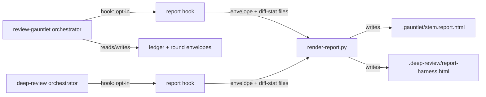
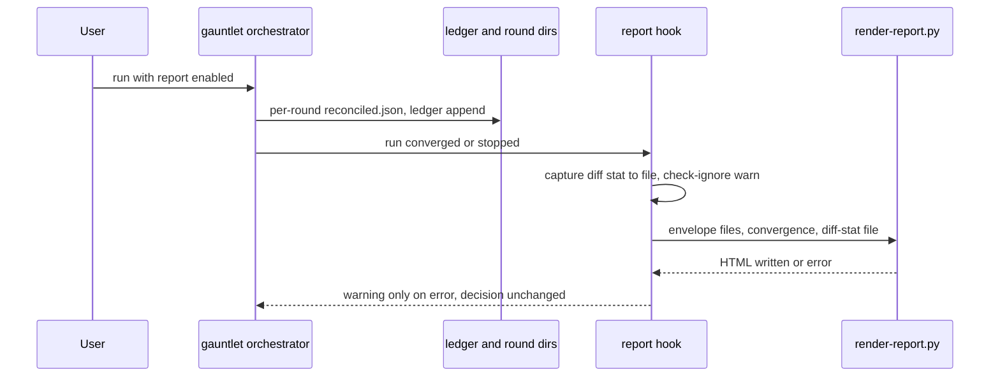

# Task: Review-output formats (plain prose, HTML report, show-me triggers)

**Status**: Not Started
**Component**: review-skills
**Assigned to**: Claude (Codex mirror via codex:rescue)
**Priority**: Medium
**Branch**: feature/karpathy-output-formats
**Created**: 2026-10-08
**Review Gates**: full

## Objective

Make review output faster to read and trust: a plain-prose writing rule for review findings, an opt-in throwaway HTML report for gauntlet/deep-review runs, and wider `show-me` triggers.

## Context

Source: Karpathy's thread (https://x.com/karpathy/status/2105819303471976479). His point: as LLMs do more work, the human job is oversight and understanding. Pick output formats that ease that: controlled-language prose (ASD-STE100 as inspiration), diagrams, HTML pages, throwaway artifacts. Explainer video is out of scope (`docs/explainer-video-idea.md`).

Today no review skill has a writing-style rule. `show-me` has no review, gauntlet or conduct triggers. `plan-view` renders dev-plan corpora only, not findings.

Facts verified during plan review (2026-10-08):
- The gauntlet ledger (`lib/convergence-ledger.sh`) stores counts and key lists only (no finding text, no severity). Per-round `reconciled.json` goes to `$run_dir/round-N` (`review-gauntlet/SKILL.md:101,248`), but `$run_dir` is not defined in any skill file.
- `.deep-review/latest-*.json` persists the raw per-lens shape, not the reconciled v2 envelope (`persist-deep-review-state.sh`).
- `scripts/check-sync.sh` treats each skill's `scripts/` dir as a byte-mirrored bundle of canonical repo-root `scripts/`, declared in `scripts/lib/bundle-map.sh`.
- A third mirror exists: `plugins/skein-pi/skills/{review-gauntlet,deep-review,review-plan,show-me}` (Pi-native rewrites).
- `scripts/finding-key.sh` builds the regression key from (file, category, normalized summary).
- `justfile` `parity-tests` and `gauntlet-tests` list tests by name, no glob.

## Requirements

- R1: Review prose follows a short plain-prose rule (short sentences, one meaning per word, active voice, no filler). It applies to `evidence`, `suggestion` and overall summaries. It must NOT touch the finding `summary` line (feeds `finding-key.sh`), schemas, severity labels, or any machine-read field.
- R2: A gauntlet or deep-review run can emit one self-contained HTML report: findings by severity, round-by-round convergence, diff scope. Opt-in; default output is unchanged. A failing report never changes a run's outcome.
- R3: `show-me` triggers cover review findings, gauntlet convergence, and conduct phase progress, still defer to `plan-view` for plans, and point review findings and gauntlet convergence at the R2 report.
- Claude and Codex mirrors stay aligned; path anchors (`${CLAUDE_PLUGIN_ROOT}` vs `$SKILL_DIR`) are never collapsed.
- `plugins/skein-pi` is out of scope for R1 and R2 (see Architecture Decisions). R3 for Pi is deferred with it.
- `just ci` passes.

## Review Focus

- R1 must not alter text that tests or parsers pin (compact/full finding rendering at `deep-review/SKILL.md:761`, `review-plan/SKILL.md:784`) or any input to `finding-key.sh`.
- Bundle invariant: a script ships into a skill iff that skill's SKILL.md invokes it (`scripts/lib/bundle-map.sh`, `scripts/check-sync.sh`).
- HTML must be a single file with no external fetches; finding text is untrusted and must be escaped in text nodes and attributes.
- Mirror parity guards: `scripts/check-sync.sh`, `scripts/check-prompt-parity.sh`, `tests/parity/*`.

## Implementation Checklist

### Phase 1: Plain-prose rule (R1)

**Impl files:** `plugins/skein/skills/review-gauntlet/SKILL.md, plugins/skein/skills/deep-review/SKILL.md, plugins/skein/skills/review-plan/SKILL.md, plugins/skein-codex/skills/review-gauntlet/SKILL.md, plugins/skein-codex/skills/deep-review/SKILL.md, plugins/skein-codex/skills/review-plan/SKILL.md`
**Test files:** `tests/parity/test-prose-rule-parity.sh`
**Test command:** `bash tests/parity/test-prose-rule-parity.sh && bash scripts/check-report-templates.sh`
**Goal:** The rule changes how prose is written only; no schema, label, pinned string, or `finding-key.sh` input changes.

- Write two named blocks, each between fixed anchor comment lines:
  - Block A (lens-prompt rule): inserted into every lens prompt template in `deep-review` and `review-plan` (where finding prose is authored).
  - Block B (summary-prose rule): inserted at the orchestrator report step in all three skills.
- Both blocks state the rule as checkable items (sentence length cap, active voice, one term per concept, no filler) and cite ASD-STE100 as inspiration only. Both exempt the finding `summary` line.
- Gate 1 (Codex adversarial) and gate 3 (`security-review`) text is out of scope: skein does not author it.
- Keep both blocks harness-neutral so each is byte-identical across mirrors; place them outside the lines pinned by `scripts/check-report-templates.sh`.
- Codex half first via `codex:rescue`, then align the Claude half in the same commit.
- Parity test: extract each block between its anchors and byte-compare all copies; assert occurrence counts (block A: lens templates in deep-review + review-plan, both mirrors; block B: 3 skills x 2 mirrors).
- Wire the test into `justfile` `parity-tests` in the same commit; check `tests/parity/codex-test-equivalents.txt`.

### Phase 2: HTML report (R2)

**Impl files:** `scripts/render-report.py, scripts/lib/bundle-map.sh, plugins/skein/skills/review-gauntlet/scripts/render-report.py, plugins/skein-codex/skills/review-gauntlet/scripts/render-report.py, plugins/skein/skills/deep-review/scripts/render-report.py, plugins/skein-codex/skills/deep-review/scripts/render-report.py, plugins/skein/skills/review-gauntlet/SKILL.md, plugins/skein-codex/skills/review-gauntlet/SKILL.md, plugins/skein/skills/deep-review/SKILL.md, plugins/skein-codex/skills/deep-review/SKILL.md`
**Test files:** `tests/gauntlet/test-render-report.sh, tests/gauntlet/fixtures/render-report/`
**Test command:** `bash tests/gauntlet/test-render-report.sh && just check-sync`
**Goal:** The renderer only reads files it is handed and writes one HTML file; it never calls git, never mutates ledger or state, and a failure never changes a run's decision.

Ordering inside the phase (each step must leave `just ci` green):
1. Decision gate: confirm where per-round `reconciled.json` lives (`$run_dir`) and what deep-review can persist; record the real field names and the decision in `## Findings`. If gauntlet per-round envelopes are not persisted, the gauntlet report falls back to counts-only convergence and says so in the report.
2. Canonical `scripts/render-report.py` + `scripts/lib/bundle-map.sh` entries (`bundle_extra_for review-gauntlet` and `deep-review`) + `just bundle-appliers` to fan out to both mirrors. Test and `justfile` wiring land in the same commit.
3. Gauntlet SKILL.md hook (both mirrors).
4. Deep-review SKILL.md hook (both mirrors). Never before step 2.

Tasks:
- Input is the reconciler v2 envelope (`reconcile-findings.sh` output) plus a convergence summary, passed as file arguments; the renderer never re-implements dedup. Gauntlet hook copies each round's `reconciled.json` into the state dir via the existing state-path guard; deep-review hook writes its reconciled envelope to `.deep-review/`.
- Diff scope is captured by the hook at run time (`git diff <base>...HEAD --stat` into a file) and passed as `--diff-stat <file>`; the report labels it as captured at run time.
- Severity buckets: Critical, Important, Minor, plus an "Other" bucket for any non-canonical severity.
- Escape all finding text for text nodes and attribute contexts; no scripts, no external URLs.
- Output path is derived from the caller's state stem: `.gauntlet/<ledger-stem>.report.html`, `.deep-review/report-<harness>.html`. Gauntlet write goes through `ledger_assert_no_symlink` and the state-path guard.
- Hook is opt-in and wrapped so any renderer failure logs a warning and cannot change the decision token. The hook (not the renderer) runs `git check-ignore` on the output path and warns if it is not ignored.

### Phase 3: show-me triggers (R3)

**Impl files:** `plugins/skein/skills/show-me/SKILL.md, plugins/skein-codex/skills/show-me/SKILL.md`
**Test files:** `tests/parity/test-show-me-triggers.sh`
**Test command:** `bash tests/parity/test-show-me-triggers.sh`

- Add bullets under "When to reach for a visual" for review findings, gauntlet convergence, and conduct phase progress; update the frontmatter `description`.
- Under "Composing with other skills", point review findings and gauntlet convergence at the R2 report; keep conduct phase progress as a plain mermaid or table trigger; keep the "defer to plan-view" note.
- Preserve the sanctioned Claude/Codex divergence (the Mermaid and HTML-artifact bullets, currently lines 32-33); anchor on that content, not line numbers.
- New test asserts the three triggers and the R2 pointer appear in both mirrors; wire into `justfile` `parity-tests` in the same commit.

## Technical Specifications

### Files to Modify
- The six review SKILL.md files (R1 blocks; R2 hooks in gauntlet and deep-review, both mirrors).
- Both `show-me/SKILL.md` files (R3).
- `scripts/lib/bundle-map.sh` (register `render-report.py` for review-gauntlet and deep-review).
- `justfile` (add the three new tests to `parity-tests` and `gauntlet-tests`; unconditional).
- `tests/parity/codex-test-equivalents.txt` (check, update if the new parity tests need an entry).

### New Files to Create
- `scripts/render-report.py` (canonical) and, via `just bundle-appliers`, byte-identical copies under both mirrors for review-gauntlet and deep-review.
- `tests/parity/test-prose-rule-parity.sh`, `tests/parity/test-show-me-triggers.sh`, `tests/gauntlet/test-render-report.sh`, fixtures under `tests/gauntlet/fixtures/render-report/`.

### Architecture Decisions
- Renderer is canonical in `scripts/`, bundled per the existing bundle map, not hand-authored in mirrors: this is what `check-sync.sh` and `test-applier-bundle-parity.sh` enforce.
- Standalone renderer, not an extension of `plan-view/generate.py`: that file takes a plan corpus (`generate.py:1659-1710`), a different input shape.
- Renderer consumes the reconciler v2 envelope so dedup stays in one place (`reconcile-findings.sh`).
- Renderer is pure: no git calls. Diff stat and base come from the hook as a file.
- Output name derives from the caller's state stem so concurrent targets and harnesses never clobber one file.
- R1 is two blocks (lens-prompt, summary-prose), each byte-identical across mirrors, because finding prose is authored in lens prompts, not only at report rendering. Finding `summary` is exempt to keep `finding-key.sh` keys stable across rounds and resumed ledgers.
- Phase 1 test checks block text and occurrence counts, not mere presence.
- `plugins/skein-pi` is out of scope: its skills are Pi-native rewrites with their own state (`.deep-review/latest-pi.json`, `lib/review_gauntlet.py`) and `tests/pi/test_skill_inventory.py` pins show-me frontmatter. Add a `docs/BACKLOG.md` entry for Pi follow-up.
- ASD-STE100 is a licensed spec with a large dictionary; the plan cites it as inspiration and encodes the rule as checkable items. No percentage claim.

### Dependencies
- None new. Python stdlib only. Both plugin manifests are at 0.9.2; no version bump here (release goes through `skein:release`).

### Integration Seams

| Seam | Writer (task) | Caller (task) | Contract |
|------|---------------|---------------|----------|
| Reconciled envelope | gauntlet round loop / deep-review reconcile step (existing, plus hook copy) | render-report.py (Phase 2) | Reconciler v2 envelope, schema_version 2; renderer ignores unknown fields; missing or malformed file yields a clear message and exit status the hook ignores |
| Diff stat file | hook (Phase 2) | render-report.py `--diff-stat` | Plain `--stat` text captured at run time; absent file renders "diff scope unavailable" |
| Rule blocks A and B | Phase 1 | parity test | Per-block byte-identical across their file sets; occurrence counts asserted |
| Bundle map | `scripts/lib/bundle-map.sh` (Phase 2 step 2) | `check-sync.sh` | Every bundled copy byte-identical to `scripts/render-report.py`; no undeclared files |

## Architecture & Call Flow

Component graph — which component triggers which:

Trigger order — one gauntlet run with the report enabled:

Context lifecycle:

| Step | Trigger | Enters context | Cleared/persisted | Turn boundary |
|------|---------|----------------|-------------------|---------------|
| Round loop | gauntlet round | findings, envelopes | envelopes persisted under state dir | none |
| Report hook | run end | file paths only | HTML persisted; no finding text enters orchestrator context | none |
| Render | hook call | none (separate process) | HTML file on disk | none |

## Testing Notes

- `just ci`, backgrounded with a Monitor (per project CLAUDE.md). Fixer briefs and fixer commits run `just ci`.
- Renderer fixtures: reconciled envelope with all severities plus a non-canonical severity; duplicate findings across rounds (dedup comes from the envelope, assert no double count); unknown extra fields.
- Renderer failure vectors: missing file, malformed JSON, empty findings, missing `--diff-stat`. Assert clear message and that the hook wrapper leaves the decision token unchanged.
- HTML safety assertions: no `<script`, `<link`, `<iframe`, external `src=`/`href=`; finding text containing `<script>`, quotes, `&` and attribute-breaking input is escaped. URLs inside finding text are allowed as escaped text.
- HTML validity: parses with `html.parser`, exactly one `<html>`.
- Derived output name asserted per caller.
- Phase 1 parity test: per-block byte-compare plus occurrence counts.
- Phase 3 test: three triggers and R2 pointer present in both mirrors.

## Acceptance Criteria

- Blocks A and B present with correct counts and byte-identical per block; no existing test changes; `finding-key.sh` inputs untouched.
- `just check-sync` green with `render-report.py` bundled; mirrors byte-identical to canonical.
- Fixture-based renderer test green, including failure vectors and safety assertions.
- Default (non-opt-in) gauntlet and deep-review output unchanged.
- `show-me` lists the three triggers and the R2 pointer in both mirrors; new test green.
- `just ci` green; Codex halves authored via `codex:rescue`.
- Manual dogfood (not CI): after the gauntlet run on this branch, run the renderer on the live state and record the result in `## Final Results`.
- `docs/BACKLOG.md` has a Pi follow-up entry.

## Final Results

(fill when complete)
