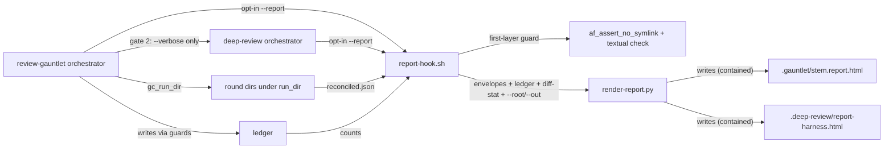
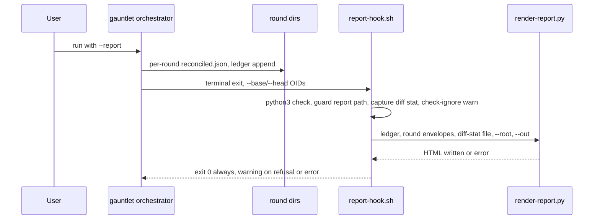
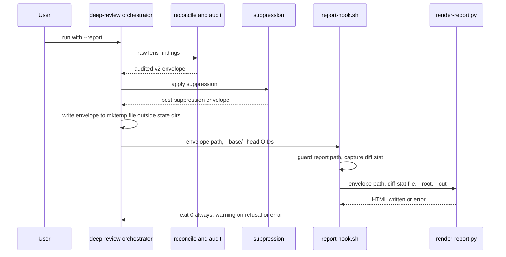

# Task: Review-output formats (plain prose, HTML report, show-me triggers)

**Status**: Not Started
**Component**: review-skills
**Assigned to**: Claude (Codex mirror via codex:rescue)
**Priority**: Medium
**Branch**: feature/karpathy-output-formats
**Created**: 2026-10-08
**Review Gates**: full

## Objective

Make review output faster to read and trust: a plain-prose writing rule for review findings, an opt-in throwaway HTML report (`--report`) for gauntlet and deep-review runs, and wider `show-me` triggers.

## Context

Source: Karpathy's thread (https://x.com/karpathy/status/2105819303471976479), as the author reads it. His point, as paraphrased here: as LLMs do more work, the human job is oversight and understanding. Pick output formats that ease that: controlled-language prose (ASD-STE100 as inspiration), diagrams, HTML pages, throwaway artifacts. This is motivation only; nothing below depends on the thread's exact wording. Explainer video is out of scope (`docs/explainer-video-idea.md`).

Today no review skill has a writing-style rule. `show-me` has no review, gauntlet or conduct triggers. `plan-view` renders dev-plan corpora only, not findings.

Facts verified during plan review (2026-10-08 and 2026-10-09, four rounds):
- The gauntlet ledger (`lib/convergence-ledger.sh`) stores counts and key lists only (no finding text, no severity). Its file is `.gauntlet/ledger-<author>-<slug>-<digest12>.json` (`gauntlet-common.sh:135`), so it is per target and per harness author; its shape is `{loop_counter, rounds}` (`convergence-ledger.sh:394`). Per-round files (`<gate>.envelope.json`, `*.normalized.jsonl`, `findings.jsonl`, `reconciled.json`, `present-keys.txt`) are already written to `$run_dir/round-N` (`review-gauntlet/SKILL.md:101-110,240-250`), but `$run_dir` itself is not defined in any skill file. Each round's `reconciled.json` is reconciled alone; no envelope spans rounds.
- `--fresh` today maps only to `convergence-ledger.sh --init --force` (`review-gauntlet/SKILL.md:51-62`), which knows nothing about round dirs. `lib/state-path-guard.sh` exports only `gauntlet_assert_no_symlink <path> <label>` (a create/write check), is sourced by lib scripts and never by SKILL.md prose, and is not a path resolver. The ledger path has one owner, `gc_ledger_path` (`lib/gauntlet-common.sh:112-136`).
- deep-review never persists a reconciled envelope; reconcile output is consumed inline (`deep-review/SKILL.md:636-639`). The audited envelope then goes through Step 4 Apply Suppression (`:658-666`), then Step 4.5 `--auto-fix=trivial` (`:671`), then Step 5 render. All `.deep-review/` state writes go through `persist-deep-review-state.sh` (`SKILL.md:35,730`), which uses `persist-common.sh`. Shell state does not survive Bash tool calls (`deep-review/SKILL.md:179`).
- `af_assert_no_symlink` (`scripts/lib/auto-fix-common.sh:100-160`) tests `-L` on the leaf and parents only. It does not refuse `..` or out-of-root paths (the applier's `resolve_path` does that) and it must not absolutise.
- The deep-review schema-versioning bullet (`deep-review/SKILL.md:606`) sits inside the `GENERIC FINDING SCHEMA AND MERGE` block (`:595-623`). `scripts/check-prompt-parity.sh:653-657` holds that block byte-identical across deep-review and review-plan in both mirrors.
- `scripts/check-sync.sh` treats each skill's `scripts/` dir as a byte-mirrored bundle of canonical repo-root `scripts/`, declared in `scripts/lib/bundle-map.sh`. It checks only skein and skein-codex (`check-sync.sh:59-61`). `tests/parity/test-applier-bundle-parity.sh:300` checks "bundled == operative" for `.sh` references only.
- `scripts/bundle-appliers.sh:21` lists `plugins/skein-pi` in MIRRORS and stages once per skill, then `rsync --delete`s into every mirror (`:49-72`); one hardcoded Pi rule exists at `:62-64`. Pi gets deep-review and review-plan bundles unless an exclusion is added. `bundle-map.sh:2-6` declares itself the single source of truth for bundle membership.
- A third mirror exists: `plugins/skein-pi/skills/{review-gauntlet,deep-review,review-plan,show-me}` (Pi-native rewrites; `tests/pi/test_skill_inventory.py:90-99` pins Pi show-me frontmatter). Pi tests are not in `just ci`.
- `scripts/finding-key.sh` builds the regression key from (file, category, normalized summary).
- The gate-1 (Codex adversarial) prompt is not a file template in either mirror. Claude: the orchestrator composes it from prose around a `"<adversarial-review prompt>"` placeholder (`review-gauntlet/SKILL.md:118-125`). Codex: it is an f-string in `plugins/skein-codex/skills/review-gauntlet/native_gates.py:576`; `tests/gauntlet/test_native_gates.py` does not pin its text. Gate 3 (`security-review`) is external.
- Diff targets: gauntlet takes `<branch> | --pr <N>` (`review-gauntlet/SKILL.md:4,25`); deep-review's input rules (`:20-26`) have no uncommitted mode. Both resolve `--pr` through `gh pr diff` (a patch; no `--stat`), and neither resolves base/head refs for a PR. "Uncommitted" appears only as gate-1 prompt wording and a Codex-only `native_gates.py` argument.
- review-plan lens prompts call the finding summary field `finding` before serialization (`review-plan/SKILL.md:784`); deep-review calls it `summary`.
- `justfile` `parity-tests` and `gauntlet-tests` list tests by name, no glob. `lint-python` runs ruff over the whole repo; `lint-scripts` shellchecks and shfmts `scripts/*.sh` and `tests/*/*.sh` and runs `lint-temp-paths.sh`; `just ci` runs `lint` first.
- The installed plugin cache (`~/.claude/plugins/cache/skein/skein/`) is 0.8.5; the repo is 0.9.2. The auto-chained gauntlet runs the cached version. That a release bump refreshes the cache is harness behaviour this repo cannot verify; treat it as an assumption. The cached `convergence-ledger.sh`, `gauntlet-common.sh` and `run-gate.sh` have no commits since tag `v0.8.5`.
- `conduct` auto-chains `review-gauntlet --plan <plan>` with a fixed argument set (`conduct/SKILL.md:367`). The gauntlet invokes `skein:deep-review --verbose` at top level each round (`review-gauntlet/SKILL.md:89,129`).

## Requirements

- R1: Review prose follows a short plain-prose rule (short sentences, one meaning per word, active voice, no filler). It applies to `evidence`, `suggestion` and overall summaries. The gate-1 adversarial prompt gets the rule as one plain sentence. It must NOT touch the finding summary line (`summary` in deep-review, `finding` in review-plan lens prompts; it feeds `finding-key.sh`), schemas, severity labels, or any machine-read field. Gate 3 (`security-review`) is out of scope: skein does not author it.
- R2: A gauntlet or deep-review run with `--report` emits one self-contained HTML report: findings by severity, round-by-round convergence, diff scope. Opt-in; default output is unchanged. A failing report never changes a run's outcome: a guard refusal, a hook failure and a renderer failure all warn, skip the report, and leave the terminal token and exit code unchanged.
- R3: `show-me` triggers cover review findings, gauntlet convergence, and conduct phase progress, still defer to `plan-view` for plans, and point review findings and gauntlet convergence at the `--report` flag of the review skills (by skill and flag, not by state path).
- Claude and Codex mirrors stay aligned; path anchors (`${CLAUDE_PLUGIN_ROOT}` vs `$SKILL_DIR`) are never collapsed.
- `plugins/skein-pi` is out of scope for R1, R2 and R3, and must receive no copy of the new scripts.
- `just ci` passes.

## Review Focus

- R1 must not alter text that tests or parsers pin (compact/full finding rendering at `deep-review/SKILL.md:761`, `review-plan/SKILL.md:784`) or any input to `finding-key.sh`. R1 blocks must sit outside the `GENERIC FINDING SCHEMA AND MERGE` block and outside lens output-schema fences.
- Bundle invariant: a script ships into a skill iff that skill's SKILL.md invokes it (`scripts/lib/bundle-map.sh`, `scripts/check-sync.sh`), and Pi receives none of it.
- HTML must be a single file with no external fetches; finding text is untrusted and must be escaped in text nodes and attributes. Output containment: `report-hook.sh` runs the tree owner's guard first and refuses before the renderer runs; the renderer re-checks as defence in depth.
- Mirror parity guards: `scripts/check-sync.sh`, `scripts/check-prompt-parity.sh`, `tests/parity/*`.
- State-write discipline: `.deep-review/` state files are written only by `persist-deep-review-state.sh`; `.gauntlet/` state by the existing guarded writers. Sanctioned additions: (a) the report file (`report-*.html`, `*.report.html`), written only by `render-report.py` after the hook's guard has checked its path and never read back as state; (b) removal of the round dir `<ledger-stem>/` on `--fresh`, done only by `convergence-ledger.sh --init --force` under its own guard. Report temp files (diff-stat, deep-review scratch envelope) live under `mktemp` outside both state dirs.

## Implementation Checklist

### Phase 1: Plain-prose rule (R1)

**Impl files:** `plugins/skein/skills/review-gauntlet/SKILL.md, plugins/skein/skills/deep-review/SKILL.md, plugins/skein/skills/review-plan/SKILL.md, plugins/skein-codex/skills/review-gauntlet/SKILL.md, plugins/skein-codex/skills/review-gauntlet/native_gates.py, plugins/skein-codex/skills/deep-review/SKILL.md, plugins/skein-codex/skills/review-plan/SKILL.md`
**Test files:** `tests/parity/test-prose-rule-parity.sh, justfile`
**Test command:** `just lint && bash tests/parity/test-prose-rule-parity.sh && bash scripts/check-report-templates.sh && bash tests/gauntlet/test-gauntlet-skill-shape.sh && ./scripts/check-prompt-parity.sh`
**Goal:** The rule changes how prose is written only; no schema, label, pinned string, or `finding-key.sh` input changes.

- Write two named blocks, each between fixed anchor comment lines:
  - Block A (authoring rule): inserted into every lens prompt template in `deep-review` (5) and `review-plan` (5 lenses plus the Contradiction Pass = 6). Per mirror: 11 occurrences. `review-gauntlet` gets no Block A. (Codex deep-review uses one `### <Name> Lens` header per lens with a shared persistence contract; anchor per header.)
  - Block B (summary-prose rule): inserted at the orchestrator report step in all three skills. Per mirror: 3 occurrences. In the gauntlet, Block B lands at the existing terminal-status report step (`review-gauntlet/SKILL.md:144-150`); Phase 2's report step wraps those anchors and adds no second Block B.
- Gate-1 adversarial prompt: add one plain sentence stating the rule. Claude: in the `review-gauntlet/SKILL.md` prose that composes the prompt (around `:118-125`). Codex: the same sentence in the prompt string in `native_gates.py` (via `codex:rescue`). It is not a byte-identical anchored block; a string assert in the parity test checks it exists in both places.
- Both blocks state the rule as checkable items (sentence length cap, active voice, one term per concept, no filler), cite ASD-STE100 as inspiration only, and contain the sentence exempting the finding summary line. The sentence names both field names: "the finding summary line (`summary` in deep-review, `finding` in review-plan lens prompts)".
- Keep both blocks harness-neutral so each is byte-identical across mirrors; place them outside the lines pinned by `scripts/check-report-templates.sh`, outside the `GENERIC FINDING SCHEMA AND MERGE` block, and outside any lens output-schema fence.
- Codex half first via `codex:rescue`, then align the Claude half in the same commit.
- Parity test: extract each block between its anchors and byte-compare all copies; assert exact occurrence counts per mirror; assert each block contains the exemption sentence; assert no anchor sits inside a schema fence or the GENERIC block; assert the gate-1 sentence in both mirrors.
- Wire `test-prose-rule-parity.sh` into `justfile` `parity-tests` in the same commit.

### Phase 2: HTML report (R2)

**Impl files:** `scripts/render-report.py, scripts/report-hook.sh, scripts/lib/bundle-map.sh, scripts/bundle-appliers.sh, tests/parity/test-applier-bundle-parity.sh, plugins/skein/skills/review-gauntlet/scripts/render-report.py, plugins/skein/skills/review-gauntlet/scripts/report-hook.sh, plugins/skein-codex/skills/review-gauntlet/scripts/render-report.py, plugins/skein-codex/skills/review-gauntlet/scripts/report-hook.sh, plugins/skein/skills/deep-review/scripts/render-report.py, plugins/skein/skills/deep-review/scripts/report-hook.sh, plugins/skein-codex/skills/deep-review/scripts/render-report.py, plugins/skein-codex/skills/deep-review/scripts/report-hook.sh, plugins/skein/skills/review-gauntlet/lib/convergence-ledger.sh, plugins/skein-codex/skills/review-gauntlet/lib/convergence-ledger.sh, plugins/skein/skills/review-gauntlet/lib/gauntlet-common.sh, plugins/skein-codex/skills/review-gauntlet/lib/gauntlet-common.sh, plugins/skein/skills/review-gauntlet/SKILL.md, plugins/skein-codex/skills/review-gauntlet/SKILL.md, plugins/skein/skills/deep-review/SKILL.md, plugins/skein-codex/skills/deep-review/SKILL.md`
**Test files:** `tests/gauntlet/test-render-report.sh, tests/gauntlet/test-gauntlet-skill-shape.sh, tests/gauntlet/test-convergence-ledger.sh, tests/gauntlet/fixtures/render-report/, tests/parity/test-applier-bundle-parity.sh, justfile`
**Test command:** `just lint && bash tests/gauntlet/test-render-report.sh && bash tests/gauntlet/test-gauntlet-skill-shape.sh && bash tests/gauntlet/test-convergence-ledger.sh && bash tests/parity/test-prose-rule-parity.sh && just check-sync && just lint-python && ./scripts/check-prompt-parity.sh`
**Goal:** The renderer only reads files it is handed and writes one contained HTML file; it never calls git or `gh` and never mutates ledger or state. The hook always returns 0, so a report failure never changes a run's decision.

Ordering inside the phase (each step must leave `just ci` green; assertions that need a later step land with that step):
1. Decision gate: read the existing round-loop writes (`review-gauntlet/SKILL.md:101-110,240-250`) and confirm the real field names of `reconciled.json` and the ledger, including the gate-1 shape (`lens: <gate>`, `confidence`, no `suggestion`, nullable `line`; `lib/run-gate.sh:215-223`). Confirm which guard helpers the hook can source from each skill's bundle (`lib/auto-fix-common.sh` for deep-review; `lib/gauntlet-common.sh` and `lib/state-path-guard.sh` for gauntlet), and whether `persist-common.sh` offers a stricter deep-review check than `af_assert_no_symlink`. Record field names, guard choices and the outcome in `## Findings` (below the marker).
2. Bundling: canonical `scripts/render-report.py` and `scripts/report-hook.sh`; a `BUNDLE_REPORT=(render-report.py report-hook.sh)` group in `scripts/lib/bundle-map.sh` expanded from both the review-gauntlet and deep-review arms; confirm `lib/auto-fix-common.sh` is bundled into both skills (add it to their bundle entries if not); a `BUNDLE_PI_EXCLUDE` list in `bundle-map.sh` that both `bundle-appliers.sh` (filter the staged tree before the Pi rsync) and the parity test read; widen the `test-applier-bundle-parity.sh` §7 regex to `\.(sh|py)`; add a section asserting Pi's skill `scripts/` contain no `render-report.py` or `report-hook.sh` and equal canonical minus `BUNDLE_REPORT`; `just bundle-appliers`. Renderer, hook and bundle tests plus `justfile` wiring land in the same commit. Between this step and steps 3/4 the bundled files are not yet invoked by any SKILL.md; that bounded state is intentional and `just ci` stays green (`check-sync.sh` walks the declared set; §7 checks referenced-to-bundled only).
3. Gauntlet (both mirrors): add `gc_run_dir <ledger_path>` to `lib/gauntlet-common.sh` (returns the ledger path minus `.json` plus `/`, calls `gauntlet_assert_no_symlink`, runs `mkdir -p`); SKILL.md prose calls it once for `$run_dir` and uses it for `round-N` (replacing the bare `mkdir -p "$gate_out_dir"`). Extend `convergence-ledger.sh --init --force` to remove that round dir under its own guard, with a test in `test-convergence-ledger.sh`; `--resume` takes `round_n` from the ledger's `rounds` array. Add the `--report` flag and argument-hint; add one named report step that runs on every exit after loop entry that reaches a terminal token (the five tokens at `:144-148`, the `--resume` exit-5 refusal at `:163`, the auto-chain exit-5 report-back at `:81`); error exits (Resume Decision Table exit 4 at `:162`, any other non-zero, `normalize` abort under `set -e`) skip the report. The step wraps the existing Block B anchors. State that gate 2 (`skein:deep-review --verbose`) never receives `--report`. Add the gauntlet gating, terminal-exit and `$run_dir` lifecycle shape assertions to `tests/gauntlet/test-gauntlet-skill-shape.sh` in the same commit.
4. deep-review (both mirrors): add the `--report` flag and argument-hint, declared a rendering-mode modifier like `--verbose` (composable, changes no lens dispatch; update the argument-rule sentences at `:20-26` and assert them); add the report step. The orchestrator captures the audited envelope once, after Step 4 Apply Suppression and before Step 4.5 auto-fix, to a `mktemp` file outside `.deep-review/` (trap cleanup), and passes it by path; the report is labelled "as reviewed, after suppression, before auto-fix". Add the schema-lockstep note for `render-report.py` outside the `GENERIC FINDING SCHEMA AND MERGE` block (beside the reconcile step near `:636-642`), in both mirrors. Add deep-review's `--report`-gating shape assertions in the same commit. Never before step 2.

Tasks:
- Renderer CLI: `render-report.py [--ledger <path>] [--round N=<envelope>]... [--envelope <path>] [--diff-stat <file>] --root <dir> --out <file>`. Gauntlet passes `--ledger` plus one `--round` per round; deep-review passes one `--envelope` and no `--ledger`. Envelopes are reconciler v2 (the audited output). Usage errors exit 2: `--envelope` with `--round`, `--round` without `--ledger`, or no input at all. The renderer asserts `schema_version == 2` on envelopes only and exits non-zero otherwise, like `scripts/render-reconciled-report.sh`; a ledger has no `schema_version` and is never version-checked. With a ledger and no `--round`, it renders a counts-only report and labels it. The renderer never re-implements dedup: the severity section renders the last round's envelope only, and earlier rounds feed the convergence rows. Add it as a third lockstep point (see step 4).
- Diff scope: the orchestrator resolves the target to refs and passes the hook `--base <oid> --head <oid>` (for `--pr <N>` it resolves the OIDs itself, with `gh pr view --json baseRefOid,headRefOid`; the hook never calls `gh`). With no scope flags the report renders "diff scope unavailable" and the hook exits 0. There is no uncommitted mode. The hook captures `git diff --stat <base>...<head>` to a `mktemp` file (trap cleanup) outside both state dirs, with a header line carrying the capture mode and time, and passes `--diff-stat <file>`. An absent `--diff-stat` flag renders "diff scope unavailable" and exits 0. A given-but-unreadable path is a failure (non-zero).
- Severity buckets in this order: Critical, Important, Minor, then an "Other" bucket (after Minor) for any non-canonical severity.
- Escape all finding text for text nodes and attribute contexts; inline CSS only; no scripts, no external URLs.
- Containment, two layers. First layer, in `report-hook.sh`: source the sibling `lib/auto-fix-common.sh`, run `af_assert_no_symlink "$out" "$root"` plus a textual `..` and out-of-root check (gauntlet additionally runs `gauntlet_assert_no_symlink` via `gc_run_dir`). A refusal logs a warning, skips the renderer, and exits 0. Second layer, in the renderer: `--root` and `--out` arguments; refuse output outside the root, symlink components, and `..`; write via temp file and rename. The renderer's checks are defence in depth and are run against the R7-G2a fixture set for refusal parity.
- Output paths: gauntlet `.gauntlet/<ledger-stem>.report.html` (per target, per harness author; `<ledger-stem>` is the ledger file's basename without `.json`); deep-review `.deep-review/report-<harness>.html` (latest-run view per harness, like `latest-<harness>.json`).
- `report-hook.sh` takes `--base/--head`, the envelope or ledger paths, and `--root`/`--out`; runs `command -v python3` (soft dependency; warn and skip when absent), runs the first-layer guard, runs `git check-ignore` on the output path and warns if it is not ignored, runs the renderer, logs any failure as a warning, and always exits 0. Two environment overrides keep it testable: `SKEIN_REPORT_RENDERER` (path to a stub renderer) and `SKEIN_REPORT_NOW` (fixed timestamp for fixtures).
- `--report` is not forwarded by `conduct`'s auto-chain; running with the report requires invoking the gauntlet directly.
- Existing tests this phase edits: `tests/parity/test-applier-bundle-parity.sh` (§7 regex, Pi section), `tests/gauntlet/test-gauntlet-skill-shape.sh` (gating, terminal-exit and `$run_dir` assertions), `tests/gauntlet/test-convergence-ledger.sh` (round-dir removal).
- `justfile` wiring: `test-prose-rule-parity.sh` and `test-show-me-triggers.sh` go to `parity-tests`; `test-render-report.sh` goes to `gauntlet-tests`.

### Phase 3: show-me triggers (R3)

**Impl files:** `plugins/skein/skills/show-me/SKILL.md, plugins/skein-codex/skills/show-me/SKILL.md, docs/BACKLOG.md`
**Test files:** `tests/parity/test-show-me-triggers.sh, justfile`
**Test command:** `just lint && bash tests/parity/test-show-me-triggers.sh`

- Add bullets under "When to reach for a visual" for review findings, gauntlet convergence, and conduct phase progress; update the frontmatter `description`.
- Wrap the new bullets in fixed anchor comment lines so they can be byte-compared across mirrors.
- Under "Composing with other skills", point review findings and gauntlet convergence at the `--report` flag of `review-gauntlet` and `deep-review` (skill and flag, not a path); keep conduct phase progress as a plain mermaid or table trigger; keep the "defer to plan-view" note.
- Preserve the sanctioned Claude/Codex divergence (the Mermaid and HTML-artifact bullets, currently lines 32-33); anchor on that content, not line numbers.
- New test asserts the three triggers and the `--report` pointer appear in both mirrors and byte-compares the anchored new bullets across mirrors; wire into `justfile` `parity-tests` in the same commit.
- Add the Pi follow-up entry to `docs/BACKLOG.md`.

## Technical Specifications

### Files to Modify
- The six review SKILL.md files (R1 blocks; R2 flag, hook step and argument-hints in gauntlet and deep-review, both mirrors; `$run_dir` via `gc_run_dir` in both gauntlet mirrors; schema lockstep note beside the reconcile step in both deep-review mirrors, outside the GENERIC block).
- `plugins/skein-codex/skills/review-gauntlet/native_gates.py` (gate-1 sentence).
- Both gauntlet mirrors' `lib/gauntlet-common.sh` (`gc_run_dir`) and `lib/convergence-ledger.sh` (`--init --force` removes the round dir).
- Both `show-me/SKILL.md` files (R3).
- `scripts/lib/bundle-map.sh` (`BUNDLE_REPORT`, `BUNDLE_PI_EXCLUDE`), `scripts/bundle-appliers.sh` (reads `BUNDLE_PI_EXCLUDE`), `tests/parity/test-applier-bundle-parity.sh` (§7 regex to `.sh|.py`, Pi section), `tests/gauntlet/test-gauntlet-skill-shape.sh`, `tests/gauntlet/test-convergence-ledger.sh`.
- `justfile` (prose-rule and show-me tests to `parity-tests`; render-report test to `gauntlet-tests`; unconditional).
- `docs/BACKLOG.md` (Pi follow-up).

### New Files to Create
- `scripts/render-report.py` and `scripts/report-hook.sh` (canonical) and, via `just bundle-appliers`, byte-identical copies under both mirrors for review-gauntlet and deep-review.
- `tests/parity/test-prose-rule-parity.sh`, `tests/parity/test-show-me-triggers.sh`, `tests/gauntlet/test-render-report.sh`, fixtures under `tests/gauntlet/fixtures/render-report/`.

### Architecture Decisions
- Renderer and hook are canonical in `scripts/`, bundled per the existing bundle map as one `BUNDLE_REPORT` group (not two `bundle_extra_for` arms), not hand-authored in mirrors: this is what `check-sync.sh` and `test-applier-bundle-parity.sh` enforce.
- Standalone renderer, not an extension of `plan-view/generate.py`: that file takes a plan corpus (`generate.py:1659-1710`), a different input shape.
- Renderer consumes the reconciler v2 envelope so dedup stays in one place (`reconcile-findings.sh`), and asserts `schema_version == 2` on envelopes.
- Renderer is pure: no git or `gh` calls. The hook captures the diff stat and passes it as a file.
- The hook is a bundled script, not SKILL.md prose, so "never changes the decision" is testable as exit 0 plus a warning plus no writes under `.gauntlet/` or `.deep-review/` other than the report. It always returns 0.
- Decision (grilled, round 2): the Pi mirror receives none of `render-report.py`/`report-hook.sh`, keeping bundled==operative and honouring "Pi out of scope". Round 4 refinement: the exclusion list is `BUNDLE_PI_EXCLUDE` in `bundle-map.sh`, read by both the bundler and the parity test, so membership has one source of truth.
- Decision (grilled, round 3): the gate-1 prompt has no file template in either mirror. Block A is 11 per mirror (lens prompts only). Gate-1 gets one plain sentence, in the Claude SKILL.md prose and in the Codex prompt in `native_gates.py` (via `codex:rescue`), checked by a string assert. This replaces the round-2 decision that put Block A (12 occurrences) in the gate-1 prompt.
- Decision (round 4, recommended resolution applied on "fix all"): containment is two layers, and the first layer lives in `report-hook.sh`, not orchestrator prose. The hook sources `lib/auto-fix-common.sh` and runs `af_assert_no_symlink` plus a textual `..`/out-of-root check (gauntlet also `gauntlet_assert_no_symlink` via `gc_run_dir`); the renderer's `--root`/`--out` check is defence in depth. A refusal warns, skips the renderer and exits 0. This replaces the round-3 "orchestrator guards first" wording, because a prose guard is the weak layer and cannot be tested in bash.
- Decision (grilled, round 3; round 4 refinement): deep-review passes the renderer the audited envelope by file path, the same input mode as the gauntlet. No stdin mode; no change to `persist-deep-review-state.sh`. The orchestrator captures the envelope once, after Step 4 suppression and before Step 4.5 auto-fix, to a `mktemp` file outside the state dirs, so HTML and markdown show the same findings.
- Decision (grilled, round 3): renderer CLI is `--ledger`, repeatable `--round N=<envelope>` and `--envelope`; the `schema_version` check applies to envelopes only; a ledger with no rounds renders a labelled counts-only report. The ledger and diff-stat get Integration Seams rows.
- Decision (round 4, recommended resolution applied on "fix all"): `$run_dir` is owned by `gc_run_dir` in `lib/gauntlet-common.sh` beside `gc_ledger_path` (one derivation, one guard call, both mirrors). `--fresh` removes the round dir inside `convergence-ledger.sh --init --force` under its own guard, so there is no prose `rm -rf`; `--resume` takes `round_n` from the ledger's `rounds` array.
- Decision (round 4, recommended resolution applied on "fix all"): the hook has two diff modes only (`--base/--head`, or none). The orchestrator resolves `--pr <N>` to OIDs; the hook never calls `gh`. No uncommitted mode, because neither skill defines one.
- Decision (grilled, round 2): `$run_dir` is `.gauntlet/<ledger-stem>/`; counts-only convergence remains the fallback when a round dir is absent, and the report labels it.
- Decision (grilled, round 2): the deep-review report name `report-<harness>.html` is a latest-run view per harness, matching `latest-<harness>.json`; only the gauntlet report is per-target and per-author (ledger stem).
- R1 is two blocks (authoring rule, summary-prose rule), each byte-identical across mirrors, because finding prose is authored in lens prompts, not only at report rendering. The finding summary line is exempt to keep `finding-key.sh` keys stable across rounds and resumed ledgers.
- The Phase 1 test checks block text, exact counts, the exemption sentence, anchor placement and the gate-1 sentence, not mere presence.
- `plugins/skein-pi` is out of scope (Pi-native rewrites with their own state, `.deep-review/latest-pi.json` and `lib/review_gauntlet.py`). A `docs/BACKLOG.md` entry tracks the follow-up.
- ASD-STE100 is a licensed spec with a large dictionary; the plan cites it as inspiration and encodes the rule as checkable items. No percentage claim. The licence statement is the author's understanding, not verified here.
- python3 is a soft dependency of the opt-in report; its absence yields a warning, not a failure.

### Dependencies
- None new for default runs. Python 3 stdlib only, and only for `--report`. Both plugin manifests are at 0.9.2; no version bump here (release goes through `skein:release`).

### Integration Seams

| Seam | Writer (task) | Caller (task) | Contract |
|------|---------------|---------------|----------|
| Reconciled envelope | gauntlet round loop (writes `$run_dir/round-N/reconciled.json`) / deep-review report step (audited, post-suppression envelope to a `mktemp` file) | render-report.py via report-hook.sh (`--round N=` / `--envelope`) | Reconciler v2 envelope, `schema_version` 2 asserted; unknown fields ignored; gauntlet rows may lack `suggestion` and have null `line`; severity section renders the last round only; missing or malformed input yields a clear message and a non-zero renderer exit that the hook converts to a warning |
| Ledger | gauntlet ledger writers (existing) | render-report.py `--ledger` | Counts and key lists only; no `schema_version`; drives convergence rows and the counts-only fallback |
| Scope flags | orchestrator (resolves target to OIDs) | report-hook.sh | `--base <oid> --head <oid>`, or none (renders "diff scope unavailable"); the hook never calls `gh` |
| Diff stat file | report-hook.sh (`mktemp`, trap cleanup, outside state dirs) | render-report.py `--diff-stat` | Plain `--stat` text with a header line (capture mode, time; `SKEIN_REPORT_NOW` overrides the clock); absent flag renders "diff scope unavailable" and exits 0; given-but-unreadable path exits non-zero |
| Output path | report-hook.sh first-layer guard (`af_assert_no_symlink` plus textual check; gauntlet also `gauntlet_assert_no_symlink`) | render-report.py | Hook refuses (warn, skip, exit 0) before the renderer runs; renderer re-refuses out-of-root, symlink or `..` paths; writes via temp file and rename |
| Rule blocks A and B | Phase 1 | parity test | Per-block byte-identical across their file sets; exact counts asserted (A = 11, B = 3 per mirror); gate-1 sentence string-asserted |
| Bundle map | `scripts/lib/bundle-map.sh` (`BUNDLE_REPORT`, `BUNDLE_PI_EXCLUDE`) | `check-sync.sh`, `bundle-appliers.sh`, bundle-parity test | Every bundled copy byte-identical to canonical; Pi gets none (asserted in the bundle-parity test); no undeclared files |
| `$run_dir` | `gc_run_dir` in `lib/gauntlet-common.sh` (both mirrors) | gauntlet SKILL.md round loop, report hook | `.gauntlet/<ledger-stem>/` guarded and created by `gc_run_dir`; removed by `convergence-ledger.sh --init --force`; `round_n` from the ledger on `--resume`; absent round dirs trigger the counts-only fallback |

## Architecture & Call Flow

Component graph — which component triggers which:

Trigger order — one gauntlet run with `--report`:

Trigger order — one deep-review run with `--report`:

Context lifecycle:

| Step | Trigger | Enters context | Cleared/persisted | Turn boundary |
|------|---------|----------------|-------------------|---------------|
| Round loop | gauntlet round | findings, envelopes | envelopes persisted under `$run_dir`; ledger counts persisted | none |
| Reconcile and audit | deep-review Step 3.5 | raw lens findings | audited envelope held for suppression | none |
| Suppression | deep-review Step 4 | audited envelope, merge-base checklist | post-suppression envelope written to a `mktemp` file (not under `.deep-review/`), removed on exit | none |
| Report hook | run end | file paths and flags only | HTML persisted; diff-stat temp file removed; no finding text enters orchestrator context | none |
| Render | hook call | none (separate process) | HTML file on disk | none |

## Testing Notes

- `just ci`, backgrounded with a Monitor (per project CLAUDE.md). Fixer briefs and fixer commits run `just ci`. Every phase test command starts with `just lint`, because each phase adds shell that `lint-scripts` checks.
- Renderer fixtures: reconciled envelope with all severities plus a non-canonical severity (lands in "Other", after Minor); a gauntlet-shaped envelope generated from `lib/run-gate.sh reconcile` over pooled gate rows (`lens: <gate>`, absent `suggestion`, null `line`); a multi-round fixture where the last round's findings appear once in the severity section and the convergence table lists every round (no cross-round dedup is attempted); unknown extra fields; a ledger fixture produced by driving `lib/convergence-ledger.sh` for 2-3 rounds (not hand-written), asserting convergence rows match `.rounds`; a ledger-only (counts-only) fixture asserting the fallback label.
- Renderer failure vectors: missing file, malformed JSON, `schema_version` mismatch on an envelope, empty findings, empty envelope file, a given-but-unreadable `--diff-stat` path. Each yields a clear message and a non-zero exit. An absent `--diff-stat` flag is not a failure: it renders "diff scope unavailable" and exits 0. Usage errors (`--envelope` with `--round`, `--round` without `--ledger`, no input) exit 2.
- Hook tests: a failing-renderer stub injected through `SKEIN_REPORT_RENDERER` asserts exit 0, a warning, and no writes under `.gauntlet/` or `.deep-review/` other than the report (hash both before and after); the python3-absent path; the not-ignored warning; `--base/--head` and no-flag diff modes; temp files removed on exit; a guard-refusal case (symlinked, `..` and out-of-root `--out`) asserting a warning, no renderer call, exit 0. `SKEIN_REPORT_NOW` fixes the capture time so the label assertion is deterministic.
- Containment: the hook's first layer is tested in bash (`af_assert_no_symlink` refuses symlinks; the textual check refuses `..` and out-of-root). The renderer's own refusals run against the R7-G2a fixture set from `tests/gauntlet/test-gate-timeout.sh` for refusal parity.
- HTML safety assertions, using a parser (python `html.parser`), not grep: no `<script`, `<link`, `<iframe`, `<object`, `<embed`, `<base`, `<form`, `<meta http-equiv`, no `on*=` attributes, no `javascript:` URLs, no CSS `@import` or `url(`, no external `src=`/`href=`; finding text containing `<script>`, quotes, `&` and attribute-breaking input is escaped. URLs inside finding text are allowed as escaped text.
- HTML structure checked positively: exactly one `<html>`, `<head>`, `<body>`; expected sections present in severity order with "Other" last.
- Default-unchanged and flow shape assertions (each lands in the step that adds the behaviour): the report step and flag are gated on `--report` in both skills and both mirrors; gate 2 never receives `--report`; every gauntlet terminal-token exit routes through the one report step and error exits skip it; a guard refusal leaves the terminal token unchanged; deep-review's argument-rule sentences list `--report` as a rendering-mode modifier; deep-review captures the envelope after Step 4 and before Step 4.5; `$run_dir` comes from `gc_run_dir`, `--fresh` goes through `--init --force`, and `--resume` derives `round_n` from the ledger.
- `test-convergence-ledger.sh`: `--init --force` removes the round dir, refuses a symlinked path, and leaves other `.gauntlet/` files alone.
- Bundle guard: widened §7 regex catches a `.py` reference with no `bundle_extra_for`/`BUNDLE_REPORT` entry; a Pi section asserts Pi's skill `scripts/` hold no copy and equal canonical minus `BUNDLE_REPORT`, using `BUNDLE_PI_EXCLUDE`.
- Phase 1 parity test: per-block byte-compare, exact counts (A = 11, B = 3 per mirror), exemption sentence, anchor placement outside the GENERIC block, gate-1 sentence in both mirrors. Phase 2's command also runs it, since Phase 2 edits the same SKILL.md files.
- Phase 3 test: three triggers and `--report` pointer present in both mirrors; anchored new bullets byte-identical.

## Acceptance Criteria

- Blocks A and B present with the exact counts and byte-identical per block; the gate-1 sentence present in both mirrors; `finding-key.sh` inputs untouched; Phase 1 changes no existing test.
- `just check-sync` green with the report group bundled; mirrors byte-identical to canonical; `plugins/skein-pi` holds no copy, asserted by a test that reads `BUNDLE_PI_EXCLUDE`.
- Fixture-based renderer and hook tests green, including failure, containment, guard-refusal and safety vectors.
- Default (no `--report`) gauntlet and deep-review output unchanged, asserted by the shape tests; a failing report leaves the terminal token and exit code unchanged.
- `show-me` lists the three triggers and the `--report` pointer in both mirrors; new test green.
- `$run_dir` comes from `gc_run_dir` in both gauntlet mirrors, with `--fresh` removal and `--resume` derivation tested; gauntlet shape and ledger tests green.
- `just ci` green; Codex halves (including `native_gates.py`) authored via `codex:rescue`.
- Manual dogfood (not CI, recorded in `## Final Results`): run `scripts/render-report.py` directly on the state the installed gauntlet leaves; expect the counts-only fallback while the plugin cache is at 0.8.5. Once a later plugin install shows the new flag (how the cache refreshes is unverified), run the full `--report` path.
- `docs/BACKLOG.md` has the Pi follow-up entry.

<!-- reviewed: YYYY-MM-DD @ <hash> -->
<!-- /review-plan writes the marker line above. Everything below is the workspace: edits here do NOT invalidate the marker. -->

## Progress

- [ ] Phase 1: Plain-prose rule (R1)
- [ ] Phase 2: HTML report (R2)
- [ ] Phase 3: show-me triggers (R3)

## Findings

- (append findings here as work proceeds; Phase 2 step 1 records the per-round data decision here)

## Issues & Solutions

(none yet)

## Final Results

(fill when complete)
