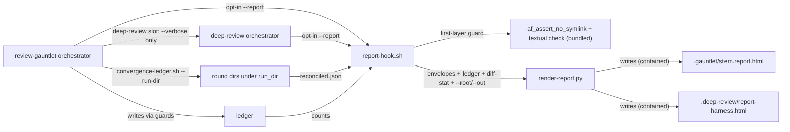
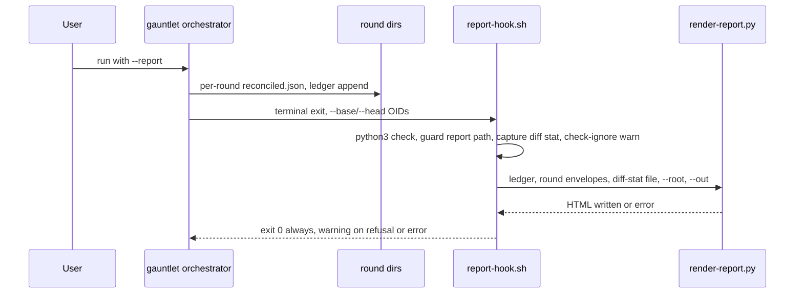
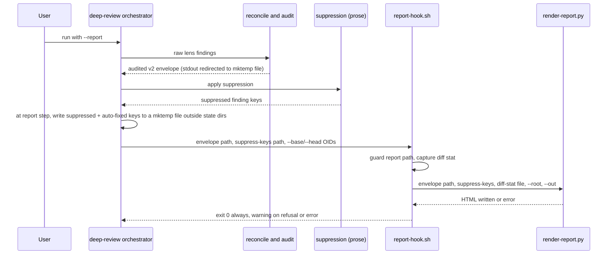

# Task: Review-output formats (plain prose, HTML report, show-me triggers)

**Status**: Not Started
**Component**: review-skills
**Assigned to**: Claude (Phases 1-3 and all common items: docs, canonical scripts, byte-mirrored helpers); Codex (Phases 4-6, implemented, tested and reviewed by Codex)
**Priority**: Medium
**Branch**: feature/karpathy-output-formats
**Created**: 2026-10-08
**Review Gates**: full

## Objective

Make review output faster to read and trust: a plain-prose writing rule for review findings, an opt-in throwaway HTML report (`--report`) for gauntlet and deep-review runs, and wider `show-me` triggers.

## Context

Source: Karpathy's thread (https://x.com/karpathy/status/2105819303471976479), as the author reads it. His point, as paraphrased here: as LLMs do more work, the human job is oversight and understanding. Pick output formats that ease that: controlled-language prose (ASD-STE100 as inspiration), diagrams, HTML pages, throwaway artifacts. This is motivation only; nothing below depends on the thread's exact wording. Explainer video is out of scope (`docs/explainer-video-idea.md`).

Today no review skill has a writing-style rule. `show-me` has no review, gauntlet or conduct triggers. `plan-view` renders dev-plan corpora only, not findings.

Facts verified during plan review (2026-10-08 and 2026-10-09, four rounds):
- The gauntlet ledger (`lib/convergence-ledger.sh`) stores counts and key lists only (no finding text, no severity). Its file is `.gauntlet/ledger-<author>-<slug>-<digest12>.json` (`gauntlet-common.sh:135`), so it is per target and per harness author; its shape is `{loop_counter, rounds}` (`convergence-ledger.sh:394`). Per-round files (`<gate>.envelope.json`, `*.normalized.jsonl`, `findings.jsonl`, `reconciled.json`, `present-keys.txt`) are already written to `$run_dir/round-N` (`review-gauntlet/SKILL.md:101-110,240-250`), but `$run_dir` itself is not defined in any skill file. Each round's `reconciled.json` is reconciled alone; no envelope spans rounds.
- `--fresh` today maps only to `convergence-ledger.sh --init --force` (`review-gauntlet/SKILL.md:51-62`), which knows nothing about round dirs. `lib/state-path-guard.sh` exports only `gauntlet_assert_no_symlink <path> <label>` (a create/write check), is sourced by lib scripts and never by SKILL.md prose, and is not a path resolver. The ledger path has one owner, `gc_ledger_path` (`lib/gauntlet-common.sh:112-136`).
- deep-review never persists a reconciled envelope; reconcile output is consumed inline (`deep-review/SKILL.md:636-639`). The audited envelope then goes through Step 4 Apply Suppression (`:658-666`), then Step 4.5 `--auto-fix=trivial` (`:671`), then Step 5 render. All `.deep-review/` state writes go through `persist-deep-review-state.sh` (`SKILL.md:35,730`), which uses `persist-common.sh`. Shell state does not survive Bash tool calls (`deep-review/SKILL.md:179`).
- `af_assert_no_symlink` (`scripts/lib/auto-fix-common.sh:100-160`) tests `-L` on the leaf and parents only. It does not refuse `..` or out-of-root paths (the applier's `resolve_path` does that) and it must not absolutise.
- The deep-review schema-versioning bullet (`deep-review/SKILL.md:606`) sits inside the `GENERIC FINDING SCHEMA AND MERGE` block (`:595-623`). `scripts/check-prompt-parity.sh:653-657` holds that block byte-identical across deep-review and review-plan in both mirrors.
- `scripts/check-sync.sh` treats each skill's `scripts/` dir as a byte-mirrored bundle of canonical repo-root `scripts/`, declared in `scripts/lib/bundle-map.sh`. It checks only skein and skein-codex (`check-sync.sh:59-61`). `tests/parity/test-applier-bundle-parity.sh:300` checks "bundled == operative" for `.sh` references only.
- `scripts/bundle-appliers.sh:21` lists `plugins/skein-pi` in MIRRORS and stages once per skill, then `rsync --delete`s into every mirror (`:49-72`); one hardcoded Pi rule exists at `:62-64`. Pi gets deep-review and review-plan bundles unless an exclusion is added. `bundle-map.sh:2-6` declares itself the single source of truth for bundle membership.
- A third mirror exists: `plugins/skein-pi/skills/{review-gauntlet,deep-review,review-plan,show-me}` (Pi-native rewrites; `tests/pi/test_skill_inventory.py:90-99` pins Pi show-me frontmatter). Pi tests are not in `just ci`.
- `scripts/finding-key.sh` builds the regression key from (file, category, normalized summary).
- The gate-1 (Codex adversarial) prompt is not a file template in either mirror. Claude: the orchestrator composes it from prose around a `"<adversarial-review prompt>"` placeholder (`review-gauntlet/SKILL.md:118-125`). Codex: it is an f-string in `plugins/skein-codex/skills/review-gauntlet/native_gates.py:576`; `tests/gauntlet/test_native_gates.py` does not pin its text. Gate 3 (`security-review`) is external.
- Diff targets: gauntlet takes `<branch> | --pr <N>` (`review-gauntlet/SKILL.md:4,25`); deep-review's input rules (`:20-26`) have no uncommitted mode. Both resolve `--pr` through `gh pr diff` (a patch; no `--stat`), and neither resolves base/head refs for a PR. "Uncommitted" appears only as gate-1 prompt wording and a Codex-only `native_gates.py` argument.
- review-plan lens prompts call the finding summary field `finding` before serialization (`review-plan/SKILL.md:784`); deep-review calls it `summary`.
- `justfile` `parity-tests` and `gauntlet-tests` list tests by name, no glob. `lint-python` runs ruff over the whole repo; `lint-scripts` shellchecks and shfmts `scripts/*.sh` and `tests/*/*.sh` and runs `lint-temp-paths.sh`; `just ci` runs `lint` first.
- The installed plugin cache (`~/.claude/plugins/cache/skein/skein/`) is 0.8.5; the repo is 0.9.2. The auto-chained gauntlet runs the cached version. That `skein:review-gauntlet` resolves to the cache rather than a repo-local plugin dir, and that a release bump refreshes the cache, are harness behaviour (launch mode, process-scoped skill registry) this repo cannot verify; treat both as assumptions and confirm at dogfood time from the gauntlet's own output. The cached `convergence-ledger.sh`, `gauntlet-common.sh` and `run-gate.sh` have no commits since tag `v0.8.5`.
- `conduct` auto-chains `review-gauntlet --plan <plan>` with a fixed argument set (`conduct/SKILL.md:367`). The gauntlet invokes `skein:deep-review --verbose` at top level each round (`review-gauntlet/SKILL.md:89,129`).

## Requirements

- R1: Review prose follows a short plain-prose rule (short sentences, one meaning per word, active voice, no filler). It applies to `evidence`, `suggestion` and overall summaries. The gate-1 adversarial prompt gets the rule as one plain sentence. It must NOT touch the finding summary line (`summary` in deep-review, `finding` in review-plan lens prompts; it feeds `finding-key.sh`), schemas, severity labels, or any machine-read field. Gate 3 (`security-review`) is out of scope: skein does not author it.
- R2: A gauntlet or deep-review run with `--report` emits one self-contained HTML report: findings by severity, round-by-round convergence, diff scope. Opt-in; default output is unchanged. A failing report never changes a run's outcome: a guard refusal, a hook failure and a renderer failure all warn, skip the report, and leave the terminal token and exit code unchanged.
- R3: `show-me` triggers cover review findings, gauntlet convergence, and conduct phase progress, still defer to `plan-view` for plans, and point review findings and gauntlet convergence at the `--report` flag of the review skills (by skill and flag, not by state path).
- Claude and Codex mirrors stay aligned. Claude implements, tests and reviews Claude-owned phases and every common item (docs, canonical scripts, bundle map, byte-mirrored helpers); Codex implements, tests and reviews Codex-owned phases. Shared generated scripts come from canonical `scripts/`. Path anchors (`${CLAUDE_PLUGIN_ROOT}` vs `$SKILL_DIR`) are never collapsed.
- `plugins/skein-pi` is out of scope for R1, R2 and R3, and must receive no copy of the new scripts.
- `just ci` passes.

## Review Focus

- R1 must not alter text that tests or parsers pin (compact/full finding rendering at `deep-review/SKILL.md:761`, `review-plan/SKILL.md:784`) or any input to `finding-key.sh`. R1 blocks must sit outside the `GENERIC FINDING SCHEMA AND MERGE` block and outside lens output-schema fences.
- Bundle invariant (end state): a script ships into a skill iff that skill's SKILL.md invokes it (`scripts/lib/bundle-map.sh`, `scripts/check-sync.sh`), and Pi receives none of it. Between Phase 2 and Phase 5 the Codex bundles carry report copies no Codex SKILL.md invokes yet; `just ci` stays green because §7 checks referenced-to-bundled only, and Phase 5 restores the invariant.
- HTML must be a single file with no external fetches; finding text is untrusted and must be escaped in text nodes and attributes. Output containment: `report-hook.sh` runs its own guard first (bundled `af_assert_no_symlink` plus a textual check that `--out` sits directly under `<root>/.gauntlet` or `<root>/.deep-review`) and refuses before the renderer runs; the renderer re-checks as defence in depth.
- Mirror parity guards: `scripts/check-sync.sh`, `scripts/check-prompt-parity.sh`, `tests/parity/*`.
- State-write discipline: `.deep-review/` state files are written only by `persist-deep-review-state.sh`; `.gauntlet/` state by the existing guarded writers. Sanctioned additions: (a) the report file (`report-*.html`, `*.report.html`), written only by `render-report.py` after the hook's guard has checked its path and never read back as state, plus the renderer's sibling temp file `<out>.tmp.<pid>` in the same directory (needed because a rename cannot cross filesystems), removed on every exit path; (b) creation and removal of the round dir `<ledger-stem>/`, done only by `convergence-ledger.sh --run-dir` (create) and `--init` (clear a stale dir) under its own guard; (c) the per-round files the gauntlet round loop already writes under `<ledger-stem>/round-N/` (`review-gauntlet/SKILL.md:101-110,240-250`), written only after `--run-dir` has guarded the directory. Hook and orchestrator scratch files (diff-stat, deep-review envelope and suppress-keys) live under `mktemp` outside both state dirs.

## Implementation Checklist

### Ownership and execution

- **Ownership rule.** Claude implements, tests and reviews Claude-owned phases and every common item (docs, `docs/BACKLOG.md`, canonical `scripts/`, bundle map and bundler, byte-mirrored helpers, shared parity tests). Codex implements, tests and reviews Codex-owned phases. Each phase below carries an `**Owner:**` line.
- **Testing and review per owner.** A Claude phase is tested by its own `Test command` in a Claude run and reviewed by Claude (`skein:review-gauntlet` on the phase diff; `/code-review xhigh --fix` is typed by the user). A Codex phase is tested and reviewed by Codex with its own runtime's review skills. `codex:rescue` is not a substitute for a Codex-owned phase.
- **Run order and handoff.** `conduct` has no per-phase owner field. Its mirror contract (`conduct/SKILL.md:255`) says the Claude run lands only `plugins/skein/` and the Codex run lands `plugins/skein-codex/` "in a separate run against the same plan". So: run Claude's `conduct --autonomous --max-phases 3` (Phases 1-3; it stops with the expected `max_phases ceiling hit (3)` blocker), then start the Codex run for Phases 4-6. `--max-phases` only fires in autonomous mode (`conduct/SKILL.md:62-63`); in legacy mode `conduct` hands back after each phase, and the next `--resume` would walk Phase 4, so do not `--resume` past the Phase 3 handback. Codex starts only after Phase 3 is ticked in `## Progress`. Confirm this behaves as described before Phase 1 (assumption); if it does not, use `--pause-phase` after Phase 3.
- **Gauntlet auto-chain owner.** `Review Gates: full` chains `review-gauntlet --plan <plan>` only when a run reaches `complete` (`conduct/SKILL.md:362-372`). The Claude run never reaches `complete`, so it does not chain; Claude runs `skein:review-gauntlet` by hand on the Phase 1-3 diff. The Codex run ticks the last phase and owns the auto-chain. Accepted limitation: the Codex gauntlet permanently defers deep-review and `security-review` (`skein-codex/.../review-gauntlet/SKILL.md:153-154,228`), so the Codex auto-chain runs only Codex's native gates on Phases 4-6. To close that gap, after Phase 6 Claude runs `skein:review-gauntlet` by hand on the Phase 4-6 diff (or the whole branch), and the user runs `/code-review xhigh --fix`.
- **Why Claude-first.** The repo rule "Codex half first, then Claude aligns, one commit" is superseded for this plan by the owner's 2026-10-09 instruction to split implementation by owner. CI safety basis (verified in round 5): `scripts/check-prompt-parity.sh` compares only `rubric.md`, `*-prompt.md`, the GENERIC block, allowlist citations and `release/SKILL.md`, not whole SKILL.md files; `show-me` is presence-tested only; `tests/parity/test-applier-bundle-parity.sh` §7 checks referenced-to-bundled only. So Claude-only prose phases leave `just ci` green.
- **Exceptions to "Codex-mirror files are Codex-owned".** (a) `lib/convergence-ledger.sh` is byte-mirrored across the two gauntlet mirrors (parity §6), so Phase 2 edits both copies as a common item. (b) Files generated by `just bundle-appliers` land in both mirrors in Phase 2. (c) `justfile` lines are added by the phase that creates the test, so a Codex phase touches `justfile` only to wire its own test.
- **Items for Codex to confirm before Phase 4** (the plan was reviewed by Claude lenses only): (1) Block A placement as the last section of each Codex lens prompt, after `## Output`, and whether Codex's lens-shape tests have the same hashed-block constraint; (2) the Codex deep-review capture rule (audit stdout redirected to a file, suppress-keys including applied auto-fix keys) given that Codex runs Step 4.5 auto-fix before suppression (`deep-review/SKILL.md:499,536`); (3) the Codex gauntlet `$run_dir` wiring through `convergence-ledger.sh --run-dir` and the report step at its terminal exits; (4) the `.deep-review/auto-fix-*.json` manifest field names for the applied-key list; (5) Codex shell semantics for deleting scratch files after the hook returns; (6) that Codex `conduct` takes Phases 4-6 from the same plan, skipping ticked phases.
- **Dependencies.** Phase 2 step 3 needs Phase 1 (Block B anchors). Phase 4 needs Phase 1 (Block text to match). Phase 5 needs Phases 2 and 4 (bundled hook, Block B anchors). Phase 6 needs Phase 3.

### Phase 1: Claude plain-prose rule (R1)

**Owner:** Claude
**Impl files:** `plugins/skein/skills/review-gauntlet/SKILL.md, plugins/skein/skills/deep-review/SKILL.md, plugins/skein/skills/review-plan/SKILL.md`
**Test files:** `tests/parity/test-prose-rule-claude.sh, justfile`
**Test command:** `bash tests/parity/test-prose-rule-claude.sh && bash tests/gauntlet/test-finding-key.sh && just ci`
**Goal:** Implement the prose rule in Claude-owned prompts without changing schemas, machine-read fields, pinned strings or finding keys.

- Write two named blocks, each between fixed anchor comment lines:
  - Block A (authoring rule): add to the five Claude deep-review lens prompts and six Claude review-plan prompts (including Contradiction Pass), 11 occurrences total. `review-gauntlet` gets no Block A.
  - Block B (summary-prose rule): add to the summary-report step in all three Claude skills, 3 occurrences. In the gauntlet, place it at the existing terminal-status report step (`review-gauntlet/SKILL.md:144-150`); Phase 2 wraps those anchors and adds no duplicate Block B.
- Gate-1 adversarial prompt: add one plain sentence to the Claude-authored `review-gauntlet/SKILL.md` prompt composition (around `:118-125`). The Codex prompt is handled independently in Phase 4.
- Both blocks state the rule as checkable items (sentence length cap, active voice, one term per concept, no filler), cite ASD-STE100 as inspiration only, and contain the sentence exempting the finding summary line. The sentence names both field names: "the finding summary line (`summary` in deep-review, `finding` in review-plan lens prompts)".
- Keep both blocks harness-neutral so each is byte-identical across mirrors; place them outside the lines pinned by `scripts/check-report-templates.sh`, outside the `GENERIC FINDING SCHEMA AND MERGE` block, and outside any lens output-schema fence. Placement inside a lens prompt: Block A is the last section of each lens prompt, after `## Output`, so it falls outside the `## Lens Persistence Contract` block that `tests/lenses/test-lens-skill-shape.sh` hashes per file (that block runs to the next `## ` heading). Keep `model:`, `effort:` and `reasoning_effort=` tokens out of the block text (`test-spawn-tiers.sh` pins exact counts). `just ci` runs both existing tests.
- Claude-side test `tests/parity/test-prose-rule-claude.sh`: per-block byte-compare across the Claude files, exact counts (A = 11, B = 3), the exemption sentence in each block, no anchor inside the GENERIC block or inside an inner triple-backtick schema fence (the outer lens-prompt fence is expected), and the gate-1 sentence string. Wire it into `justfile` `parity-tests`. Phase 4 adds the Codex counterpart and the cross-mirror byte-compare.

### Phase 2: Shared HTML report foundation and Claude integration (R2)

**Owner:** Claude (common items: canonical scripts, bundle map, byte-mirrored `convergence-ledger.sh`, generated bundle copies in both mirrors)
**Impl files:** `scripts/render-report.py, scripts/report-hook.sh, scripts/lib/bundle-map.sh, scripts/bundle-appliers.sh, tests/parity/test-applier-bundle-parity.sh, generated renderer/hook copies under the Claude and Codex review-gauntlet/deep-review bundles, plugins/skein/skills/review-gauntlet/lib/convergence-ledger.sh, plugins/skein-codex/skills/review-gauntlet/lib/convergence-ledger.sh, plugins/skein/skills/review-gauntlet/SKILL.md, plugins/skein/skills/deep-review/SKILL.md`
**Test files:** `tests/gauntlet/test-render-report.sh, tests/gauntlet/test-report-shape-claude.sh, tests/gauntlet/test-convergence-ledger.sh, tests/gauntlet/fixtures/render-report/, tests/parity/test-applier-bundle-parity.sh, justfile`
**Test command:** `bash tests/gauntlet/test-render-report.sh && bash tests/gauntlet/test-report-shape-claude.sh && bash tests/gauntlet/test-convergence-ledger.sh && bash tests/parity/test-applier-bundle-parity.sh && just ci`
**Goal:** The renderer only reads files it is handed and writes one contained HTML file; it never calls git or `gh` and never mutates ledger or state. The hook always returns 0, so a report failure never changes a run's decision.

Ordering inside the phase (each step must leave `just ci` green; assertions that need a later step land with that step):
1. Decision gate: read the existing round-loop writes (`review-gauntlet/SKILL.md:101-110,240-250`) and confirm the real field names of `reconciled.json` and the ledger, including the gate-1 shape (`lens: <gate>`, `confidence`, no `suggestion`, nullable `line`; `lib/run-gate.sh:215-223`). Confirm that `lib/auto-fix-common.sh` is bundled into both skills, whether `persist-common.sh` offers a stricter deep-review check than `af_assert_no_symlink`, how `convergence-ledger.sh` takes its `--ledger` path (so `--run-dir` can reuse it), and what deep-review's suppression step matches on and what the `.deep-review/auto-fix-*.json` manifest records for applied fixes (to confirm the `--suppress-keys` key format fixed below; if suppression does not match on `(file, line, category)`, fall back to `finding-key.sh`'s key). Record the answers and the outcome in `## Findings` (below the marker).
2. Bundling: canonical `scripts/render-report.py` and `scripts/report-hook.sh`; a `BUNDLE_REPORT=(render-report.py report-hook.sh)` group in `scripts/lib/bundle-map.sh` expanded from both the review-gauntlet and deep-review arms; add `lib/auto-fix-common.sh` to their bundle entries if the gate finds it missing; a `BUNDLE_PI_EXCLUDE` list in `bundle-map.sh` that both `bundle-appliers.sh` (filter the staged tree before the Pi rsync) and the parity test read; widen the `test-applier-bundle-parity.sh` §7 regex to `\.(sh|py)`; add a section asserting Pi's skill `scripts/` contain no `render-report.py` or `report-hook.sh` and equal canonical minus `BUNDLE_REPORT`; `just bundle-appliers`. Renderer, hook and bundle tests plus their `justfile` wiring land in the same commit (`test-render-report.sh` is wired here; `test-report-shape-claude.sh` is wired in step 3, when it first has assertions). Between this step and the Codex integration in Phase 5, the Codex bundles carry copies no Codex SKILL.md invokes yet; that bounded state is intentional and `just ci` stays green (`check-sync.sh` walks the declared set; §7 is referenced-to-bundled only). The end-state invariant is restored when Phase 5 lands.
3. Gauntlet: add a `--run-dir --ledger <path>` mode to `lib/convergence-ledger.sh` (both byte-mirrored copies) that derives `<ledger-stem>/` from the ledger path, runs `gauntlet_assert_no_symlink` on it and on the sibling report path `<ledger-stem>.report.html` (a refusal exits non-zero and the orchestrator skips the report with a warning), runs `mkdir -p`, and prints the directory. Plain `--init` and `--init --force` both clear a pre-existing `<ledger-stem>/` under the same guard when they create a fresh ledger (a fresh ledger has zero rounds, so an existing round dir is stale and would collide with the new run's `round-1/`); `--init` refused with exit 6 leaves everything untouched. `--run-dir` never deletes. The gauntlet SKILL.md prose calls `--run-dir` once to define `$run_dir`, and `--resume` takes `round_n` from the ledger's `rounds` array. At the report step the orchestrator passes `--round N=<run_dir>/round-N/reconciled.json` for each N in 1..len(ledger `.rounds`) (no globbing). `gauntlet-common.sh` is not edited (it is hand-authored per mirror and excluded from byte-parity). Wire the report flag and terminal report step into the Claude `review-gauntlet/SKILL.md`; error exits skip reporting. The step wraps the existing Block B anchors. State that the deep-review slot (gate 2 here) never receives `--report`. Claude-side flag gating, terminal-exit and `$run_dir` assertions go in `tests/gauntlet/test-report-shape-claude.sh`. Codex skill integration is in Phase 5.
4. Deep-review: wire the report flag, modifier rules and report step into Claude's `deep-review/SKILL.md`. After Step 3.5's audit, redirect the audit script's stdout (not hand-assembled JSON) to a `mktemp` file outside `.deep-review/`. At the report step, write one key per line to a second `mktemp` file for (a) each finding the Step 4 suppression drops and (b) each finding an applied auto-fix fixed (from the `.deep-review/auto-fix-*.json` manifest, when `--auto-fix=trivial` ran); pass both by path (`--envelope`, `--suppress-keys`). Label the report "as reviewed; suppressed and auto-fixed findings omitted". The same rule works in both mirrors, whichever order Step 4 and Step 4.5 run in, because the report step comes after both. The orchestrator deletes both files in prose right after the hook returns, success or failure (shell state does not span Bash tool calls, so no `trap` can own them). Add the `render-report.py` schema-lockstep note outside the GENERIC block. Claude-side assertions go in `tests/gauntlet/test-report-shape-claude.sh`. Codex skill integration and its native checks are in Phase 5.

Tasks:
- Renderer CLI: `render-report.py [--ledger <path>] [--round N=<envelope>]... [--envelope <path>] [--suppress-keys <file>] [--diff-stat <file>] --root <dir> --out <file>`. Gauntlet passes `--ledger` plus one `--round` per round; deep-review passes one `--envelope`, optionally `--suppress-keys`, and no `--ledger`. Envelopes are reconciler v2 (the audited output). `--suppress-keys` reads one key per line, `file<TAB>line<TAB>category`, with `line` empty for a null line and `file` spelled as in the envelope; a finding is dropped only when all three fields match exactly, so a sibling finding with the same tuple but a different summary is also dropped (accepted: the tuple is the reconciler's own identity). It is a filter, never a dedup. Usage errors exit 2: `--envelope` with `--round`, `--round` without `--ledger`, or no input at all. The renderer asserts `schema_version == 2` on envelopes only and exits non-zero otherwise, like `scripts/render-reconciled-report.sh`; a ledger has no `schema_version` and is never version-checked. With a ledger and no `--round`, it renders a counts-only report and labels it. The renderer never re-implements dedup: the severity section renders the envelope of the highest-numbered present round only (flag order does not matter; a duplicate `N` exits 2), and earlier rounds feed the convergence rows. A round listed in the ledger whose envelope file is missing renders as "round N: envelope missing" (partial sets are expected after a resumed 0.8.5 ledger or a round that errored before reconcile). Add it as a third lockstep point (see step 4).
- Diff scope: the orchestrator resolves the target to refs and passes the hook `--base <oid> --head <oid>` (deep-review reuses the `base_commit`/`head_commit` it already persists, `deep-review/SKILL.md:34,63-64`; for gauntlet `--pr <N>` the orchestrator resolves the OIDs itself, with `gh pr view --json baseRefOid,headRefOid`; the hook never calls `gh`, and runs `git -C "$root"`). With no scope flags the report renders "diff scope unavailable" and the hook exits 0. There is no uncommitted mode. The hook captures `git diff --stat <base>...<head>` to a `mktemp` file (trap cleanup) outside both state dirs, with a header line carrying the capture mode and time, and passes `--diff-stat <file>`. If `git diff --stat` fails (OID not in the local object store, shallow clone, fork PR), the hook warns and the report renders "diff scope unavailable (git diff failed)"; the hook still exits 0. An absent `--diff-stat` flag renders "diff scope unavailable". A given-but-unreadable `--diff-stat` path is a renderer failure (non-zero), which the hook turns into a warning.
- Severity buckets in this order: Critical, Important, Minor, then an "Other" bucket (after Minor) for any non-canonical severity.
- Escape all finding text for text nodes and attribute contexts; inline CSS only; no scripts, no external URLs.
- Containment, two layers. First layer, in `report-hook.sh`: source only the bundled sibling `lib/auto-fix-common.sh` (the hook has no gauntlet-specific branch and sources nothing authored) inside a subshell, because that lib runs `set -euo pipefail` and `readonly` at top level and must not reach the hook's own shell; run `af_assert_no_symlink "$out" "$root"` there, and run a textual check that refuses `..` and any `--out` whose parent is not `<root>/.gauntlet` or `<root>/.deep-review`. A refusal logs a warning, skips the renderer, and exits 0. The orchestrator derives `--out` from the ledger path (gauntlet) or the harness name (deep-review) before calling the hook. For the gauntlet, `convergence-ledger.sh --run-dir` has already run `gauntlet_assert_no_symlink` on the report path, so `.gauntlet/` keeps its owner's guard and the hook's `af_assert_no_symlink` is a second, testable layer (recorded in Architecture Decisions). Second layer, in the renderer: `--root` and `--out` arguments; refuse output outside the root, symlink components, and `..`; write to a sibling temp file `<out>.tmp.<pid>` in the same directory and rename (removed on every exit path; the failure-vector tests assert no residue). The renderer's checks are defence in depth; the new tests replicate the symlink, `..` and out-of-root cases in their own temp dirs (nothing is shared from `tests/gauntlet/test-gate-timeout.sh`).
- Output paths: gauntlet `.gauntlet/<ledger-stem>.report.html` (per target, per harness author; `<ledger-stem>` is the ledger file's basename without `.json`); deep-review `.deep-review/report-<harness>.html` (latest-run view per harness, like `latest-<harness>.json`).
- `report-hook.sh` takes `--base/--head`, the envelope or ledger paths, `--suppress-keys`, and `--root`/`--out`; runs `command -v python3` (soft dependency; warn and skip when absent), runs the first-layer guard, runs `git check-ignore` on the output path and warns if it is not ignored, runs the renderer, logs any failure as a warning, and always exits 0. Two environment overrides keep it testable: `SKEIN_REPORT_RENDERER` (path to a stub renderer) and `SKEIN_REPORT_NOW` (fixed timestamp for fixtures).
- `--report` is not forwarded by `conduct`'s auto-chain; running with the report requires invoking the gauntlet directly.
- Phase 2 spawns sequentially by design: `tests/parity/test-applier-bundle-parity.sh` is in both its Impl files and Test files, which `conduct` treats as overlapping.
- Existing tests this phase edits: `tests/parity/test-applier-bundle-parity.sh` (§7 regex, Pi section) and `tests/gauntlet/test-convergence-ledger.sh` (`--run-dir`, stale round-dir clearing by `--init` and `--init --force`, `--init` exit 6 leaves the dir untouched). `tests/gauntlet/test-gauntlet-skill-shape.sh` and `tests/lenses/test-lens-skill-shape.sh` are not edited; they run inside `just ci` and must stay green.
- `justfile` wiring: `test-render-report.sh` (step 2) and `test-report-shape-claude.sh` (step 3) go to `gauntlet-tests`. `just ci` in the phase command exercises the wiring.

### Phase 3: Claude show-me triggers (R3)

**Owner:** Claude (the `docs/BACKLOG.md` entry is a common item)
**Impl files:** `plugins/skein/skills/show-me/SKILL.md, docs/BACKLOG.md`
**Test files:** `tests/parity/test-show-me-triggers-claude.sh, justfile`
**Test command:** `bash tests/parity/test-show-me-triggers-claude.sh && just ci`

- Add bullets under "When to reach for a visual" for review findings, gauntlet convergence, and conduct phase progress; update the frontmatter `description`.
- Under "Composing with other skills", point review findings and gauntlet convergence at the `--report` flag of `review-gauntlet` and `deep-review` (skill and flag, not a path); keep conduct phase progress as a plain mermaid or table trigger; keep the "defer to plan-view" note.
- Wrap the new bullets in fixed anchor comment lines so Phase 6 can byte-compare them. Preserve Claude's existing visual-format guidance.
- Add the Pi follow-up entry to `docs/BACKLOG.md`.
- Claude-side test: the three triggers, the `--report` pointers, the plan-view deferral and the conduct-progress mermaid/table rule are present in the Claude `show-me/SKILL.md`; wire into `justfile` `parity-tests`. Phase 6 adds the Codex counterpart and the byte-compare.

### Phase 4: Codex plain-prose implementation (R1)

**Owner:** Codex (implements, tests and reviews)
**Impl files:** `plugins/skein-codex/skills/deep-review/SKILL.md, plugins/skein-codex/skills/review-plan/SKILL.md, plugins/skein-codex/skills/review-gauntlet/SKILL.md, plugins/skein-codex/skills/review-gauntlet/native_gates.py`
**Test files:** `tests/parity/test-prose-rule-codex.sh, justfile`
**Test command:** `bash tests/parity/test-prose-rule-codex.sh && bash tests/parity/test-prose-rule-claude.sh && bash tests/gauntlet/test-finding-key.sh && just ci`
**Goal:** Implement Codex's native prompt and prose changes independently, then verify the shared blocks against Claude's.

- Add Block A to the five Codex deep-review lenses and six review-plan lenses, including Contradiction Pass; add Block B to the three Codex report steps. Match Phase 1's block text.
- Add the gate-1 sentence to the Codex prompt string in `native_gates.py`.
- Codex-side test `tests/parity/test-prose-rule-codex.sh`: exact counts (A = 11, B = 3), the exemption sentence, anchor placement outside the GENERIC block and outside schema fences, the gate-1 sentence in `native_gates.py` (string assert), and a cross-mirror byte-compare of each block against Claude's. Wire into `justfile` `parity-tests`.

### Phase 5: Codex HTML report integration (R2)

**Owner:** Codex (implements, tests and reviews)
**Impl files:** `plugins/skein-codex/skills/review-gauntlet/SKILL.md, plugins/skein-codex/skills/deep-review/SKILL.md`
**Test files:** `tests/gauntlet/test-report-shape-codex.sh, justfile`
**Test command:** `bash tests/gauntlet/test-report-shape-codex.sh && bash tests/parity/test-applier-bundle-parity.sh && just ci`
**Goal:** Add Codex-native hook dispatch and `$run_dir` lifecycle, and prove the completed cross-harness behavior.

- Add Codex argument handling and report steps using its existing dispatch idiom and `$SKILL_DIR` script anchors. The deep-review slot (gate 3 in the Codex gauntlet, where it is permanently deferred) never receives `--report`.
- Wire the Codex gauntlet's undefined `$run_dir` (`review-gauntlet/SKILL.md:102`) to `convergence-ledger.sh --run-dir`, route `--fresh` through `--init --force`, and take `round_n` from the ledger on `--resume`.
- Codex deep-review: capture the audited envelope and the suppress-keys file (suppressed plus applied-auto-fix keys) by the same rule as Phase 2 step 4, and delete both files after the hook returns. The rule does not depend on Step 4.5 ordering, which differs in the Codex mirror (`deep-review/SKILL.md:499,536`).
- `tests/gauntlet/test-report-shape-codex.sh` covers: flag gating, terminal and resume paths, error-path skipping, default-output invariance, `$run_dir` lifecycle, envelope capture, and the deep-review slot never receiving `--report`. Wire into `justfile` `gauntlet-tests`.
- Running the full phase command proves the end state: both mirrors invoke the bundled hook, so the bundle invariant holds again.

### Phase 6: Codex show-me triggers (R3)

**Owner:** Codex (implements, tests and reviews)
**Impl files:** `plugins/skein-codex/skills/show-me/SKILL.md`
**Test files:** `tests/parity/test-show-me-triggers-codex.sh, justfile`
**Test command:** `bash tests/parity/test-show-me-triggers-codex.sh && bash tests/parity/test-show-me-triggers-claude.sh && just ci`
**Goal:** Implement Codex's visual guidance separately and close the show-me mirror contract.

- Add the three triggers and `--report` pointers, preserving Codex's sanctioned Mermaid/HTML guidance and the plan-view deferral.
- Codex-side test: triggers, `--report` pointers, plan-view deferral and conduct-progress rule present; anchored new bullets byte-identical to Claude's. Wire into `justfile` `parity-tests`.

## Technical Specifications

### Files to Modify
- The six review SKILL.md files (R1 blocks; R2 flag, hook step and argument-hints in gauntlet and deep-review, both mirrors; `$run_dir` via `convergence-ledger.sh --run-dir` in both gauntlet mirrors; schema lockstep note beside the reconcile step in both deep-review mirrors, outside the GENERIC block). Claude files in Phases 1-3, Codex files in Phases 4-6.
- `plugins/skein-codex/skills/review-gauntlet/native_gates.py` (gate-1 sentence).
- Both gauntlet mirrors' `lib/convergence-ledger.sh` (byte-mirrored; `--run-dir` mode, and `--init --force` removes the round dir). Edited by Claude in Phase 2 as a common item. `lib/gauntlet-common.sh` is not edited.
- Both `show-me/SKILL.md` files (R3).
- `scripts/lib/bundle-map.sh` (`BUNDLE_REPORT`, `BUNDLE_PI_EXCLUDE`), `scripts/bundle-appliers.sh` (reads `BUNDLE_PI_EXCLUDE`), `tests/parity/test-applier-bundle-parity.sh` (§7 regex to `.sh|.py`, Pi section), `tests/gauntlet/test-convergence-ledger.sh`.
- `justfile` (each phase wires the tests it creates: prose-rule and show-me tests to `parity-tests`; render-report and report-shape tests to `gauntlet-tests`; unconditional).
- `docs/BACKLOG.md` (Pi follow-up).

### New Files to Create
- `scripts/render-report.py` and `scripts/report-hook.sh` (canonical) and, via `just bundle-appliers`, byte-identical copies under both mirrors for review-gauntlet and deep-review.
- Claude-owned: `tests/parity/test-prose-rule-claude.sh`, `tests/parity/test-show-me-triggers-claude.sh`, `tests/gauntlet/test-render-report.sh`, `tests/gauntlet/test-report-shape-claude.sh`, fixtures under `tests/gauntlet/fixtures/render-report/`. Codex-owned: `tests/parity/test-prose-rule-codex.sh`, `tests/parity/test-show-me-triggers-codex.sh`, `tests/gauntlet/test-report-shape-codex.sh`.

### Architecture Decisions
- Renderer and hook are canonical in `scripts/`, bundled per the existing bundle map as one `BUNDLE_REPORT` group (not two `bundle_extra_for` arms), not hand-authored in mirrors: this is what `check-sync.sh` and `test-applier-bundle-parity.sh` enforce.
- Standalone renderer, not an extension of `plan-view/generate.py`: that file takes a plan corpus (`generate.py:1659-1710`), a different input shape.
- Renderer consumes the reconciler v2 envelope so dedup stays in one place (`reconcile-findings.sh`), and asserts `schema_version == 2` on envelopes.
- Renderer is pure: no git or `gh` calls. The hook captures the diff stat and passes it as a file.
- The hook is a bundled script, not SKILL.md prose, so "never changes the decision" is testable as exit 0 plus a warning plus no writes under `.gauntlet/` or `.deep-review/` other than the report. It always returns 0.
- Decision (grilled, round 2): the Pi mirror receives none of `render-report.py`/`report-hook.sh`, keeping bundled==operative and honouring "Pi out of scope". Round 4 refinement: the exclusion list is `BUNDLE_PI_EXCLUDE` in `bundle-map.sh`, read by both the bundler and the parity test, so membership has one source of truth.
- Decision (grilled, round 3): the gate-1 prompt has no file template in either mirror. Block A is 11 per mirror (lens prompts only). Gate-1 gets one plain sentence, in the Claude SKILL.md prose (Phase 1) and in the Codex prompt in `native_gates.py` (Phase 4, Codex-owned), each checked by a string assert in its owner's test. This replaces the round-2 decision that put Block A (12 occurrences) in the gate-1 prompt.
- Decision (round 4, recommended resolution applied on "fix all"): containment is two layers, and the first layer lives in `report-hook.sh`, not orchestrator prose. The hook sources only its bundled sibling `lib/auto-fix-common.sh` and runs `af_assert_no_symlink` plus a textual check (no `..`; `--out` directly under `<root>/.gauntlet` or `<root>/.deep-review`); it has no gauntlet-specific branch and sources nothing authored, because a generated script must not depend on an authored skill lib (round 5). The renderer's `--root`/`--out` check is defence in depth. A refusal warns, skips the renderer and exits 0. This replaces the round-3 "orchestrator guards first" wording, because a prose guard is the weak layer and cannot be tested in bash.
- Decision (grilled, round 3; round 4 refinement): deep-review passes the renderer the audited envelope by file path, the same input mode as the gauntlet. No stdin mode; no change to `persist-deep-review-state.sh`. Round 5 refinement: suppression is orchestrator prose with no file output, and the Codex mirror runs auto-fix before suppression, so "after suppression, before auto-fix" is not implementable in both mirrors. Instead the orchestrator redirects the audit script's stdout to a `mktemp` file (script output, never hand-assembled JSON), at the report step writes the keys of suppressed and auto-fixed findings to a second `mktemp` file, and passes `--envelope` plus `--suppress-keys`; the renderer filters. Round 6 refinement: applied-auto-fix keys are included because the Codex mirror runs auto-fix before suppression, so the captured envelope predates both; the orchestrator deletes both files after the hook returns. The report is labelled "as reviewed; suppressed and auto-fixed findings omitted".
- Decision (grilled, round 3): renderer CLI is `--ledger`, repeatable `--round N=<envelope>` and `--envelope`; the `schema_version` check applies to envelopes only; a ledger with no rounds renders a labelled counts-only report. The ledger and diff-stat get Integration Seams rows.
- Decision (round 4; round 5 revision): `$run_dir` is derived, guarded and created by `convergence-ledger.sh --run-dir --ledger <path>`, replacing the round-4 `gc_run_dir`. `gauntlet-common.sh` is hand-authored per mirror and excluded from byte-parity (`GAUNTLET_LIB_ANCHOR_DIVERGENT`), so a guard-calling helper there could drift between mirrors; `convergence-ledger.sh` is byte-mirrored and parity-enforced. `--fresh` removes the round dir inside `--init --force` under the same guard, so there is no prose `rm -rf`; `--resume` takes `round_n` from the ledger's `rounds` array.
- Decision (round 4, recommended resolution applied on "fix all"): the hook has two diff modes only (`--base/--head`, or none). The orchestrator resolves `--pr <N>` to OIDs; the hook never calls `gh`. No uncommitted mode, because neither skill defines one.
- Decision (2026-10-09, owner instruction): Claude implements, tests and reviews Claude-owned phases (1-3) and every common item (docs, canonical `scripts/`, bundle map, byte-mirrored `convergence-ledger.sh`, generated bundle copies, `docs/BACKLOG.md`); Codex implements, tests and reviews Codex-owned phases (4-6). This supersedes both the earlier `codex:rescue` routing and the repo rule "Codex half first, one commit" for this plan (basis and handoff in `### Ownership and execution`). Each owner gets its own test files (`*-claude.sh`, `*-codex.sh`) so neither phase edits the other's tests; the Codex tests also run the Claude tests and cross-mirror byte-compares.
- Decision (grilled, round 6): the gauntlet orchestrator, not the hook or a glob, enumerates rounds: it passes `--round N=<run_dir>/round-N/reconciled.json` for each N in 1..len(ledger `.rounds`). The renderer marks rounds whose envelope is missing and renders the severity section from the highest present N; flag order is irrelevant and a duplicate N exits 2.
- Decision (grilled, round 6): the gauntlet report path keeps both owners' guards. `convergence-ledger.sh --run-dir` runs `gauntlet_assert_no_symlink` on `<ledger-stem>/` and on `<ledger-stem>.report.html` (a refusal skips the report with a warning); the hook then runs the bundled `af_assert_no_symlink` plus textual check as the testable first layer; the renderer re-checks. `state-path-guard.sh`'s one-owner-per-tree rule stays satisfied for `.gauntlet/`; the hook's `af_assert_no_symlink` is recorded here as a deliberate second layer, not a second owner. Adaptation of the accepted answer: the gauntlet guard runs inside `--run-dir`, not in SKILL.md prose, because SKILL.md prose does not source `state-path-guard.sh`.
- Decision (round 6, recommended resolution applied): plain `--init` clears a stale round dir (a fresh ledger has no rounds), so a new run's `round-1/` never collides with an old run's; the hook sources `lib/auto-fix-common.sh` inside a subshell so its `set -euo pipefail` cannot break the always-exit-0 contract; the renderer's temp file is a sibling in the output directory (a rename cannot cross filesystems) and is sanctioned in Review Focus; the Codex gauntlet auto-chain is accepted as native-gates-only, with a Claude-run `skein:review-gauntlet` on the Phase 4-6 diff after Phase 6.
- Decision (grilled, round 2): `$run_dir` is `.gauntlet/<ledger-stem>/`; counts-only convergence remains the fallback when a round dir is absent, and the report labels it.
- Decision (grilled, round 2): the deep-review report name `report-<harness>.html` is a latest-run view per harness, matching `latest-<harness>.json`; only the gauntlet report is per-target and per-author (ledger stem).
- R1 is two blocks (authoring rule, summary-prose rule), each byte-identical across mirrors, because finding prose is authored in lens prompts, not only at report rendering. The finding summary line is exempt to keep `finding-key.sh` keys stable across rounds and resumed ledgers.
- The Claude-side prose test (Phase 1) and the Codex-side one (Phase 4) check block text, exact counts, the exemption sentence, anchor placement outside the GENERIC block and schema fences, and the gate-1 sentence, not mere presence.
- `plugins/skein-pi` is out of scope (Pi-native rewrites with their own state, `.deep-review/latest-pi.json` and `lib/review_gauntlet.py`). A `docs/BACKLOG.md` entry tracks the follow-up.
- ASD-STE100 is a licensed spec with a large dictionary; the plan cites it as inspiration and encodes the rule as checkable items. No percentage claim. The licence statement is the author's understanding, not verified here.
- python3 is a soft dependency of the opt-in report; its absence yields a warning, not a failure.

### Dependencies
- None new for default runs. Python 3 stdlib only, and only for `--report`. Both plugin manifests are at 0.9.2; no version bump here (release goes through `skein:release`).

### Integration Seams

| Seam | Writer (task) | Caller (task) | Contract |
|------|---------------|---------------|----------|
| Reconciled envelope | gauntlet round loop (writes `$run_dir/round-N/reconciled.json`) / deep-review report step (audit script stdout redirected to a `mktemp` file) | render-report.py via report-hook.sh (`--round N=` / `--envelope`) | Reconciler v2 envelope, `schema_version` 2 asserted; unknown fields ignored; gauntlet rows may lack `suggestion` and have null `line`; severity section renders the last round only; missing or malformed input yields a clear message and a non-zero renderer exit that the hook converts to a warning |
| Suppress keys | deep-review orchestrator at the report step (`mktemp` file; keys of suppressed findings plus applied-auto-fix findings; deleted by the orchestrator after the hook returns) | render-report.py `--suppress-keys` | One key per line: `file<TAB>line<TAB>category`, empty `line` for null; exact match on all three; absent file means no filtering; non-matching keys ignored; a same-tuple sibling is also dropped (accepted); Phase 2 step 1 confirms what suppression and the auto-fix manifest record |
| Ledger | gauntlet ledger writers (existing) | render-report.py `--ledger` | Counts and key lists only; no `schema_version`; drives convergence rows and the counts-only fallback |
| Scope flags | orchestrator (resolves target to OIDs) | report-hook.sh | `--base <oid> --head <oid>`, or none (renders "diff scope unavailable"); the hook never calls `gh` |
| Diff stat file | report-hook.sh (`mktemp`, trap cleanup, outside state dirs) | render-report.py `--diff-stat` | Plain `--stat` text with a header line (capture mode, time; `SKEIN_REPORT_NOW` overrides the clock); absent flag renders "diff scope unavailable" and exits 0; given-but-unreadable path exits non-zero |
| Output path | report-hook.sh first-layer guard (bundled `af_assert_no_symlink` plus textual check; no gauntlet-specific branch) | render-report.py | Hook refuses (warn, skip, exit 0) before the renderer runs; renderer re-refuses out-of-root, symlink or `..` paths; writes via temp file and rename |
| Rule blocks A and B | Phases 1 (Claude) and 4 (Codex) | Claude test (Phase 1), Codex test with cross-mirror compare (Phase 4) | Per-block byte-identical across their file sets; exact counts asserted (A = 11, B = 3 per mirror); gate-1 sentence string-asserted |
| Bundle map | `scripts/lib/bundle-map.sh` (`BUNDLE_REPORT`, `BUNDLE_PI_EXCLUDE`) | `check-sync.sh`, `bundle-appliers.sh`, bundle-parity test | Every bundled copy byte-identical to canonical; Pi gets none (asserted in the bundle-parity test); no undeclared files |
| `$run_dir` | `convergence-ledger.sh --run-dir` (byte-mirrored; Phase 2) | gauntlet SKILL.md round loop (Claude Phase 2, Codex Phase 5), report hook | `.gauntlet/<ledger-stem>/` derived, guarded and created by `--run-dir`; removed by `--init --force`; `round_n` from the ledger on `--resume`; absent round dirs trigger the counts-only fallback |

## Architecture & Call Flow

Component graph — which component triggers which:

Trigger order — one gauntlet run with `--report`:

Trigger order — one deep-review run with `--report`:

Context lifecycle:

| Step | Trigger | Enters context | Cleared/persisted | Turn boundary |
|------|---------|----------------|-------------------|---------------|
| Round loop | gauntlet round | findings, envelopes | envelopes persisted under `$run_dir`; ledger counts persisted | none |
| Reconcile and audit | deep-review Step 3.5 | raw lens findings | audited envelope redirected to a `mktemp` file | none |
| Suppression | deep-review Step 4 (before 4.5 in Claude, after it in Codex) | audited envelope, merge-base checklist | suppressed-finding keys held for the report step; written (with applied auto-fix keys) to a `mktemp` file outside `.deep-review/` at that step, deleted by the orchestrator after the hook returns | none |
| Report hook | run end | file paths and flags only | HTML persisted; diff-stat temp file removed; no finding text enters orchestrator context | none |
| Render | hook call | none (separate process) | HTML file on disk | none |

## Testing Notes

- `just ci`, backgrounded with a Monitor (per project CLAUDE.md). Fixer briefs and fixer commits run `just ci`. Every phase test command ends with `just ci`, which runs `lint` first (each phase adds shell that `lint-scripts` checks) and exercises the `justfile` recipe wiring.
- Renderer fixtures: reconciled envelope with all severities plus a non-canonical severity (lands in "Other", after Minor); a gauntlet-shaped envelope generated from `lib/run-gate.sh reconcile` over pooled gate rows (`lens: <gate>`, absent `suggestion`, null `line`); a multi-round fixture, with `--round` flags passed out of numeric order, where the highest-numbered round's findings appear once in the severity section and the convergence table lists every round (no cross-round dedup is attempted); a partial-rounds fixture (ledger lists N rounds, only some envelopes exist) asserting present rounds render, missing rounds are marked, and severity comes from the highest present N; a duplicate-`N` case exiting 2; unknown extra fields; a ledger fixture produced by driving `lib/convergence-ledger.sh` for 2-3 rounds (not hand-written), asserting convergence rows match `.rounds`; a ledger-only (counts-only) fixture asserting the fallback label.
- Renderer failure vectors: missing file, malformed JSON, `schema_version` mismatch on an envelope, empty findings, empty envelope file, a given-but-unreadable `--diff-stat` path. Each yields a clear message and a non-zero exit. An absent `--diff-stat` flag is not a failure: it renders "diff scope unavailable" and exits 0. Usage errors (`--envelope` with `--round`, `--round` without `--ledger`, no input) exit 2.
- Hook tests: a failing-renderer stub injected through `SKEIN_REPORT_RENDERER` asserts exit 0, a warning, and no writes under `.gauntlet/` or `.deep-review/` other than the report (hash both before and after); the python3-absent path; the not-ignored warning; `--base/--head` and no-flag diff modes; an unresolvable OID (`git diff --stat` fails: warning, "diff scope unavailable (git diff failed)", exit 0); temp files removed on exit; a guard-refusal case (symlinked, `..` and out-of-root `--out`) asserting a warning, no renderer call, exit 0. `SKEIN_REPORT_NOW` fixes the capture time so the label assertion is deterministic.
- Hook subshell and fixtures: a case with a failing git and a failing renderer while the sourced `auto-fix-common.sh` is active, asserting exit 0; fixtures create the state dir first and root under `/private/tmp` (as `bundle-appliers.sh:22-25` does), because `af_assert_no_symlink` walks to a symlinked `/var` when the state dir does not exist yet; a hook test with a missing round dir. The renderer failure vectors assert no `<out>.tmp.<pid>` residue.
- Containment: the hook's first layer is tested in bash (`af_assert_no_symlink` refuses symlinks; the textual check refuses `..`, out-of-root and any `--out` not directly under `.gauntlet` or `.deep-review`). The renderer's own refusals are tested with the same cases, built in the test's own temp dirs (nothing is shared from `tests/gauntlet/test-gate-timeout.sh`). A `--suppress-keys` fixture asserts matching findings are dropped and non-matching keys are ignored.
- HTML safety assertions, using a parser (python `html.parser`), not grep: no `<script`, `<link`, `<iframe`, `<object`, `<embed`, `<base`, `<form`, `<meta http-equiv`, no `on*=` attributes, no `javascript:` URLs, no CSS `@import` or `url(`, no external `src=`/`href=`; finding text containing `<script>`, quotes, `&` and attribute-breaking input is escaped. URLs inside finding text are allowed as escaped text.
- HTML structure checked positively: exactly one `<html>`, `<head>`, `<body>`; expected sections present in severity order with "Other" last.
- Default-unchanged and flow shape assertions (each lands in the step that adds the behaviour): the report step and flag are gated on `--report` in both skills and both mirrors (Claude assertions in `test-report-shape-claude.sh`, Codex in `test-report-shape-codex.sh`); the deep-review slot never receives `--report`; every gauntlet terminal-token exit routes through the one report step and error exits skip it; a guard refusal leaves the terminal token unchanged; deep-review's argument-rule sentences list `--report` as a rendering-mode modifier; deep-review writes the envelope and suppress-keys files and passes both by path; `$run_dir` comes from `convergence-ledger.sh --run-dir`, `--fresh` goes through `--init --force`, and `--resume` derives `round_n` from the ledger.
- `test-convergence-ledger.sh`: `--run-dir` derives, guards and creates `<ledger-stem>/` and prints it, and refuses a symlinked report path; plain `--init` clears a stale `<ledger-stem>/` and `--init` exit 6 leaves it untouched; `--init --force` removes the round dir, refuses a symlinked path, and leaves other `.gauntlet/` files alone.
- Bundle guard: widened §7 regex catches a `.py` reference with no `bundle_extra_for`/`BUNDLE_REPORT` entry; a Pi section asserts Pi's skill `scripts/` hold no copy and equal canonical minus `BUNDLE_REPORT`, using `BUNDLE_PI_EXCLUDE`.
- Prose parity tests: the Claude test (Phase 1) and the Codex test (Phase 4) each assert exact counts (A = 11, B = 3 per mirror), the exemption sentence, anchor placement outside the GENERIC block and outside triple-backtick schema fences, and the gate-1 sentence; the Codex test also byte-compares each block with Claude's. Both phases run `tests/gauntlet/test-finding-key.sh` to show finding keys are unchanged.
- Show-me tests: the Claude test (Phase 3) and the Codex test (Phase 6) assert the three triggers, the `--report` pointers, the plan-view deferral and the conduct-progress mermaid/table rule; the Codex test also byte-compares the anchored new bullets with Claude's.

## Acceptance Criteria

- Claude's Blocks A and B and gate-1 sentence land in Phase 1 and pass the Claude test (counts, exemption sentence, anchors outside the GENERIC block and schema fences, `test-finding-key.sh`); Codex's blocks and gate-1 sentence land in Phase 4 and pass the Codex test, including cross-mirror byte-identity.
- `just check-sync` green with the report group bundled; mirrors byte-identical to canonical; `plugins/skein-pi` holds no copy, asserted by a test that reads `BUNDLE_PI_EXCLUDE`.
- Fixture-based renderer and hook tests green, including failure, containment, guard-refusal and safety vectors.
- Default (no `--report`) gauntlet and deep-review output unchanged, asserted by the shape tests; a failing report leaves the terminal token and exit code unchanged.
- Claude show-me guidance lands in Phase 3 and passes its test; Codex guidance lands in Phase 6 and passes its test, including byte-identity of the anchored bullets.
- `$run_dir` comes from `convergence-ledger.sh --run-dir` in both gauntlet mirrors, with `--fresh` removal and `--resume` derivation tested (ledger test in Phase 2, shape tests in Phases 2 and 5).
- `just ci` green at the end of every phase. Phases 1-3 are implemented, tested and reviewed by Claude; Phases 4-6 by Codex; common items by Claude.
- Manual dogfood (not CI, recorded in `## Final Results`): run `scripts/render-report.py` directly on the state the installed gauntlet leaves; expect the counts-only fallback while the plugin cache is at 0.8.5. Once a later plugin install shows the new flag (how the cache refreshes is unverified), run the full `--report` path.
- `docs/BACKLOG.md` has the Pi follow-up entry.
- Round enumeration, partial round sets, stale-dir clearing, both-owner guards on the gauntlet report path, and the hook's exit-0 behaviour under the sourced lib are each covered by a named test (`test-render-report.sh`, `test-convergence-ledger.sh`, hook tests).
- Deep-review report step deletes its scratch files and omits suppressed and applied-auto-fix findings; asserted by the shape tests in both mirrors.
- After Phase 6, Claude runs `skein:review-gauntlet` on the Phase 4-6 diff and records the result in `## Final Results`; Codex has confirmed the items listed under `### Ownership and execution`.

<!-- reviewed: 2026-10-09 @ c3bdda0ed93de77889f533f2d83e6cbe28475771 -->

<!-- /review-plan writes the marker line above. Everything below is the workspace: edits here do NOT invalidate the marker. -->

## Progress

- [ ] Phase 1: Claude plain-prose rule (R1) [Claude]
- [ ] Phase 2: Shared HTML report foundation and Claude integration (R2) [Claude]
- [ ] Phase 3: Claude show-me triggers (R3) [Claude]
- [ ] Phase 4: Codex plain-prose implementation (R1) [Codex]
- [ ] Phase 5: Codex HTML report integration (R2) [Codex]
- [ ] Phase 6: Codex show-me triggers (R3) [Codex]

## Findings

- (append findings here as work proceeds; Phase 2 step 1 records the per-round data decision here)

## Issues & Solutions

(none yet)

## Final Results

(fill when complete)
