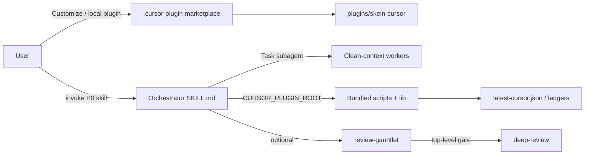
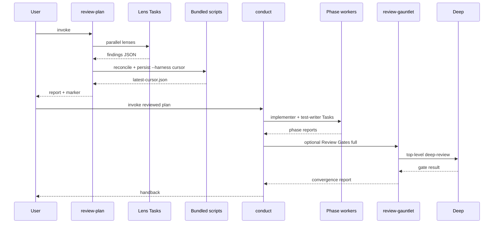

# Task: Cursor harness port for skein P0 skills

**Status**: Not Started
**Component**: meta
**Assigned to**: Cursor agent + maintainer
**Priority**: High
**Branch**: feature/cursor-harness-port
**Created**: 2026-11-16
**Completed**:
**Review Gates**: none

## Objective

Ship a Cursor-native skein plugin at `plugins/skein-cursor` so the plan → review → conduct → gauntlet loop runs inside Cursor Agent, adapting Claude-mirror skills for Cursor's Task/subagent and `${CURSOR_PLUGIN_ROOT}` contracts without regressing Claude, Codex, or Pi.

## Context

Skein today ships three harness trees: `plugins/skein` (Claude Code), `plugins/skein-codex` (Codex CLI), and `plugins/skein-pi` (Pi package). Cursor is a daily coding surface for the maintainer but has no mirror, marketplace entry, or `--harness cursor` state identity.

**Out of scope — Grok Bots / Grok Build.** The maintainer uses Grok Bots whose personas and workflows are defined elsewhere (bot settings / other repos), not via this plugin tree. Grok Build CLI plugin packaging is therefore not a deliverable of this plan. If a future spike shows Grok Build loading Cursor-compatible skills usefully, track a separate `skein-grok` plan; do not fold it into this one. Using Grok *as a model inside Cursor* still consumes the Cursor plugin — no Grok-specific mirror required for that case.

**Prior art.** The Pi port (`docs/dev_plans/20260929-feature-pi-plugin-port.md`, shipped v0.9.0) proved that loading another harness's `SKILL.md` is not enough: dispatch idiom, path anchors, install surface, and harness state identity must be adapted. Cursor is closer to Claude than Pi was (native clean-context Task/subagents; plugin `skills/` layout; `${CURSOR_PLUGIN_ROOT}`), so prefer a Claude-derived prompt mirror over a Pi-style worker-host.

**Copy source.** Claude mirror (`plugins/skein`) is the primary adaptation source. Codex remains the reference for sanctioned dispatch divergence patterns. Pi remains the reference for allowlisted skill inventory / honest `unavailable` gates, not for worker_host.py.

## Requirements

1. **Distinct Cursor plugin tree** at `plugins/skein-cursor/` with a Cursor Plugin (or Agent Plugin) manifest under `.cursor-plugin/plugin.json`, skills under `skills/`, and a repo-root `.cursor-plugin/marketplace.json` entry pointing at that tree. Do not reuse Claude/Codex/Pi install paths as the Cursor install surface.
2. **P0 skill allowlist only** (explicit READY set). In scope: `dev-plan`, `grill`, `review-plan`, `deep-review`, `conduct`, `review-gauntlet`. Deliberately skipped (Pi-style, remain undiscoverable or absent from the Cursor plugin): `fan-out`, `plan-view`, `rfc-finder`, `spec-compliance`, `in-your-own-words`, and initially `release`, `content-draft`, `content-review`, `update-docs`, `show-me` unless a later phase pulls a cheap P1 skill in. Never register an unready orchestrator.
3. **Adapt, don't symlink, SKILL.md bodies.** Replace Claude `Agent` / `subagent_type: general-purpose` / `model:`/`effort:` pins with Cursor Task/subagent idiom verified by Phase 0 spike. Replace `${CLAUDE_PLUGIN_ROOT}` with `${CURSOR_PLUGIN_ROOT}` (or the spike-confirmed equivalent). Keep harness-neutral procedure, schemas, marker rules, and allowlist citations.
4. **Reuse harness-neutral assets.** Rubrics, templates, `auto-fix-allowlist.json`, marker/write-review-marker, reconciler/appliers, and non-anchor gauntlet `lib/` stay sourced from canonical `scripts/` / Claude-authored lib via the bundler — not hand-copied forever. Add `plugins/skein-cursor` to `scripts/bundle-appliers.sh` `MIRRORS` (with Pi-like filters if report HTML stays Claude/Codex-only).
5. **Extend harness state identity.** `scripts/persist-review-state.sh` and `scripts/persist-deep-review-state.sh` accept `--harness cursor` and write `latest-cursor.json`. Do not overwrite `latest-claude.json` / `latest-codex.json` / `latest-pi.json`. Gauntlet ledger paths remain under `.gauntlet/` with Cursor SKILL prose naming the harness where needed.
6. **Honest gauntlet degradation.** Cursor `review-gauntlet` must run `deep-review` as a first-class gate. Native Claude `/security-review` / Codex-only gates that do not exist in Cursor are marked `unavailable`/`skipped` and never counted as passes (Pi capability-cache pattern).
7. **One-level delegation.** Orchestrator → workers only. Workers must not spawn further workers. Gauntlet's multi-lens `deep-review` remains a top-level skill invocation, not a nested Task inside a fixer.
8. **No Claude/Codex/Pi regressions.** `just check-sync`, `just check-prompt-parity`, `just parity-tests` (existing Claude↔Codex), and Pi inventory tests stay green. Cursor gains its own inventory/manifest tests; do not force Claude↔Cursor SKILL.md byte identity.
9. **Local install + smoke.** Document Customize / local plugin install (`~/.cursor/plugins/local` or marketplace-from-path). Phase 0 spike must prove Task spawn isolation and script path resolution before P0 skills are marked READY.

## Review Focus

- Path-anchor and install-root correctness after marketplace or local-plugin install (relocated cache paths).
- Task/subagent clean-context isolation for parallel lenses and conduct implementer/test-writer pairs; no parent-history leakage.
- `--harness cursor` persistence and resume/`--continue` behaviour vs existing harness files.
- Gauntlet gate honesty: unavailable gates never become passes; zero runnable gates exits visibly.
- Allowlist discipline: skipped skills remain undiscoverable; READY set matches tests and marketplace discovery.
- Dual-harness plans: this plan touches only Cursor + shared scripts — Claude/Codex SKILL.md bodies should not need content edits beyond shared script callers if any.

## Implementation Checklist

### Phase 0: Cursor capability spike (blocking)

**Impl files:** `docs/dev_plans/20261116-feature-cursor-harness-port.md` (spike notes below marker only until contract changes), optional scratch under gitignored paths — no `plugins/skein-cursor` READY skills yet
**Test files:** `tests/cursor/test_spike_notes.md` or `tests/cursor/README.md` recording spike commands/results (deterministic assertions only where possible)
**Test command:** `test -f docs/dev_plans/20261116-feature-cursor-harness-port.md`
**Goal:** Prove or refute Cursor Task isolation, `${CURSOR_PLUGIN_ROOT}` (or substitute) resolution, and parallel multi-Task dispatch before any P0 skill is registered READY.

- Install a minimal throwaway Cursor plugin (one skill) that (a) prints plugin root via documented variable expansion or a one-line shell probe, (b) spawns two Task subagents that must not see parent chat secrets, (c) invokes a bundled script relative to the plugin root.
- Record: exact subagent tool name/parameters Cursor expects; whether `general-purpose` / explore-like types exist; whether model/effort pins in frontmatter or prose are honoured; whether Claude-compat paths are irrelevant for Cursor install.
- Hard-stop: if clean-context parallel Tasks are unavailable, redesign Phase 2+ toward sequential orchestrator-emitted lens persistence (Claude SKILL.md already documents a sequential fallback clause) — do not claim parallel-lens parity.
- Update this plan's Architecture Decisions with spike outcomes (contract edit → re-review before conduct).

### Phase 1: Plugin skeleton, marketplace, inventory

**Impl files:** `plugins/skein-cursor/.cursor-plugin/plugin.json`, `.cursor-plugin/marketplace.json`, `plugins/skein-cursor/skills/show-me/SKILL.md` (or another standalone canary if show-me stays P1 — prefer a tiny `show-me` or stub canary skill marked READY only for discovery), `README.md`, `AGENTS.md`, `docs/dev_plans/README.md`
**Test files:** `tests/cursor/test_skill_inventory.py`, `tests/cursor/test_manifests.sh`, `tests/plugin/test_manifests.sh` (extend carefully — Cursor count ≠ 16)
**Test command:** `uv run --with pytest python -m pytest tests/cursor -q && bash tests/cursor/test_manifests.sh`
**Goal:** Cursor can install a discoverable plugin whose allowlist is exact; unready P0 skills are absent from discovery.

- Create `plugins/skein-cursor` with Cursor Plugin manifest (`name: skein`, version aligned with Claude/Codex `0.12.0` or next bump policy).
- Add root `.cursor-plugin/marketplace.json` listing `source` → `plugins/skein-cursor` (multi-plugin repo pattern).
- Maintain READY/SKIPPED inventory table (below marker + mirrored in tests) matching Pi's discipline.
- Document local install: symlink or copy into `~/.cursor/plugins/local`, or Customize → From GitHub / team marketplace; note Enterprise "Allow Local Plugin Imports".
- Do not yet expose orchestrators.

### Phase 2: Shared infra — harness enum + bundler mirror

**Impl files:** `scripts/persist-review-state.sh`, `scripts/persist-deep-review-state.sh`, `scripts/bundle-appliers.sh`, `scripts/lib/bundle-map.sh`, `tests/reconciliation/test-review-plan-state.sh`, `tests/reconciliation/test-deep-review-state.sh`, `tests/parity/test-applier-bundle-parity.sh`
**Test files:** same as Impl files' tests; `tests/cursor/test_bundles.sh`
**Test command:** `just reconciliation-tests && just check-sync && bash tests/parity/test-applier-bundle-parity.sh`
**Goal:** `--harness cursor` is a first-class persist identity; Cursor mirror receives bundled scripts for `BUNDLE_SKILLS` without report HTML unless explicitly opted in.

- Extend harness validation from `claude|codex|pi` to include `cursor`.
- Add `plugins/skein-cursor` to bundler `MIRRORS`; decide `BUNDLE_PI_EXCLUDE`-style filters for `render-report.py` / `report-hook.sh` (default: exclude from Cursor until `--report` is ported).
- Register Cursor gauntlet `lib/` parity expectations: either copy non-anchor files byte-identical from Claude and keep an anchor-divergent `gauntlet-common.sh`, or document Cursor as Pi-like (Python/orchestration-only) if lib scripts are unused — spike decides.
- Keep Claude↔Codex prompt-parity managed list unchanged (16 skills); Cursor uses its own allowlist tests.

### Phase 3: P0 skill adaptations (Claude → Cursor)

**Impl files:** `plugins/skein-cursor/skills/dev-plan/**`, `plugins/skein-cursor/skills/grill/**`, `plugins/skein-cursor/skills/review-plan/**`, `plugins/skein-cursor/skills/deep-review/**`, `plugins/skein-cursor/skills/conduct/**`, `plugins/skein-cursor/skills/review-gauntlet/**`, bundled `scripts/` / `lib/` under those skills
**Test files:** `tests/cursor/test_skill_inventory.py`, `tests/cursor/test_dispatch_idiom.sh`, `tests/cursor/test_path_anchors.sh`, `tests/parity/test-prose-rule-*.sh` only if Cursor joins the prose-rule block (default: defer prose-rule / show-me triggers like Pi)
**Test command:** `uv run --with pytest python -m pytest tests/cursor -q && bash tests/cursor/test_dispatch_idiom.sh && bash tests/cursor/test_path_anchors.sh && just check-sync`
**Goal:** Each READY skill's SKILL.md uses Cursor Task idiom + `${CURSOR_PLUGIN_ROOT}` (or spike-confirmed anchor); procedure/schemas match Claude intent; `--harness cursor` wired on persist call sites.

- Port order: `dev-plan` → `grill` → `deep-review` → `review-plan` → `conduct` → `review-gauntlet`.
- For each skill: start from Claude `SKILL.md`; rewrite dispatch sections; keep GENERIC FINDING SCHEMA / marker / allowlist fences byte-stable where parity tests require; cite bundled scripts via Cursor anchor.
- `review-plan` must route grill-eligible findings and post-accept plan edits through Cursor-invokable `dev-plan` / `grill` (same composition edges as `site/graph.json`).
- `conduct` optional terminal chain into `review-gauntlet` when plan header `**Review Gates:** full`.
- `review-gauntlet`: deep-review gate required; other gates `unavailable` with visible skip; fixer via Task (mechanical tier); no fan-out.
- Register each skill in the Cursor allowlist only after its static tests pass.

### Phase 4: Docs, site matrix, smoke, CI wiring

**Impl files:** `README.md`, `AGENTS.md`, `site/graph.json` (only if install/discovery docs need a Cursor note — prefer README matrix column first), `justfile`, `.github/workflows/ci.yml` (optional: cursor tests in `just ci` or documented separate like Pi)
**Test files:** `tests/cursor/**`, `tests/site/**` if README install commands are asserted
**Test command:** `uv run --with pytest python -m pytest tests/cursor -q && just lint && just check-sync && just check-prompt-parity`
**Goal:** README skill matrix gains a Cursor column for P0 skills; install docs are accurate; CI or explicit recipe covers Cursor inventory without claiming live-model quality.

- Add Cursor column to README skills table (Yes / No / partial) for every skill row.
- Document invocation spelling (Cursor skill name / slash / plugin-qualified form as spike discovers).
- Manual smoke checklist (below marker): local install → `deep-review` on a tiny fixture branch → `review-plan` on this plan → one `conduct` phase dry-run → gauntlet with expected skips.
- Decide whether `tests/cursor` joins `just ci` (prefer yes for inventory/manifest/anchor; live Task smoke stays manual).
- Log deferred items in `docs/BACKLOG.md` (P1 skills, `--report`, prose-rule port, Grok Build if ever needed).

## Technical Specifications

### Files to Modify

- `scripts/persist-review-state.sh`, `scripts/persist-deep-review-state.sh` — accept `cursor` in `--harness` validation (today: `claude|codex|pi` only at L104–105 / L191–192 pattern).
- `scripts/bundle-appliers.sh` — extend `MIRRORS=(plugins/skein plugins/skein-codex plugins/skein-pi)` with `plugins/skein-cursor`; apply exclude filters analogous to Pi for report scripts if needed.
- `scripts/lib/bundle-map.sh` — document Cursor as a fourth mirror consumer of `BUNDLE_SKILLS=(deep-review review-plan review-gauntlet)`.
- `tests/parity/test-applier-bundle-parity.sh` — Cursor bundle presence checks; do not require Claude↔Cursor SKILL.md equality.
- `tests/reconciliation/test-review-plan-state.sh`, `tests/reconciliation/test-deep-review-state.sh` — harness=`cursor` cases.
- `README.md`, `AGENTS.md` — Cursor install + skill matrix column.
- `docs/dev_plans/README.md` — index this plan under Planned → move on ship.
- `docs/BACKLOG.md` — deferred Cursor P1 + explicit non-goal for Grok Bots / Grok Build under this plan.

### New Files to Create

- `plugins/skein-cursor/.cursor-plugin/plugin.json` — Cursor Plugin manifest.
- `.cursor-plugin/marketplace.json` — repo marketplace listing `skein` → `./plugins/skein-cursor`.
- `plugins/skein-cursor/skills/<p0>/SKILL.md` (+ references/rubrics/templates as needed) for READY skills.
- Bundled `plugins/skein-cursor/skills/{deep-review,review-plan,review-gauntlet}/scripts/**` via `just bundle-appliers`.
- Optional `plugins/skein-cursor/skills/review-gauntlet/lib/**` (anchor-divergent `gauntlet-common.sh` + parity-listed neutrals).
- `tests/cursor/*` — inventory, manifests, path-anchor, dispatch-idiom guards.

### Architecture Decisions

- **AD1 — Cursor-only scope.** No `plugins/skein-grok` in this plan. Grok Bots are external definitions; Grok-as-Cursor-model uses `skein-cursor`.
- **AD2 — Claude is the copy source.** Rewrite dispatch + anchors; keep schemas/procedures. Do not start from Pi `skein_worker` unless Phase 0 proves Task isolation impossible.
- **AD3 — Distinct plugin tree, shared bundles.** Same relationship as Claude vs Codex: separate `SKILL.md`, shared generated `scripts/`.
- **AD4 — Allowlist over full 16-skill parity.** Cursor ships a READY subset; skipped skills stay out of the plugin (Pi pattern), while Claude/Codex remain at 16.
- **AD5 — Path anchor.** Prefer `${CURSOR_PLUGIN_ROOT}/skills/<name>/…` in SKILL.md (Cursor docs expand this for plugin MCP; spike must confirm expansion inside skill-invoked shell). Fallback: skill-relative resolution documented after spike — never `${CLAUDE_PLUGIN_ROOT}` or `$SKILL_DIR`.
- **AD6 — Harness id `cursor`.** Persist files `latest-cursor.json`; resume logic keys on that id.
- **AD7 — Gauntlet partial OK.** deep-review required; other gates unavailable/skipped; never false convergence.
- **AD8 — Versioning.** Cursor plugin version tracks Claude/Codex plugin.json version string when releasing; interim may ship on the feature branch without a release bump until READY smoke passes.

### Dependencies

- No new npm/PyPI runtime dependencies required for the plugin tree (skills + shell/python already in-repo).
- Cursor IDE / Agent with plugins enabled; local plugin import may require Enterprise setting.
- Existing tools: `just`, `jq`, `shellcheck`, `shfmt`, `ruff`, `uv` (contributor gates).

### Integration Seams

| Seam | Writer | Caller | Contract |
|------|--------|--------|----------|
| Bundled scripts | `scripts/bundle-appliers.sh` + canonical `scripts/` | Cursor SKILL.md via `${CURSOR_PLUGIN_ROOT}/skills/<skill>/scripts/…` | Byte-identical to canonical for registered bundle entries; absent bundle → hard-fail |
| Persist harness | `persist-*-state.sh` | `deep-review` / `review-plan` Cursor SKILL.md | `--harness cursor` → `.*/latest-cursor.json`; exit 0/1/2 unchanged |
| Plan marker | `write-review-marker.py` / `marker.py` | `review-plan` → consumed by `conduct` | Same hash authority as Claude/Codex (`scripts/marker.py`) |
| Grill / dev-plan updates | `grill`, `dev-plan` Cursor skills | `review-plan` Step 6.x | Decisions persist above marker via `/dev-plan update` equivalent; no silent writes |
| Gauntlet → deep-review | `review-gauntlet` | top-level `deep-review` skill | Not a nested Task inside fixer; one-level rule preserved |
| Gate capability | `review-gauntlet` (+ optional cache) | convergence loop | Stable absence → `skipped`/`unavailable`; never `passed` |

## Architecture & Call Flow

> Confirmed 2026-11-16: Cursor-only; Grok Bots out of scope; distinct `plugins/skein-cursor`; Claude-derived adaptation.

Component graph — which component triggers which:

Trigger order — single `review-plan` then later `conduct` run:

Context lifecycle:

| Step | Trigger | Enters context | Cleared/persisted | Turn boundary |
|------|---------|----------------|-------------------|---------------|
| 1 | User invokes Cursor skill | Skill body + args + repo tools | None yet | Orchestrator turn |
| 2 | Orchestrator spawns Task(s) | Filled worker prompt only | Parent chat cleared for child | Child Task session |
| 3 | Worker returns | Structured result / findings | Attempt JSONL on disk | Back to orchestrator |
| 4 | Bundled scripts | Paths + envelopes | `latest-cursor.json`, markers, `.gauntlet/` | Same orchestrator turn |
| 5 | Optional gauntlet | Gate briefs + ledger | Ledger rounds; skips recorded | Top-level skill context |

## Testing Notes

- Static: inventory allowlist exactness; manifest name/version; no `${CLAUDE_PLUGIN_ROOT}` / `$SKILL_DIR` in Cursor SKILL.md; `--harness cursor` string present on persist call sites; bundle byte-identity via `just check-sync`.
- Reconciliation: extend existing persist tests with `cursor` harness.
- Manual smoke (required before calling the port shipped): install plugin → run `deep-review` and `review-plan` on a fixture → confirm `.review-plan/latest-cursor.json` / `.deep-review/latest-cursor.json` → one conduct phase → gauntlet with expected unavailable gates.
- Non-goals for automated CI: live model judgment quality; Grok Bot behaviour.

## Issues & Solutions

_(Fill during implementation.)_

## Acceptance Criteria

- [ ] `plugins/skein-cursor` installs via documented Cursor path and exposes exactly the READY P0 skill set.
- [ ] P0 skills (`dev-plan`, `grill`, `review-plan`, `deep-review`, `conduct`, `review-gauntlet`) run with Cursor Task idiom and resolved plugin-root script paths.
- [ ] `--harness cursor` persistence works; Claude/Codex/Pi state files untouched.
- [ ] Gauntlet never counts unavailable gates as passes.
- [ ] `fan-out` and other SKIPPED skills are not discoverable via the Cursor plugin.
- [ ] Claude↔Codex parity gates and Pi tests remain green; Cursor has its own inventory/manifest tests.
- [ ] README documents Cursor install and matrix column; Grok Bots / Grok Build explicitly out of scope for this work.
- [ ] Phase 0 spike notes recorded; Architecture Decisions updated if anchors/dispatch differ from assumptions.

## Final Results

_(Fill on completion.)_

---

## Progress

- [ ] Phase 0: Cursor capability spike
- [ ] Phase 1: Plugin skeleton, marketplace, inventory
- [ ] Phase 2: Shared infra — harness enum + bundler mirror
- [ ] Phase 3: P0 skill adaptations
- [ ] Phase 4: Docs, site matrix, smoke, CI wiring

## Findings

_(Review-plan / deep-review findings land here.)_

### Explore facts (create-time, 2026-11-16)

Woven into Technical Specifications above. Summary anchors:

- Verified trees: `plugins/skein`, `plugins/skein-codex`, `plugins/skein-pi`; missing `plugins/skein-cursor`, `plugins/skein-grok`.
- Marketplaces: `.claude-plugin/marketplace.json` → `./plugins/skein`; `.agents/plugins/marketplace.json` → `./plugins/skein-codex`; Pi via root `package.json` `pi.skills` allowlist (11 READY).
- Bundler: `MIRRORS=(plugins/skein plugins/skein-codex plugins/skein-pi)`; `BUNDLE_SKILLS=(deep-review review-plan review-gauntlet)`.
- Persist harness enum: `claude|codex|pi` only today.
- Claude dispatch/anchors: `Agent` + `${CLAUDE_PLUGIN_ROOT}`; Codex: `spawn_agent` + `$SKILL_DIR`; Pi: `skein_worker` + package-relative paths.
- P0 deps: `review-plan` → `grill` + `dev-plan`; `conduct` → review marker; `review-gauntlet` → `deep-review`.
- No in-repo mentions of grok / skein-cursor / Grok Build.
- Plugin versions Claude/Codex: `0.12.0`.
