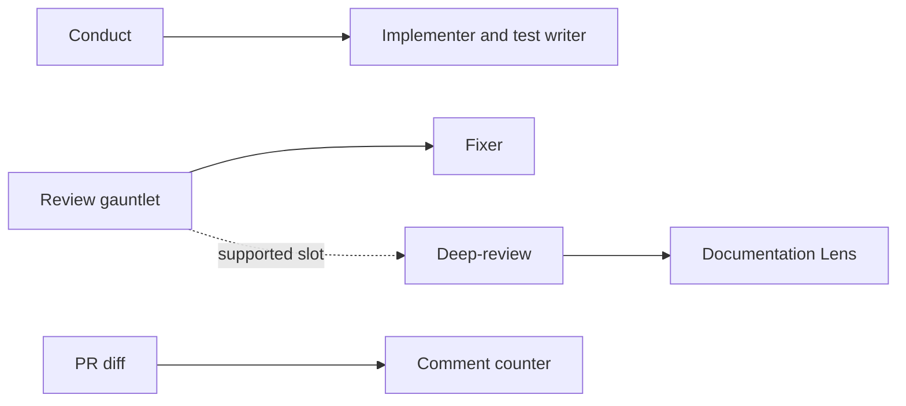
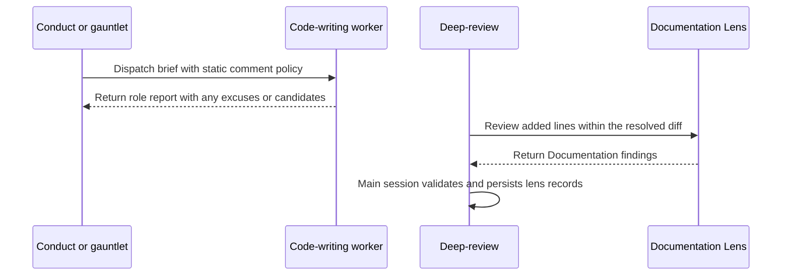

# Task: Comment hygiene for new code

**Status**: Not Started
**Component**: meta
**Assigned to**: Claude
**Priority**: Medium
**Branch**: feature/comment-hygiene-and-decisions
**Created**: 2026-11-22
**Review Gates**: full

## Objective

Stop agent-written code from accumulating tautology, stale and excuse comments: state a why-only comment policy, inject it into the briefs of the subagents that write code (`conduct` implementer and test-writer, `review-gauntlet` fixer), have `deep-review` flag violating comments the diff adds, and measure added comment lines per PR.

## Context

Agents over-comment. Comments that restate the code, go stale, or excuse a hacky implementation cost review time and the hack propagates. The trigger was a post proposing a categorise-and-delete audit with a comment-banning lint rule.

Scoping decisions taken in the design discussion (2026-11-22):

- **Why-only, not a ban.** skein is mostly bash, jq and markdown, where a comment is often the only place the why lives. Exemptions: docstrings, linter and type pragmas, license headers, TODOs that link an issue.
- **New code only.** This plan covers comments an agent writes or touches from now on. A retroactive audit skill (plan C) is deferred and may never be built: untouched code is left alone.
- **No decisions folder here.** Decision-record comments stay in place and are surfaced as "decision candidates" in handbacks. The `docs/decisions/` folder, its record format, promotion at `/update-docs`, and the active-record checks are plan B (`20261122-feature-decision-records.md`).

Evidence from `~/Code/pipecat-ai/pipecat-code-mcp` (read-only analysis): its `docs/decisions/` held 2 records against 31 dev plans, at least 10 of which carry their own decision sections, because nothing triggered promotion. That is why record-writing is not bolted onto this plan.

The Codex conduct templates end in a role-specific JSON block. The Pi conduct worker request is assembled from skill prose. `scripts/check-prompt-parity.sh` selects skills through the whitespace-separated `MANAGED_SKILLS` environment variable or `.env`; the normal gate uses the full default list.

Land A before implementing B. A owns the new AGENTS.md policy, conduct worker briefs, gauntlet fixer policy, and deep-review Documentation Lens. B owns the AGENTS.md decisions layout and pointer, conduct terminal nudge, and architecture-lens inputs. Apply each plan's shape-test assertions, changelog entry and index row to the current versions of those shared files.

## Requirements

- AGENTS.md carries a short comment-policy block: comment only a non-obvious why; no comment that restates the code; no comment that excuses a hack (fix it, or report it); exemptions for docstrings, linter/type pragmas, license headers, and TODOs linking an issue.
- `conduct` implementer and test-writer briefs and the `review-gauntlet` fixer brief carry the same rule in all three mirrors, as static text. A touched comment may be deleted only if it is a tautology or stale and lies inside a hunk or function the change already touches. No sweeping cleanup. An excuse comment is never deleted silently: it is reported in the handback. A decision-record comment stays and is listed as a "decision candidate" in the handback.
- `deep-review`'s documentation lens flags comments ADDED by the diff only (never pre-existing ones), classified excuse (Important), tautology / stale / decision-candidate (Minor), in all three mirrors, at the lens's current model tier.
- A script counts added comment lines from `git diff`, and a baseline is recorded before the new rules take effect.
- Author the Codex half first through `codex:rescue`, then align the Claude half in the same commit. Preserve Claude's `${CLAUDE_PLUGIN_ROOT}` and Codex's `"$SKILL_DIR"` anchors. Keep Pi and docs in separate commits where their changes are independent. Require `just ci` in every gauntlet fixer brief and retain the conductor's post-commit CI checks.
- Keep `{{PHASE_GOAL}}` a zero-byte substitution when the slot is absent or empty (both conduct templates, line 9). The two rendered briefs may change only through the new static policy and handback guidance.

Out of scope: retroactive audit skill (plan C); lint or ratchet tooling; auto-fix deletion kinds in `auto-fix-common.sh`; any `docs/decisions/` folder, record format or promotion (plan B); changing any lens model tier.

## Review Focus

- Prompt byte parity: `scripts/check-prompt-parity.sh` checks the managed `rubric.md` and `*-prompt.md` files. The two conduct templates are byte-compared under the normal gate. The intentional fan-out normalisation and temporary lagging-mirror overrides do not apply to this change.
- `{{PHASE_GOAL}}` empty-string invariant and the SKILL.md substitution table (`conduct/SKILL.md:163,169`; Codex `:184,190`).
- Model tier: Claude's Documentation Lens uses haiku/low (`deep-review/SKILL.md:567`). Codex inherits the harness model and requests low reasoning when supported (`plugins/skein-codex/skills/deep-review/SKILL.md:104`). Preserve the tier census in `tests/parity/test-spawn-tiers.sh`.
- Severity vocabulary differs by mirror: Claude and Codex `Critical|Important|Minor`; Pi worker findings use `critical|important|suggestion` (`plugins/skein-pi/skills/deep-review/SKILL.md:22`) and the disk-first adapter maps them to `Critical|Important|Minor` (`:26`, Disk-first records and reconciliation). Pi is not checked by `scripts/check-prompt-parity.sh`; run `just pi-tests` for its contracts.
- Add policy outside the literal `<!-- BEGIN PROSE RULE BLOCK A -->` / `<!-- END PROSE RULE BLOCK A -->` and corresponding Block B anchors. Preserve those blocks and the shared `GENERIC FINDING SCHEMA AND MERGE` region byte-for-byte.
- The cleanup allowance must not contradict the repo rule "minimal impact": bounded to hunks and functions already touched.

## Implementation Checklist

Each mirror-spanning phase is split into `a` (Codex), `b` (Claude) and `c` (Pi) sub-phases, run in that order. Every sub-phase names its executor in its first bullet. `a` and `b` land as one commit (Codex half first, Claude aligned to its bytes); `c` is a separate Pi commit.

`conduct` dispatches Claude subagents only. For `a` and `c` phases the main session performs the hand-off itself (`codex:rescue` for Codex, a non-interactive Pi run for Pi) and then runs the phase's declared test command. Whether `conduct` can pause at such a phase for an external executor is unverified; if it cannot, walk the phases in order by hand and use `conduct` only for Claude-owned phases (1, `b`, and the verify phase).

### Phase 1: Policy block and measurement

**Impl files:** `AGENTS.md, scripts/count-added-comments.sh, justfile`
**Test files:** `tests/plugin/test-count-added-comments.sh`
**Test command:** `bash tests/plugin/test-count-added-comments.sh`
**Goal:** The counter measures real added comment lines only; structural markers never count, so the baseline is comparable across runs.

- Add the comment-policy block to AGENTS.md under `Contributing Hygiene`, keep it to a handful of lines, and state the exemptions.
- Write `scripts/count-added-comments.sh`: reads `git diff <base>...HEAD`, counts added lines whose first non-blank character is `#` in `*.sh`, `*.py`, `*.jq` and `justfile`; excludes shebang lines and linter/type pragmas (`# shellcheck`, `# noqa`, `# type:`); excludes HTML comments in markdown (they are structural `BEGIN`/`END` markers in this repo); prints one integer, per-file with `--verbose`.
- Test against a fixture repo created in a temp dir: added comment, added shebang, added pragma, added HTML marker, pre-existing comment untouched. Register the fixture in `plugin-tests`.

### Phase 2a: conduct briefs, Codex mirror

**Impl files:** `plugins/skein-codex/skills/conduct/implementer-prompt.md, plugins/skein-codex/skills/conduct/test-writer-prompt.md, plugins/skein-codex/skills/conduct/SKILL.md, justfile`
**Test files:** `tests/gauntlet/test-comment-policy-briefs.sh`
**Test command:** `bash tests/gauntlet/test-comment-policy-briefs.sh`
**Goal:** Static policy and handback guidance are the only changes to the no-goal rendering. Both templates stay byte-identical across Claude and Codex. (Codex mirror.)

- **Executor:** Codex. The main Claude session invokes `codex:rescue` with this phase block as the brief; Codex edits only the files listed above. The main session byte-verifies against `git diff`, runs the test command, and does not commit: the commit is shared with the matching `b` phase.
- Ask for labelled excuses and decision candidates in the existing implementer `summary` and test-writer `coverage_summary` strings. Preserve each template's terminal fenced JSON block and role-specific keys (`conduct/SKILL.md` Step 4 and `schema.py`). Add the policy inside the dispatched Template block and outside the warned data blocks.
- Have the main conduct session surface these notices from validated reports in the ordinary phase handback, or at the phase boundary in autonomous mode. Shared templates alone will not surface them to the operator. Add this guidance to the live SKILL.md handback path without changing state or the successful terminal seam owned by B.
- Add a short "Comments" paragraph to both templates: the Requirements rule, verbatim wording shared by both templates.
- Keep Codex lifecycle in `conduct/worker-dispatch.md`: every first spawn and retry uses the full rendered prompt as the structured `spawn_agent` message, a unique task name, `fork_turns="none"` and medium reasoning when supported. Collect the delivered final report and terminal status. Missing delegation support hard-stops conduct. Implementation under conduct requires a sandbox that permits the declared files and the index operations its workers use.
- Register the new brief test in `gauntlet-tests`. Check both mirrors' Template blocks, existing report fields and handback guidance. Assert the no-goal rendering differs from the baseline template only by the planned additions. The existing `test-goal-injection.sh` statically checks the Claude templates and skill. Retain it and cover Codex directly in the new test.

### Phase 2b: conduct briefs, Claude mirror

**Impl files:** `plugins/skein/skills/conduct/implementer-prompt.md, plugins/skein/skills/conduct/test-writer-prompt.md, plugins/skein/skills/conduct/SKILL.md`
**Test files:** `tests/gauntlet/test-comment-policy-briefs.sh`
**Test command:** `just parity-tests && bash tests/gauntlet/test-goal-injection.sh && bash tests/gauntlet/test-comment-policy-briefs.sh`
**Goal:** Static policy and handback guidance are the only changes to the no-goal rendering. Both templates stay byte-identical across Claude and Codex. (Claude mirror, aligned to the Codex half.)

- **Executor:** Claude (a `conduct` subagent or the main session). Align to the bytes landed in the matching `a` phase, run the test command, then commit `a` and `b` together as one logical change (Codex half first, per AGENTS.md).
- Codex templates first (via `codex:rescue`), then the Claude templates byte-identical to them.
- Align the Claude mirror to the Codex half from phase 2a: copy shared wording, template and rubric bytes verbatim. Claude keeps `${CLAUDE_PLUGIN_ROOT}` path anchors; never collapse them with Codex's `"$SKILL_DIR"`.
- Extend `tests/gauntlet/test-comment-policy-briefs.sh` to cover the Claude templates and the Claude/Codex byte identity; surface the same notices in the live Claude SKILL.md handback path.

### Phase 2c: conduct briefs, Pi mirror

**Impl files:** `plugins/skein-pi/skills/conduct/SKILL.md`
**Test files:** `tests/pi/test_orchestration_routes.py`
**Test command:** `just pi-tests`
**Goal:** Static policy and handback guidance are the only changes to the no-goal rendering. Both templates stay byte-identical across Claude and Codex. (Pi mirror.)

- **Executor:** Pi. The main session runs Pi non-interactively (`pi -p --no-session`) with this phase block as the brief, limited to the files listed above; if Pi is unavailable, a Claude subagent applies the same block. The main session verifies against `git diff`, runs the test command, and commits the Pi half separately (commit per platform).
- Pi has no templates: add the same rule to the worker-request prose in `plugins/skein-pi/skills/conduct/SKILL.md` (worker boundary at lines 24–30; Phase loop steps 2–3 at 39–46). Both roles use `skein_worker` with only `role` and `prompt`; carry the static rule in `prompt`, outside untrusted snapshots, including retries. Pi has no pinned implementer/test-writer JSON report fields equivalent to `coverage_summary`: keep notices in the existing generic envelope `summary` or proposal/report prose, validate them and surface them in `Handback contract`. No new typed-tool fields or extension schema are needed. Main session alone applies approved patches, runs tests and commits; do not import Claude/Codex worker-write or index operations.
- Extend `tests/pi/test_orchestration_routes.py::test_conduct_is_pi_native_sequential_and_main_owned` for both role requests, retry policy and notice handback. Preserve its no-tools, explicit-approval and main-owned-write assertions.
- Apply the shared wording from phase 2a inside the Pi mirror's own routes. Pi is not covered by `check-prompt-parity.sh`, so the `tests/pi` assertions are its only guard.

### Phase 3a: review-gauntlet fixer brief, Codex mirror

**Impl files:** `plugins/skein-codex/skills/review-gauntlet/SKILL.md`
**Test files:** `tests/gauntlet/test-gauntlet-skill-shape.sh, tests/gauntlet/test_codex_agent_api.py`
**Test command:** `bash tests/gauntlet/test-gauntlet-skill-shape.sh`
**Goal:** The comment rule is carried unconditionally into every fixer brief, alongside the existing blast-radius and `just ci` requirements, and never widens a fix beyond its finding. (Codex mirror.)

- **Executor:** Codex. The main Claude session invokes `codex:rescue` with this phase block as the brief; Codex edits only the files listed above. The main session byte-verifies against `git diff`, runs the test command, and does not commit: the commit is shared with the matching `b` phase.
- Add the comment constraint to every fixer brief's Constraints, alongside Claude and Codex Guardrails 5–8 (Codex `SKILL.md:1025-1047`) and Pi `fixer_request()` (`lib/review_gauntlet.py:133-170`). In Codex it applies to full, quick-mode, resumed and retry dispatches through `review-gauntlet/worker-dispatch.md`. Quick runs native gate 1 once, can dispatch a substantive fixer and does not run deep-review.
- Keep deletion within the fix's existing hunk or function and blast radius. Report excuses and candidates in the existing fixer handback prose or summary. Preserve `claimed`, `design_deltas` and the one-report-per-round sink. A candidate is information for the operator and does not claim a fix or create a design delta.
- Extend shape coverage for the common brief and Codex dispatch routes. Preserve the terminal design-delta sink and report shape guards exercised by `gauntlet-tests`.

### Phase 3b: review-gauntlet fixer brief, Claude mirror

**Impl files:** `plugins/skein/skills/review-gauntlet/SKILL.md`
**Test files:** `tests/gauntlet/test-gauntlet-skill-shape.sh, tests/gauntlet/test_codex_agent_api.py`
**Test command:** `just gauntlet-tests`
**Goal:** The comment rule is carried unconditionally into every fixer brief, alongside the existing blast-radius and `just ci` requirements, and never widens a fix beyond its finding. (Claude mirror, aligned to the Codex half.)

- **Executor:** Claude (a `conduct` subagent or the main session). Align to the bytes landed in the matching `a` phase, run the test command, then commit `a` and `b` together as one logical change (Codex half first, per AGENTS.md).
- Align the Claude mirror to the Codex half from phase 3a: copy shared wording, template and rubric bytes verbatim. Claude keeps `${CLAUDE_PLUGIN_ROOT}` path anchors; never collapse them with Codex's `"$SKILL_DIR"`.
- Add the comment constraint to the Claude fixer Guardrails 5–8 and keep its shape tests green.

### Phase 3c: review-gauntlet fixer brief, Pi mirror

**Impl files:** `plugins/skein-pi/lib/review_gauntlet.py`
**Test files:** `tests/pi/test_gate_capabilities.py`
**Test command:** `just pi-tests`
**Goal:** The comment rule is carried unconditionally into every fixer brief, alongside the existing blast-radius and `just ci` requirements, and never widens a fix beyond its finding. (Pi mirror.)

- **Executor:** Pi. The main session runs Pi non-interactively (`pi -p --no-session`) with this phase block as the brief, limited to the files listed above; if Pi is unavailable, a Claude subagent applies the same block. The main session verifies against `git diff`, runs the test command, and commits the Pi half separately (commit per platform).
- Pi-specific boundary: `fixer_request()` is at lines 133–172, but currently has neither a `just ci` instruction nor a design-delta sink. Add the required validation instruction alongside the new static comment rule; the no-tools fixer proposes tests and the main session executes `just ci` after approved edits. Preserve `validate_fixer_result()`'s exact artifact keys (`schema_version`, `status`, `summary`, `claimed`, `patches`, `blast_radius`): put notices in `summary`, never add `design_deltas` or claim candidates as fixes. The design-delta preservation requirement above applies to Claude/Codex only; Pi does not gain that feature.
- Extend `tests/pi/test_gate_capabilities.py::test_fixer_route_is_pi_native_and_rejects_auto_fix` to inspect the generated prompt/constraints, and its fixer-result tests to accept summary notices while rejecting extra proposal keys and candidate claims outside the actionable batch. `tests/pi/test_review.py` tests review-plan, not this fixer.
- Apply the shared wording from phase 3a inside the Pi mirror's own routes. Pi is not covered by `check-prompt-parity.sh`, so the `tests/pi` assertions are its only guard.

### Phase 4a: deep-review documentation lens, Codex mirror

**Impl files:** `plugins/skein-codex/skills/deep-review/SKILL.md, plugins/skein-codex/skills/review-gauntlet/SKILL.md`
**Test files:** `tests/lenses/test-lens-skill-shape.sh, tests/gauntlet/test-gauntlet-skill-shape.sh`
**Test command:** `just lens-tests`
**Goal:** The Documentation Lens uses simple lexical and adjacent-line signals on added comments. Every mirror keeps its current routing tier. (Codex mirror.)

- **Executor:** Codex. The main Claude session invokes `codex:rescue` with this phase block as the brief; Codex edits only the files listed above. The main session byte-verifies against `git diff`, runs the test command, and does not commit: the commit is shared with the matching `b` phase.
- Add to the documentation lens "Look for": excuse (Important): an added comment containing hack, workaround, temporary, "for now", or a TODO without an issue link, next to code that looks like the hack; tautology (Minor): an added comment whose words restate the identifiers of the adjacent line; stale (Minor): an added comment naming a symbol absent from the changed file; decision candidate (Minor, informational): an added comment explaining a cross-file or long-lived choice.
- Use existing category `Documentation`, location at the added line and the existing severity vocabulary. Keep exemptions for pre-existing comments, docstrings, pragmas, licence headers and issue-linked TODOs. Keep Claude's existing "Minor typos in comments" ignore line. Codex has no such line and its ignore rule concerns code behaviour.
- Edit Claude's and Codex's Documentation Lens in `SKILL.md` (Codex lines 292–311 before Block A); their identical `rubric.md` files already define the existing finding contract. Pi's `rubric.md` carries the lens scope and its `SKILL.md:22-26` already maps severity. Edit Codex first, then align Claude and Pi.
- Give informational decision candidates a stable `Decision candidate:` summary prefix under `Documentation`. When gauntlet consumes deep-review findings, surface those candidates as advice and exclude them from fix dispatch and actionable convergence accounting. Exercise that seam where the deep-review slot is supported. Leave the native quick route unchanged.
- Sample deep-review directly against recent diffs with added and pre-existing comments. Use the existing Codex spawned and sequential lens contracts and keep the disk-first writer, collector and location shape intact. Report noise or missed excuses to the user as a tier question. Keep the tier unchanged.

### Phase 4b: deep-review documentation lens, Claude mirror

**Impl files:** `plugins/skein/skills/deep-review/SKILL.md, plugins/skein/skills/review-gauntlet/SKILL.md`
**Test files:** `tests/lenses/test-lens-skill-shape.sh, tests/gauntlet/test-gauntlet-skill-shape.sh`
**Test command:** `just lens-tests && just parity-tests && just gauntlet-tests`
**Goal:** The Documentation Lens uses simple lexical and adjacent-line signals on added comments. Every mirror keeps its current routing tier. (Claude mirror, aligned to the Codex half.)

- **Executor:** Claude (a `conduct` subagent or the main session). Align to the bytes landed in the matching `a` phase, run the test command, then commit `a` and `b` together as one logical change (Codex half first, per AGENTS.md).
- Align the Claude mirror to the Codex half from phase 4a: copy shared wording, template and rubric bytes verbatim. Claude keeps `${CLAUDE_PLUGIN_ROOT}` path anchors; never collapse them with Codex's `"$SKILL_DIR"`.
- Keep Claude's existing "Minor typos in comments" ignore line and its haiku/low routing; surface `Decision candidate:` findings as gauntlet advice on the Claude route.

### Phase 4c: deep-review documentation lens, Pi mirror

**Impl files:** `plugins/skein-pi/skills/deep-review/SKILL.md, plugins/skein-pi/skills/deep-review/rubric.md, plugins/skein-pi/skills/review-gauntlet/SKILL.md, plugins/skein-pi/lib/review_gauntlet.py`
**Test files:** `tests/pi/test_deep_review.py, tests/pi/test_gate_capabilities.py`
**Test command:** `just pi-tests`
**Goal:** The Documentation Lens uses simple lexical and adjacent-line signals on added comments. Every mirror keeps its current routing tier. (Pi mirror.)

- **Executor:** Pi. The main session runs Pi non-interactively (`pi -p --no-session`) with this phase block as the brief, limited to the files listed above; if Pi is unavailable, a Claude subagent applies the same block. The main session verifies against `git diff`, runs the test command, and commits the Pi half separately (commit per platform).
- Pi evidence and routing: extend deep-review's main-session packet preparation to give the documentation worker added-line coordinates, adjacent code, and a bounded symbol inventory or targeted lookup evidence for the changed file. A partial diff alone cannot establish that a named symbol is absent from the file; report unsupported checks as unverified. Keep the existing plan-target route: without an actual diff, do not invent added-comment findings. Preserve Pi's user-selected model and per-launch approval; haiku/low is Claude's routing, not Pi's.
- Pi candidate seam: keep raw Documentation findings in deep-review state/report. In gauntlet, separate only `Documentation` findings with the exact `Decision candidate:` prefix into operator advice before constructing the actionable fixer batch and ledger projection. `PiLedger._validate_round()` currently counts every gate finding and rejects `passed` gates containing findings; supply actionable-only projected gate findings/status/counts to the ledger, while retaining the original gate envelope and advice in the report. Advice-only input must not trigger a fixer or another round, and must not erase skipped/degraded coverage or claim that the raw review had no findings. No worker/result schema expansion is needed.
- Extend `tests/pi/test_deep_review.py` for packet contents, added-only locations, exemptions and missing-symbol evidence limits; extend `tests/pi/test_gate_capabilities.py` for mixed and advice-only batches, projected ledger counts, and skipped/degraded gates with advice. Use bounded synthetic packets/results to test adapter contracts; a live lens quality exercise is separate.
- Apply the shared wording from phase 4a inside the Pi mirror's own routes. Pi is not covered by `check-prompt-parity.sh`, so the `tests/pi` assertions are its only guard.
- `plugins/skein-pi/lib/review_gauntlet.py` is added to this phase's impl files because the candidate seam above edits `PiLedger` handling there.

### Phase 5: Verify, baseline, docs

**Impl files:** `CHANGELOG.md, docs/dev_plans/README.md`
**Test files:** `tests/plugin/test-count-added-comments.sh`
**Test command:** `just ci`
**Goal:** The full CI is green on the branch and a baseline comment count is recorded before the new rules are used.

- Run `just ci` in a background job and wait for the exit status. Codex conduct runs its declared test command in a bounded subprocess, so use a sufficient `--test-timeout` if it owns this run.
- Compute the baseline with the counter over the last ten merged PRs; record the number and the method in `## Findings`.
- Update `CHANGELOG.md` and the `docs/dev_plans/README.md` row; run `/update-docs` after the reviews converge.
- Record in `## Findings` that even after B lands, a candidate reaches promotion only if a person copies it into the plan's `## Findings` or records it in `### Architecture Decisions`.

## Technical Specifications

### Files to Modify

All paths verified to exist by Explore (2026-11-22):

- `AGENTS.md` — add comment-policy block (existing headings: Contributing Hygiene at line 161, Skill Workflow at 172).
- `plugins/skein/skills/conduct/implementer-prompt.md`, `test-writer-prompt.md` — add Comments paragraph and handback lists.
- `plugins/skein-codex/skills/conduct/implementer-prompt.md`, `test-writer-prompt.md` — same, byte-identical to Claude.
- `plugins/{skein,skein-codex}/skills/conduct/SKILL.md` — phase report and handback guidance. B owns the terminal completion nudge.
- `plugins/skein-pi/skills/conduct/SKILL.md` — add the rule to the worker-request prose (no templates exist).
- `plugins/skein/skills/review-gauntlet/SKILL.md`, `plugins/skein-codex/skills/review-gauntlet/SKILL.md` — add fixer constraint.
- `plugins/skein-pi/lib/review_gauntlet.py` — add to `fixer_request()` constraints (line 133).
- `plugins/skein/skills/deep-review/SKILL.md`, `plugins/skein-codex/skills/deep-review/SKILL.md`, `plugins/skein-pi/skills/deep-review/{SKILL.md,rubric.md}` — Documentation Lens rule and Pi bounded evidence preparation.
- `plugins/{skein,skein-codex,skein-pi}/skills/review-gauntlet/SKILL.md` — keep informational candidates out of the fixer queue and ledger.
- `tests/gauntlet/test-gauntlet-skill-shape.sh`, `tests/gauntlet/test_codex_agent_api.py`, `tests/lenses/test-lens-skill-shape.sh`, `tests/pi/test_gate_capabilities.py`, `tests/pi/test_deep_review.py`, `tests/pi/test_orchestration_routes.py` — extend assertions at the actual Pi fixer, ledger, lens and conduct seams.
- `justfile` — register the counter and brief tests. `CHANGELOG.md`, `docs/dev_plans/README.md` — A's entries only.

### New Files to Create

- `scripts/count-added-comments.sh` — added-comment-line counter.
- `tests/plugin/test-count-added-comments.sh` — fixture-based counter test.
- `tests/gauntlet/test-comment-policy-briefs.sh` — asserts rule text, slot isolation, Claude/Codex parity.

### Architecture Decisions

- Decision (grilled 2026-11-22): why-only comment rule with exemptions, not a ban. Rejected: full ban (deletes the why that bash and markdown comments carry).
- Decision (grilled 2026-11-22): a non-obvious decision is recorded once, as a short inline why or, once plan B lands, as a record; prefer a record for cross-file or long-lived decisions.
- Decision (grilled 2026-11-22): new code only; untouched code is not audited, so the retroactive audit skill (plan C) is deferred.
- Decision (grilled 2026-11-22, accepted): this plan does not create `docs/decisions/`. Decision-record comments are flagged as candidates in handbacks. Rationale: a folder has no consumer until plan B's checks exist, and the record format is best designed once with those consumers in view. Rejected: create folder and format here with flag-only (half-built), or full migration by mechanical-tier agents (judgment at volume, widens every PR).
- Decision (grilled 2026-11-22, accepted): the deep-review documentation lens stays at haiku/low; the rules are written as lexical and adjacent-line signals. If sampling shows it cannot hold them, surface the tier question to the user.
- Resolved by lookup (not a judgment call): the counter ignores HTML comments, including the structural markers `<!-- BEGIN GENERIC LENS PROMPT: architecture -->` and `<!-- BEGIN PROSE RULE BLOCK A -->`, as well as shebang and pragma lines.
- Resolved (user-specified 2026-11-22): non-excuse findings are Minor, excuse is Important; Pi's `suggestion` maps to Minor (`skein-pi/skills/deep-review/SKILL.md:26`).

### Dependencies

- No new dependencies. The counter uses Bash and git; Pi retains its existing TypeScript extension/Python helper runtime. The repo-root `package.json` is named `skein-pi` and lists the installed skill paths; there is no `plugins/skein-pi/package.json`.

### Integration Seams

| Seam | Writer (task) | Caller (task) | Contract |
|------|---------------|---------------|----------|
| Policy wording | AGENTS.md block (Phase 1) | conduct and gauntlet briefs (Phases 2a–3c), deep-review rule (Phases 4a–4c) | One wording for exemptions and the cleanup bound; tests assert the shared key phrases, not paraphrases. |
| Decision candidates | Conduct and gauntlet handbacks (Phases 2a–3c), Documentation Lens (Phases 4a–4c) | Operator, then plan B `/update-docs` after manual capture | Existing summary and finding fields carry advice. The operator chooses what to copy into the plan. |
| Byte parity | Codex conduct templates (Phase 2a) | Claude conduct templates (Phase 2b) | Identical bytes; `check-prompt-parity.sh` fails otherwise. |

## Architecture & Call Flow

| Step | Trigger | Enters context | Cleared/persisted | Turn boundary |
|------|---------|----------------|-------------------|---------------|
| 1 | Worker dispatch or retry | Full role brief and bounded untrusted work context | Fresh worker context, existing report on return | Final output and terminal status |
| 2 | Deep-review dispatch | Diff, checklist and focus | Existing per-attempt lens stream, candidates reported as advice | Collector reconciles completed attempts |
| 3 | Baseline measurement | Each merged PR's resolved diff | Count and method in Findings | Counter exits |

## Testing Notes

### Test Approach
- [ ] Counter: fixture repo with added comment, shebang, pragma, HTML marker, pre-existing comment.
- [ ] Briefs: static rule and handback guidance reach both mirrors' rendered requests. The no-goal substitution adds zero bytes.
- [ ] Fixer: constraint present in the Claude and Codex SKILL.md and in Pi `fixer_request()` output.
- [ ] Lens: shape tests, prose-rule parity and tier census pass. Sample real diffs and verify gauntlet reports candidates without dispatching fixes for them.
- [ ] Reconcile both harnesses' plan reviews before implementation, as required by AGENTS.md.
- [ ] `just ci` green.

### Test Results
- [ ] All existing tests pass
- [ ] New tests added and passing
- [ ] Lens sample reviewed by the user

### Edge Cases Tested
- [ ] Comment inside a touched function but outside the touched hunk (cleanup bound).
- [ ] TODO with and without an issue link.
- [ ] Docstring and pragma lines never flagged or counted.

## Acceptance Criteria

- AGENTS.md states the policy and exemptions in a short block.
- Claude and Codex conduct templates carry identical comment text, the empty-goal rendering is otherwise unchanged, and `just parity-tests` passes.
- The gauntlet fixer constraint is present in all three mirrors and tested.
- The documentation lens flags an added excuse comment as Important and an added tautology as Minor in a fixture diff, and does not flag a pre-existing comment.
- The counter returns the expected integer on its fixture, and a baseline from the last ten merged PRs is recorded in Findings.
- No model tier changes; `test-spawn-tiers.sh` passes.
- Code reviewed and approved
- Tests passing (`just ci`)
- Documentation updated

<!-- reviewed: YYYY-MM-DD @ <hash> -->
<!-- /review-plan writes the marker line above. Everything below is the workspace: edits here do NOT invalidate the marker. -->

## Progress

- [ ] Phase 1: Policy block and measurement
- [ ] Phase 2a: conduct briefs (Codex)
- [ ] Phase 2b: conduct briefs (Claude)
- [ ] Phase 2c: conduct briefs (Pi)
- [ ] Phase 3a: review-gauntlet fixer brief (Codex)
- [ ] Phase 3b: review-gauntlet fixer brief (Claude)
- [ ] Phase 3c: review-gauntlet fixer brief (Pi)
- [ ] Phase 4a: deep-review documentation lens (Codex)
- [ ] Phase 4b: deep-review documentation lens (Claude)
- [ ] Phase 4c: deep-review documentation lens (Pi)
- [ ] Phase 5: Verify, baseline, docs

## Findings

- Pi review (2026-11-22): Confirmed — conduct has no prompt templates; its two mechanical roles use approved no-tools `skein_worker` requests described in SKILL.md, and the main session owns edits/tests/commits; corrected the imprecise line reference and added explicit retry/handback tasks and orchestration-route tests.
- Claude review (2026-11-22): Split phases 2–4 by mirror (a Codex, b Claude, c Pi) so each executor gets a scoped block; shared tests stay with a/b, tests/pi with c; added plugins/skein-pi/lib/review_gauntlet.py to 4c impl files because the candidate-seam bullet edits it. All original bullets preserved verbatim; no decision touched.
- Pi review (2026-11-22): Corrected — scoped terminal role JSON fields to Claude/Codex; Pi notices use the generic envelope summary or proposal/report prose without new tool fields.
- Pi review (2026-11-22): Confirmed — fixer_request is in lib/review_gauntlet.py:133–172 and returns only role/prompt; corrected fixer test ownership from test_review.py to test_gate_capabilities.py and required generated-request/result coverage.
- Pi review (2026-11-22): Wrong for Pi — the shared preservation wording mentions design_deltas and existing just-ci constraints, but Pi has neither a design-delta field/sink nor that instruction; retained Claude/Codex text and added a Pi-specific boundary using summary notices, exact six-key proposals and main-session CI.
- Pi review (2026-11-22): Confirmed — deep-review's rubric owns lens scope, category is Documentation, severity maps critical/important/suggestion to Critical/Important/Minor, and workers cannot inspect files; corrected the severity citation and added packet/symbol-evidence and no-diff requirements.
- Pi review (2026-11-22): Corrected — call-flow diagram now has the lens return findings and the main session persist them; a no-tools Pi worker cannot write its attempt stream.
- Pi review (2026-11-22): Added — PiLedger counts all findings and rejects passed-with-findings, so specified an actionable-only ledger projection with raw advice retained in reports and tests for advice-only/mixed/degraded routes.
- Pi review (2026-11-22): Confirmed — prompt-parity excludes Pi; added just pi-tests and Pi-specific conduct, fixer and lens assertions rather than relying on Claude/Codex parity.
- Pi review (2026-11-22): Corrected — root package.json is the skein-pi manifest, not a manifest under plugins/skein-pi; no dependency or skill registration changes are needed.
- Pi review (2026-11-22): Confirmed — A owns worker/comment policy and candidate advice, while B consumes only manually captured plan decisions; no Pi scope conflict between plans after the evidence and handback clarifications.
- Pi review (2026-11-22): Unverifiable — future lens quality, generated-request compliance and end-to-end convergence require implementation and an approved runtime exercise; no workers or full suites were run. The protected haiku/low decision is retained as Claude-specific, not a Pi tier override.
- Codex review (2026-11-22): Confirmed — both conduct template pairs exist and match byte-for-byte, including the line 9 goal contract.
- Codex review (2026-11-22): Confirmed — Codex conduct Step 3 has the goal substitution table at 184 and applies the same substitution on respawn at 190.
- Codex review (2026-11-22): Confirmed — the Codex gauntlet's Guardrail 5 at 1025–1029 requires full CI in the brief and after commits.
- Codex review (2026-11-22): Confirmed — Codex deep-review uses Critical/Important/Minor and Pi maps suggestion to Minor.
- Codex review (2026-11-22): Confirmed — the cited shape, goal, report, sink, tier, prose-rule and state tests exist. Their static or runtime roles are distinguished in the relevant phases.
- Codex review (2026-11-22): Corrected — paired Claude and Codex changes in one commit and kept independent Pi/docs work separate to avoid contradictory commit instructions.
- Codex review (2026-11-22): Corrected — narrowed the parity claim to the managed artifacts and conduct pair, documented MANAGED_SKILLS selection and named the literal protected anchors.
- Codex review (2026-11-22): Corrected — preserved a zero-byte absent goal while allowing static policy and handback additions in the rendered template.
- Codex review (2026-11-22): Corrected — put notices in implementer summary and test-writer coverage_summary so Codex parses the same terminal JSON.
- Codex review (2026-11-22): Corrected — identified Documentation Lens lines 292–311 and the Claude-only typo ignore, and removed the Codex-only rubric edit because the shared rubric already defines the contract.
- Codex review (2026-11-22): Corrected — documented Codex's inherited model and low reasoning separately from Claude's haiku/low. The grilled tier decision remains intact.
- Codex review (2026-11-22): Corrected — described the worker and reporting seams so candidates can reach B only through deliberate capture in the plan.
- Codex review (2026-11-22): Corrected — replaced the Claude-specific Monitor instruction with background execution and the Codex conduct timeout requirement.
- Codex review (2026-11-22): Added — pinned the clean-context dispatch and sandbox requirements to worker-dispatch.md, where Codex keeps runtime arguments apart from shared templates.
- Codex review (2026-11-22): Added — passed validated notices through the phase handback because editing the templates alone changes only worker output.
- Codex review (2026-11-22): Added — covered quick, full, resumed and retry fixers while keeping claim and design-delta schemas intact.
- Codex review (2026-11-22): Added — kept informational candidates out of gauntlet fixing and convergence counts so flagged comments stay in place.
- Codex review (2026-11-22): Added — assigned CI fixture wiring and Codex template assertions, and kept existing parity and tier checks as guards.
- Codex review (2026-11-22): Added — separated the plans' ownership and recorded the conditional call flow and both-harness review prerequisite.
- Codex review (2026-11-22): Unverifiable — this source audit cannot establish live codex:rescue availability or Documentation Lens quality on real diffs.

## Issues & Solutions

(none yet)

## Final Results

[Fill this section when the work is complete]

### Summary

### Outcomes

### Learnings

### Follow-up Work
- Plan B: `20261122-feature-decision-records.md`.
- Plan C (retroactive audit skill): deferred, possibly never.
