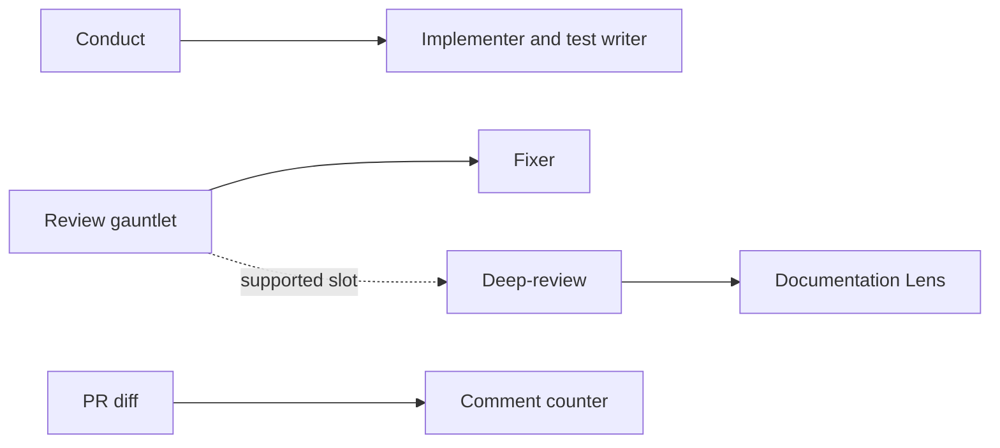
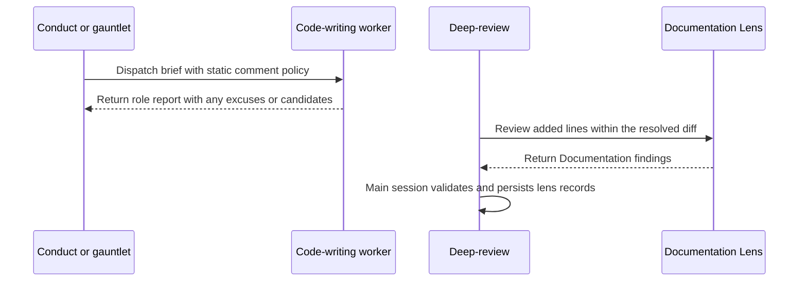

# Task: Comment hygiene for new code

**Status**: In Review
**Component**: meta
**Assigned to**: Claude
**Priority**: Medium
**Branch**: feature/comment-hygiene-and-decisions
**Created**: 2026-11-22
**Review Gates**: full

## Objective

Stop agent-written code from accumulating tautology, stale and excuse comments: state a why-only comment policy, inject it into the briefs of the subagents that write code (`conduct` implementer and test-writer, `review-gauntlet` fixer), have `deep-review` flag violating comments the diff adds, and measure added comment lines per PR.

## Context

Agents over-comment. Comments that restate the code, go stale, or excuse a hacky implementation cost review time and the hack propagates. The trigger was a post proposing a categorise-and-delete audit with a comment-banning lint rule.

Scoping decisions taken in the design discussion (2026-11-22):

- **Why-only, not a ban.** skein is mostly bash, jq and markdown, where a comment is often the only place the why lives. Exemptions: docstrings, linter and type pragmas, license headers, TODOs that link an issue (a full issue URL or `#N`).
- **New code only.** This plan covers comments an agent writes or touches from now on. A retroactive audit skill (plan C) is deferred and may never be built: untouched code is left alone.
- **No decisions folder here.** Decision-record comments stay in place and are surfaced as "decision candidates" in handbacks. The `docs/decisions/` folder, its record format, promotion at `/update-docs`, and the active-record checks are plan B (`20261122-feature-decision-records.md`).

Evidence from `~/Code/pipecat-ai/pipecat-code-mcp` (read-only analysis): its `docs/decisions/` held 2 records against 31 dev plans, at least 10 of which carry their own decision sections, because nothing triggered promotion. That is why record-writing is not bolted onto this plan.

The Codex conduct templates end in a role-specific JSON block. The Pi conduct worker request is assembled from skill prose. `scripts/check-prompt-parity.sh` selects skills through the whitespace-separated `MANAGED_SKILLS` environment variable or `.env`; the normal gate uses the full default list.

Land A before implementing B. A owns the new AGENTS.md policy, conduct worker briefs, gauntlet fixer policy, and deep-review Documentation Lens. B owns the AGENTS.md decisions layout and pointer, conduct terminal nudge, and architecture-lens inputs. Apply each plan's shape-test assertions, changelog entry and index row to the current versions of those shared files.

## Requirements

- AGENTS.md carries a short comment-policy block: comment only a non-obvious why; no comment that restates the code; no comment that excuses a hack (fix it, or report it); exemptions for docstrings, linter/type pragmas, license headers, and TODOs linking an issue.
- `conduct` implementer and test-writer briefs and the `review-gauntlet` fixer brief carry the same rule in all three mirrors, as static text. A touched comment may be deleted only if it is a tautology or stale and lies inside a hunk or function the change already touches. No sweeping cleanup. An excuse comment is never deleted silently: the fixer either repairs the hack, removes the excuse in the same change and claims the finding, or reports it as a design conflict through the existing quarantine path. A decision-record comment stays and is listed as a "decision candidate" in the handback.
- `deep-review`'s documentation lens flags comments ADDED by the diff only (never pre-existing ones), classified excuse (Important), tautology / stale / decision-candidate (Minor), in all three mirrors, at the lens's current model tier. The rules are lexical and adjacent-line signals on the added diff alone; stale means a symbol the same diff removes or renames. A decision candidate is advice only with the exact `Decision candidate:` prefix and severity Minor; otherwise it stays actionable.
- A script counts added comment lines from `git diff <base>...<head>` as a documented heuristic, and a baseline (per-PR counts and their median over the last ten merges) is recorded as a record only before the new rules take effect.
- Claude lands first and each mirror commits on its own (grilled 2026-11-22; see `### Review Waivers`): independent Codex and Pi sessions align to the committed Claude bytes. Preserve Claude's `${CLAUDE_PLUGIN_ROOT}` and Codex's `"$SKILL_DIR"` anchors. Require `just ci` in every Claude and Codex gauntlet fixer brief and retain the conductor's post-commit CI checks; Pi's fixer brief names the repository's required validation command generically.
- Keep `{{PHASE_GOAL}}` a zero-byte substitution when the slot is absent or empty (both conduct templates, line 9). The two rendered briefs may change only through the new static policy and handback guidance.

Out of scope: retroactive audit skill (plan C); lint or ratchet tooling; auto-fix deletion kinds in `auto-fix-common.sh`; any `docs/decisions/` folder, record format or promotion (plan B); changing any lens model tier.

## Review Focus

- Prompt byte parity: `scripts/check-prompt-parity.sh` checks the managed `rubric.md` and `*-prompt.md` files. The two conduct templates are byte-compared under the normal gate. The intentional fan-out normalisation and temporary lagging-mirror overrides do not apply to this change.
- `{{PHASE_GOAL}}` empty-string invariant and the SKILL.md substitution table (`conduct/SKILL.md:163,169`; Codex `:184,190`).
- Model tier: Claude's Documentation Lens uses haiku/low (`deep-review/SKILL.md:567`). Codex inherits the harness model and requests low reasoning when supported (`plugins/skein-codex/skills/deep-review/SKILL.md:104`). Preserve the tier census in `tests/parity/test-spawn-tiers.sh`.
- Severity vocabulary differs by mirror: Claude and Codex `Critical|Important|Minor`; Pi worker findings use `critical|important|suggestion` (`plugins/skein-pi/skills/deep-review/SKILL.md:22`) and the disk-first adapter maps them to `Critical|Important|Minor` (`:26`, Disk-first records and reconciliation). Pi is not checked by `scripts/check-prompt-parity.sh`; run `just pi-tests` for its contracts.
- Add policy outside the literal `<!-- BEGIN PROSE RULE BLOCK A -->` / `<!-- END PROSE RULE BLOCK A -->` and corresponding Block B anchors. Preserve those blocks and the shared `GENERIC FINDING SCHEMA AND MERGE` region byte-for-byte. The anchors exist only in the Claude and Codex deep-review files; Pi's `deep-review/SKILL.md` has none.
- The cleanup allowance must not contradict the repo rule "minimal impact": bounded to hunks and functions already touched.

## Implementation Checklist

Each mirror-spanning phase is split into `a` (Codex), `b` (Claude) and `c` (Pi) sub-phases, and every sub-phase names its executor in its first bullet.

**Execution protocol (grilled 2026-11-22): Claude lands first, and the letters do not give the run order.** The main Claude session hand-walks Phase 1, then 2b, 3b and 4b, running each phase's test command and committing each phase on its own. `conduct` is not used for this plan: it dispatches Claude subagents only and would send the `a` and `c` phases to the wrong executor. The user then hands this plan to an independent Codex session (phases 2a, 3a, 4a) and an independent Pi session (phases 2c, 3c, 4c). Each external session reads only its own phase blocks, aligns to the Claude bytes already committed on the branch, edits only the files its phase lists, runs its phase's test command and commits its own mirror. Run Phase 5 after both external sessions finish, then `review-gauntlet` by hand (`Review Gates: full`), then `/update-docs`. If an external session is unavailable, a Claude subagent applies that block and the commit message says so. This inverts AGENTS.md's Codex-first rule for these phases; see `### Review Waivers` in `## Findings`.

### Phase 1: Policy block, counter and baseline

**Impl files:** `AGENTS.md, scripts/count-added-comments.sh, justfile`
**Test files:** `tests/plugin/test-count-added-comments.sh`
**Test command:** `bash tests/plugin/test-count-added-comments.sh && just lint`
**Goal:** The counter is a documented heuristic that counts real added comment lines only; structural markers never count, so the baseline is comparable across runs.

- **Executor:** main Claude session, by hand.
- Add the comment-policy block to AGENTS.md under `Contributing Hygiene`, keep it to a handful of lines, and state the exemptions. Define the issue-link form once: a full issue URL or `#N`. The block carries the shared key phrases listed under Integration Seams.
- Write `scripts/count-added-comments.sh <base> [<head>]` (head defaults to `HEAD`): reads `git diff <base>...<head>`, counts added lines whose first non-blank character is `#` in `*.sh`, `*.py`, `*.jq` and `justfile`. It excludes shebang lines, linter/type pragmas (`# shellcheck`, `# noqa`, `# type:`), license-header lines (`# Copyright`, `# SPDX-`), TODO lines that carry an issue link, lines inside shell heredoc bodies, and HTML comments in markdown (structural `BEGIN`/`END` markers in this repo). Docstrings and multi-line strings in `.py` remain a known over-count, recorded in the method. Prints one integer, per-file with `--verbose`.
- Add a `just comment-count` recipe that prints the count for the current branch against `main`. The user compares it with the baseline median by hand at review time; nothing re-measures automatically.
- Test against a fixture repo created in a temp dir. Cases: added comment in `.sh`, `.py`, `.jq` and `justfile`; shebang; each pragma; HTML marker; license header; TODO with a URL and with `#N` and without a link; `#` line inside a heredoc; removed comment line; diff header lines; pre-existing comment untouched; explicit `<head>` argument over a merge commit; `--verbose` output. Register the fixture in `plugin-tests`.
- Baseline, before any rule lands: sample the counted lines of two recent merges and classify them to confirm the heuristic. Then run `scripts/count-added-comments.sh M^1 M` for each of the last ten merge commits `M` on first-parent history. Record the PR numbers, merge SHAs, the exact command, the per-PR counts and the median in `## Findings`. The baseline is a record only.

### Phase 2b: conduct briefs, Claude mirror

**Impl files:** `plugins/skein/skills/conduct/implementer-prompt.md, plugins/skein/skills/conduct/test-writer-prompt.md, plugins/skein/skills/conduct/SKILL.md, justfile`
**Test files:** `tests/gauntlet/test-comment-policy-briefs.sh, tests/gauntlet/fixtures/conduct-templates/implementer-prompt.md, tests/gauntlet/fixtures/conduct-templates/test-writer-prompt.md`
**Test command:** `bash tests/gauntlet/test-goal-injection.sh && bash tests/gauntlet/test-comment-policy-briefs.sh --mirror claude`
**Goal:** Static policy and handback guidance are the only changes to the no-goal rendering of the Claude templates. The Codex half later aligns to them byte-for-byte. (Claude mirror, lands first.)

- **Executor:** main Claude session, by hand (not `conduct`). Commit this phase on its own after the test command passes.
- First step, before any edit: save the current Claude templates verbatim as the pre-change fixtures under `tests/gauntlet/fixtures/conduct-templates/`.
- Ask for labelled excuses and decision candidates in the existing implementer `summary` and test-writer `coverage_summary` strings. Preserve each template's terminal fenced JSON block and role-specific keys (`conduct/SKILL.md` Step 4 and `schema.py`). Add the policy inside the dispatched Template block and outside the warned data blocks.
- Add a short "Comments" paragraph to both templates: the Requirements rule, verbatim wording shared by both templates.
- Notice sink (grilled 2026-11-22): the main conduct session prints notices from validated reports in the ordinary phase handback, and in autonomous mode as one notice block per phase boundary. That block is best-effort transcript text, not persisted, and may be lost on `--resume`. Add this guidance to the live SKILL.md handback path with no `conductor.py` or state change. Notices stay labelled text in the existing summary strings because the terminal JSON fields are pinned. B owns the successful terminal seam.
- Create `tests/gauntlet/test-comment-policy-briefs.sh` with a `--mirror claude|codex|both` option (default `both`). It asserts the shared key phrases in AGENTS.md and the selected mirror's templates, the existing report fields and the handback guidance. For the no-goal rendering it substitutes an empty string for `{{PHASE_GOAL}}` in each Template block and diffs the result against the pre-change fixtures. The diff may contain only added lines, each belonging to the Comments paragraph or the handback sentence, and no removed lines. Register the test in `gauntlet-tests`. Retain `test-goal-injection.sh`.

### Phase 2a: conduct briefs, Codex mirror

**Impl files:** `plugins/skein-codex/skills/conduct/implementer-prompt.md, plugins/skein-codex/skills/conduct/test-writer-prompt.md, plugins/skein-codex/skills/conduct/SKILL.md`
**Test files:** `tests/gauntlet/test-comment-policy-briefs.sh`
**Test command:** `just parity-tests && bash tests/gauntlet/test-goal-injection.sh && bash tests/gauntlet/test-comment-policy-briefs.sh --mirror both`
**Goal:** Static policy and handback guidance are the only changes to the no-goal rendering. Both templates stay byte-identical across Claude and Codex. (Codex mirror, aligned to the committed Claude half.)

- **Executor:** an independent Codex session started by the user with this plan and this phase block (or `codex:rescue` from a Claude session). It edits only the files listed above, byte-verifies against `git diff`, runs the test command and commits the Codex half on its own.
- Align to the bytes committed in phase 2b: copy shared wording and both templates verbatim. Codex keeps `"$SKILL_DIR"` path anchors; never collapse them with Claude's `${CLAUDE_PLUGIN_ROOT}`. Surface the same notices in the live Codex SKILL.md handback path.
- Keep Codex lifecycle in `conduct/worker-dispatch.md`: every first spawn and retry uses the full rendered prompt as the structured `spawn_agent` message, a unique task name, `fork_turns="none"` and medium reasoning when supported. Collect the delivered final report and terminal status. Missing delegation support hard-stops conduct. Implementation under conduct requires a sandbox that permits the declared files and the index operations its workers use.
- The `--mirror both` run asserts the Codex Template blocks, report fields and handback guidance, and Claude/Codex byte identity of both templates. The existing `test-goal-injection.sh` statically checks the Claude templates and skill; retain it.

### Phase 2c: conduct briefs, Pi mirror

**Impl files:** `plugins/skein-pi/skills/conduct/SKILL.md`
**Test files:** `tests/pi/test_orchestration_routes.py`
**Test command:** `just pi-tests`
**Goal:** The static comment rule reaches both `skein_worker` role prompts and their retries, outside untrusted snapshots, and notices surface in the `Handback contract`. (Pi mirror.)

- **Executor:** an independent Pi session started by the user (interactive, or `pi -p --no-session`) with this plan and this phase block. It edits only the files listed above, and the main session or user verifies against `git diff`, runs the test command and commits the Pi half separately (commit per platform). The plan does not assume an unattended editing run.
- Pi has no templates: add the same rule to the worker-request prose in `plugins/skein-pi/skills/conduct/SKILL.md` (the worker-boundary paragraph under `Preflight and state`; `Phase loop` steps 2–3). Both roles use `skein_worker` with only `role` and `prompt`; carry the static rule in `prompt`, outside untrusted snapshots, including retries. Pi has no pinned implementer/test-writer JSON report fields equivalent to `coverage_summary`: keep notices in the existing generic envelope `summary` or proposal/report prose, validate them and surface them in `Handback contract`. No new typed-tool fields or extension schema are needed. Main session alone applies approved patches, runs tests and commits; do not import Claude/Codex worker-write or index operations.
- Extend `tests/pi/test_orchestration_routes.py::test_conduct_is_pi_native_sequential_and_main_owned` for both role requests, retry policy and notice handback. Preserve its no-tools, explicit-approval and main-owned-write assertions.
- Apply the shared wording committed in phase 2b inside the Pi mirror's own routes. Pi is not covered by `check-prompt-parity.sh`, so the `tests/pi` assertions are its only guard.

### Phase 3b: review-gauntlet fixer brief, Claude mirror

**Impl files:** `plugins/skein/skills/review-gauntlet/SKILL.md`
**Test files:** `tests/gauntlet/test-gauntlet-skill-shape.sh`
**Test command:** `just gauntlet-tests`
**Goal:** The comment rule is carried unconditionally into every fixer brief, alongside the existing blast-radius and `just ci` requirements, and never widens a fix beyond its finding. (Claude mirror, lands first.)

- **Executor:** main Claude session, by hand (not `conduct`). Commit this phase on its own after the test command passes.
- Add the comment constraint to the Claude fixer Guardrails 5–8, for every fixer dispatch.
- Keep deletion within the fix's existing hunk or function and blast radius. Excuse route (grilled 2026-11-22): the fixer either repairs the underlying hack, removes the excuse in the same change and claims the finding, or cannot repair it and reports it as a design conflict through the existing quarantine path (no new counter). An excuse is never deleted silently. A decision candidate is information for the operator and does not claim a fix or create a design delta. Preserve `claimed`, `design_deltas` and the one-report-per-round sink.
- Put the new shape assertions in a Claude-only function so `just gauntlet-tests` stays green until 3a adds the Codex counterpart. Assert both excuse branches and the shared key phrases.

### Phase 3a: review-gauntlet fixer brief, Codex mirror

**Impl files:** `plugins/skein-codex/skills/review-gauntlet/SKILL.md`
**Test files:** `tests/gauntlet/test-gauntlet-skill-shape.sh`
**Test command:** `just gauntlet-tests`
**Goal:** The comment rule is carried unconditionally into every fixer brief, alongside the existing blast-radius and `just ci` requirements, and never widens a fix beyond its finding. (Codex mirror, aligned to the committed Claude half.)

- **Executor:** an independent Codex session started by the user with this plan and this phase block (or `codex:rescue`). It edits only the files listed above, byte-verifies against `git diff`, runs the test command and commits the Codex half on its own.
- Align to the bytes committed in phase 3b: copy shared wording verbatim. Codex keeps `"$SKILL_DIR"` path anchors; never collapse them with Claude's `${CLAUDE_PLUGIN_ROOT}`.
- Add the comment constraint to every fixer brief's Constraints, alongside Codex Guardrails 5–8 (`SKILL.md:1025-1047`). It applies to full, quick-mode, resumed and retry dispatches through `review-gauntlet/worker-dispatch.md`. Quick runs native gate 1 once, can dispatch a substantive fixer and does not run deep-review. Include the excuse route from 3b.
- Extend the shape coverage with the Codex counterpart of the 3b assertions and the common-brief and Codex dispatch-route checks. Preserve the terminal design-delta sink and report shape guards exercised by `gauntlet-tests`.

### Phase 3c: review-gauntlet fixer brief, Pi mirror

**Impl files:** `plugins/skein-pi/lib/review_gauntlet.py`
**Test files:** `tests/pi/test_gate_capabilities.py`
**Test command:** `just pi-tests`
**Goal:** Pi's fixer request carries the static comment rule and gains a generic validation instruction, and never widens a fix beyond its finding. (Pi mirror.)

- **Executor:** an independent Pi session started by the user (interactive, or `pi -p --no-session`) with this plan and this phase block. It edits only the files listed above, and the main session or user verifies against `git diff`, runs the test command and commits the Pi half separately (commit per platform).
- Pi-specific boundary: `fixer_request()` is at lines 133–172, but currently has neither a validation instruction nor a design-delta sink. Add one generic instruction, "the repository's required validation command" (never the literal `just ci`, which the Requirements scope to Claude and Codex), alongside the new static comment rule; the no-tools fixer proposes tests and the main session executes the validation after approved edits. Preserve `validate_fixer_result()`'s exact artifact keys (`schema_version`, `status`, `summary`, `claimed`, `patches`, `blast_radius`): put notices in `summary`, never add `design_deltas` or claim candidates as fixes. The design-delta preservation requirement above applies to Claude/Codex only; Pi does not gain that feature.
- Pi excuse route: the fixer either repairs the hack, removes the excuse and claims the finding, or reports it in `summary`; the main session then lists it for the operator and excludes it from later fixer batches.
- Extend `tests/pi/test_gate_capabilities.py::test_fixer_route_is_pi_native_and_rejects_auto_fix` to inspect the generated prompt/constraints, and its fixer-result tests to accept summary notices while rejecting extra proposal keys and candidate claims outside the actionable batch. `tests/pi/test_review.py` tests review-plan, not this fixer.
- Apply the shared wording committed in phase 3b inside the Pi mirror's own routes. Pi is not covered by `check-prompt-parity.sh`, so the `tests/pi` assertions are its only guard.

### Phase 4b: deep-review documentation lens, Claude mirror

**Impl files:** `plugins/skein/skills/deep-review/SKILL.md, plugins/skein/skills/review-gauntlet/SKILL.md`
**Test files:** `tests/lenses/test-lens-skill-shape.sh, tests/gauntlet/test-gauntlet-skill-shape.sh, tests/lenses/fixtures/documentation-lens.diff`
**Test command:** `just lens-tests && just parity-tests && just gauntlet-tests`
**Goal:** The Documentation Lens uses lexical and adjacent-line signals on the added diff only, with no whole-file evidence step. Every mirror keeps its current routing tier. (Claude mirror, lands first.)

- **Executor:** main Claude session, by hand (not `conduct`). Commit this phase on its own after the test command passes.
- Add to the documentation lens "Look for": excuse (Important): an added comment containing hack, workaround, temporary, "for now", or a TODO without an issue link, on or next to the line it excuses; tautology (Minor): an added comment whose words restate the identifiers of the adjacent line; stale (Minor): an added comment naming a symbol that the same diff removes or renames; decision candidate (Minor, informational): an added comment that states a choice with a lexical marker (`because`, `instead of`, `rather than`, `chose`) next to the line implementing it.
- Use existing category `Documentation`, location at the added line and the existing severity vocabulary. Keep exemptions for pre-existing comments, docstrings, pragmas, license headers and issue-linked TODOs. Keep Claude's existing "Minor typos in comments" ignore line and its haiku/low routing.
- Edit Claude's Documentation Lens in `SKILL.md` outside the literal Block A/Block B anchors. Give informational decision candidates a stable `Decision candidate:` summary prefix under `Documentation`.
- Advice seam (grilled 2026-11-22): a finding becomes advice only when it carries the exact `Decision candidate:` prefix and severity Minor. Gauntlet splits advice off BEFORE `reconcile-findings.sh` runs, so the gate status, `--count`, `--present-keys`, the annotated envelope and the fixer batch all see only actionable findings and a same-line excuse is never merged into a candidate. A near-miss prefix stays actionable and is also shown to the operator. Advice is printed once, in the round's terminal message. `render-report.py` and `convergence-ledger.sh` stay unchanged. Leave the native quick route unchanged. The seam is prose-only; assert it with exact-phrase shape assertions that name the malformed-prefix and same-line excuse-plus-candidate cases.
- Commit the fixture `tests/lenses/fixtures/documentation-lens.diff` with an excuse, a tautology, a candidate and a pre-existing comment, plus the expected findings beside it. Extend `test-lens-skill-shape.sh` to assert the four class names and severities, added-only scope, the exemptions, the `Decision candidate:` prefix and Claude's retained typo line. The sampled model run is Phase 5.

### Phase 4a: deep-review documentation lens, Codex mirror

**Impl files:** `plugins/skein-codex/skills/deep-review/SKILL.md, plugins/skein-codex/skills/review-gauntlet/SKILL.md`
**Test files:** `tests/lenses/test-lens-skill-shape.sh, tests/gauntlet/test-gauntlet-skill-shape.sh`
**Test command:** `just lens-tests && just parity-tests && just gauntlet-tests`
**Goal:** The Documentation Lens uses lexical and adjacent-line signals on the added diff only. Every mirror keeps its current routing tier. (Codex mirror, aligned to the committed Claude half.)

- **Executor:** an independent Codex session started by the user with this plan and this phase block (or `codex:rescue`). It edits only the files listed above, byte-verifies against `git diff`, runs the test command and commits the Codex half on its own.
- Align to the lens rule, `Decision candidate:` prefix and advice-seam wording committed in phase 4b. Codex keeps `"$SKILL_DIR"` anchors. Edit Codex's Documentation Lens in `SKILL.md` (lines 292–311 before Block A); Codex has no "Minor typos in comments" line and its ignore rule concerns code behaviour. The identical `rubric.md` files already define the finding contract.
- Use the existing Codex spawned and sequential lens contracts and keep the disk-first writer, collector and location shape intact. Preserve the literal Block A/Block B anchors and the shared `GENERIC FINDING SCHEMA AND MERGE` region byte-for-byte. Keep the tier unchanged.
- Add the Codex counterpart of the 4b lens and gauntlet shape assertions. Exercise the advice seam where the deep-review slot is supported.

### Phase 4c: deep-review documentation lens, Pi mirror

**Impl files:** `plugins/skein-pi/skills/deep-review/SKILL.md, plugins/skein-pi/skills/deep-review/rubric.md, plugins/skein-pi/skills/review-gauntlet/SKILL.md, plugins/skein-pi/lib/review_gauntlet.py`
**Test files:** `tests/pi/test_deep_review.py, tests/pi/test_gate_capabilities.py`
**Test command:** `just pi-tests`
**Goal:** The Documentation Lens uses lexical and adjacent-line signals on the added diff only, and the candidate advice seam projects actionable-only gate state. Every mirror keeps its current routing tier. (Pi mirror.)

- **Executor:** an independent Pi session started by the user (interactive, or `pi -p --no-session`) with this plan and this phase block. It edits only the files listed above, and the main session or user verifies against `git diff`, runs the test command and commits the Pi half separately (commit per platform).
- Pi evidence and routing: extend deep-review's main-session packet preparation to give the documentation worker added-line coordinates and adjacent code. The stale class needs only symbols the same diff removes or renames, which the diff already shows; no symbol inventory or file lookup is needed. Keep the existing plan-target route: without an actual diff, do not invent added-comment findings. Preserve Pi's user-selected model and per-launch approval; haiku/low is Claude's routing, not Pi's.
- Pi candidate seam: keep raw Documentation findings in deep-review state/report. In gauntlet, separate into operator advice only `Documentation` findings with the exact `Decision candidate:` prefix and Pi severity `suggestion` (Minor), before constructing the actionable fixer batch and ledger projection. A near-miss prefix stays actionable and is shown to the operator. `PiLedger._validate_round()` currently counts every gate finding and rejects `passed` gates containing findings; supply actionable-only projected gate findings/status/counts to the ledger, while retaining the original gate envelope and advice in the report. Advice-only input must not trigger a fixer or another round, and must not erase skipped/degraded coverage or claim that the raw review had no findings. No worker/result schema expansion is needed.
- Projection owner (grilled 2026-11-22): `plugins/skein-pi/lib/review_gauntlet.py` gains one pure function that splits advice from actionable findings and returns the projected gate status and counts. `pi_ledger.py` stays unchanged (read-only context: `PiLedger` at `:50`, `_validate_round` at `:117`); the Pi review-gauntlet `SKILL.md` passes the projected outcome to `PiLedger.append`.
- Extend `tests/pi/test_deep_review.py` for packet contents, added-only locations, exemptions and removed/renamed-symbol staleness from the diff alone; extend `tests/pi/test_gate_capabilities.py` for mixed and advice-only batches, the projection function, projected ledger counts, skipped/degraded gates with advice, the malformed-prefix and same-line excuse-plus-candidate cases, and a severity round trip (an excuse at `important` and a prefixed candidate at `suggestion` map to Important and Minor with the prefix unchanged). Use bounded synthetic packets/results to test adapter contracts.
- Apply the shared wording committed in phase 4b inside the Pi mirror's own routes. Pi is not covered by `check-prompt-parity.sh`, so the `tests/pi` assertions are its only guard. The Pi `deep-review/SKILL.md` has no Block A/B anchors; Pi's `rubric.md` carries the lens scope.

### Phase 5: Verify, lens sample, docs

**Impl files:** `CHANGELOG.md, docs/dev_plans/README.md`
**Test files:** `tests/plugin/test-count-added-comments.sh`
**Test command:** `just ci`
**Goal:** The full CI is green on the branch and the Documentation Lens sample is reviewed by the user.

- Run after both external sessions have committed. Run `just ci` in a background job and wait for the exit status; record its duration in `## Findings`.
- Lens sample (the sampled part of the lens acceptance criterion): run the Documentation Lens on `tests/lenses/fixtures/documentation-lens.diff` three times per mirror. Pass rule: in each of the three runs the excuse is flagged Important, the tautology Minor, and the pre-existing comment not flagged. Also sample a few recent real diffs. Record results in `## Findings`, report noise or missed excuses to the user as a tier question, and keep the tier unchanged. The user reviews the sample.
- Update `CHANGELOG.md` and the `docs/dev_plans/README.md` row (draft).
- Record in `## Findings` that even after B lands, a candidate reaches promotion only if a person copies it into the plan's `## Findings` or records it in `### Architecture Decisions`.

After Phase 5, run `review-gauntlet` by hand and let it converge, then run `/update-docs`. Gauntlet fix commits can change what the CHANGELOG entry must say, so this step sits outside the phases.

## Technical Specifications

### Files to Modify

All paths verified to exist by Explore (2026-11-22):

- `AGENTS.md` — add comment-policy block (existing headings: Contributing Hygiene at line 161, Skill Workflow at 172).
- `plugins/skein/skills/conduct/implementer-prompt.md`, `test-writer-prompt.md` — add Comments paragraph and handback lists.
- `plugins/skein-codex/skills/conduct/implementer-prompt.md`, `test-writer-prompt.md` — same, byte-identical to Claude.
- `plugins/{skein,skein-codex}/skills/conduct/SKILL.md` — phase report and handback guidance, including the autonomous-mode notice block. B owns the terminal completion nudge.
- `plugins/skein-pi/skills/conduct/SKILL.md` — add the rule to the worker-request prose (no templates exist).
- `plugins/skein/skills/review-gauntlet/SKILL.md`, `plugins/skein-codex/skills/review-gauntlet/SKILL.md` — add fixer constraint.
- `plugins/skein-pi/lib/review_gauntlet.py` — add to `fixer_request()` constraints (line 133) and one pure advice-projection function. `plugins/skein-pi/lib/pi_ledger.py` stays unchanged.
- `plugins/skein/skills/deep-review/SKILL.md`, `plugins/skein-codex/skills/deep-review/SKILL.md`, `plugins/skein-pi/skills/deep-review/{SKILL.md,rubric.md}` — Documentation Lens rule and Pi bounded evidence preparation.
- `plugins/{skein,skein-codex,skein-pi}/skills/review-gauntlet/SKILL.md` — split advice off before reconcile and keep informational candidates out of the fixer queue, gate counts and ledger. `render-report.py` and `convergence-ledger.sh` stay unchanged.
- `tests/gauntlet/test-gauntlet-skill-shape.sh`, `tests/lenses/test-lens-skill-shape.sh`, `tests/pi/test_gate_capabilities.py`, `tests/pi/test_deep_review.py`, `tests/pi/test_orchestration_routes.py` — extend assertions at the actual Pi fixer, ledger, lens and conduct seams.
- `justfile` — register the counter and brief tests; add the `comment-count` recipe. `CHANGELOG.md`, `docs/dev_plans/README.md` — A's entries only.

### New Files to Create

- `scripts/count-added-comments.sh` — added-comment-line counter.
- `tests/plugin/test-count-added-comments.sh` — fixture-based counter test.
- `tests/gauntlet/test-comment-policy-briefs.sh` — asserts the shared key phrases, slot isolation, the no-goal rendering against the fixtures and Claude/Codex parity (`--mirror claude|codex|both`).
- `tests/gauntlet/fixtures/conduct-templates/{implementer,test-writer}-prompt.md` — pre-change Claude templates, saved before the Phase 2b edit.
- `tests/lenses/fixtures/documentation-lens.diff` (plus expected findings) — fixture diff for the lens sample.

### Architecture Decisions

- Decision (grilled 2026-11-22): why-only comment rule with exemptions, not a ban. Rejected: full ban (deletes the why that bash and markdown comments carry).
- Decision (grilled 2026-11-22): a non-obvious decision is recorded once, as a short inline why or, once plan B lands, as a record; prefer a record for cross-file or long-lived decisions.
- Decision (grilled 2026-11-22): new code only; untouched code is not audited, so the retroactive audit skill (plan C) is deferred.
- Decision (grilled 2026-11-22, accepted): this plan does not create `docs/decisions/`. Decision-record comments are flagged as candidates in handbacks. Rationale: a folder has no consumer until plan B's checks exist, and the record format is best designed once with those consumers in view. Rejected: create folder and format here with flag-only (half-built), or full migration by mechanical-tier agents (judgment at volume, widens every PR).
- Decision (grilled 2026-11-22, accepted): the deep-review documentation lens stays at haiku/low; the rules are written as lexical and adjacent-line signals. If sampling shows it cannot hold them, surface the tier question to the user.
- Resolved by lookup (not a judgment call): the counter ignores HTML comments, including the structural markers `<!-- BEGIN GENERIC LENS PROMPT: architecture -->` and `<!-- BEGIN PROSE RULE BLOCK A -->`, as well as shebang and pragma lines.
- Resolved (user-specified 2026-11-22): non-excuse findings are Minor, excuse is Important; Pi's `suggestion` maps to Minor (`skein-pi/skills/deep-review/SKILL.md:26`).
- Decision (grilled 2026-11-22, accepted; beside the tier decision above): the lens needs no whole-file evidence. Stale is restricted to symbols the same diff removes or renames, and excuse and decision-candidate cues are lexical and adjacent-line only, so haiku/low and the diff-only `{{DIFF}}` input stay sufficient. Rejected: a whole-file evidence step for Claude and Codex (adds cost and a higher tier question).
- Decision (grilled 2026-11-22, accepted): `Decision candidate:` is advice only with the exact prefix AND severity Minor, split off before `reconcile-findings.sh` on all three mirrors. A near-miss prefix stays actionable and is also shown to the operator. Rejected: case-insensitive match or treating a near miss as advice (drops real findings).
- Decision (grilled 2026-11-22, accepted): Pi's advice projection is one pure function in `review_gauntlet.py`; `pi_ledger.py` stays unchanged and the Pi gauntlet `SKILL.md` passes the projected outcome to `PiLedger.append`.
- Decision (grilled 2026-11-22, accepted): the Claude and Codex advice split is prose-only in the gauntlet `SKILL.md` files, before reconcile. The operator sees advice in the round's terminal message; `render-report.py`, `convergence-ledger.sh` and the report-shape tests are untouched. Rejected: a shared script or a new report section (new byte-identical surface).
- Decision (grilled 2026-11-22, accepted): an excuse finding is repaired and removed in the same fix, or reported as a design conflict through the existing quarantine path. Rejected: a dedicated excuse quarantine counter.
- Decision (grilled 2026-11-22): Claude lands first and each mirror commits separately; the user runs independent Codex and Pi sessions afterwards. `conduct` is not used for this plan. Rejected: Codex-first with one shared commit (the AGENTS.md convention), recorded as a waiver.
- Decision (grilled 2026-11-22, accepted): the counter takes `<base> [<head>]`, excludes heredoc bodies, license headers and issue-linked TODOs, and is a documented heuristic. The baseline is taken in Phase 1 with `git diff M^1 M` per merge for the last ten merges, recorded as per-PR counts and a median, as a record only. `just comment-count` prints the current-branch count; the user compares it by hand.

### Dependencies

- No new dependencies. The counter uses Bash and git; Pi retains its existing TypeScript extension/Python helper runtime. The repo-root `package.json` is named `skein-pi` and lists the installed skill paths; there is no `plugins/skein-pi/package.json`.

### Integration Seams

| Seam | Writer (task) | Caller (task) | Contract |
|------|---------------|---------------|----------|
| Policy wording | AGENTS.md block (Phase 1) | conduct and gauntlet briefs (Phases 2b–3c), deep-review rule (Phases 4b–4c) | One wording for exemptions and the cleanup bound; `test-comment-policy-briefs.sh` asserts the shared key phrases below, not paraphrases, and `tests/pi` repeats the same list as a constant. |
| Decision candidates | Conduct and gauntlet handbacks (Phases 2b–3c), Documentation Lens (Phases 4b–4c) | Operator, then plan B `/update-docs` after manual capture | Existing summary and finding fields carry advice. Exact `Decision candidate:` prefix plus Minor is advice, split before reconcile (Pi: before the ledger projection). The operator chooses what to copy into the plan. |
| Byte parity | Claude conduct templates (Phase 2b) | Codex conduct templates (Phase 2a, aligned afterwards) | Identical bytes; `check-prompt-parity.sh` fails otherwise, so the parity gate first runs in 2a. |

**Shared key phrases** (defined once; asserted wherever an artifact carries the rule): `non-obvious why`, `restates the code`, `excuses a hack`, `docstrings`, `linter and type pragmas`, `license headers`, `TODOs that link an issue` (a full issue URL or `#N`), `inside a hunk or function the change already touches`, `Decision candidate:`.

## Architecture & Call Flow

| Step | Trigger | Enters context | Cleared/persisted | Turn boundary |
|------|---------|----------------|-------------------|---------------|
| 1 | Worker dispatch or retry | Full role brief and bounded untrusted work context | Fresh worker context, existing report on return | Final output and terminal status |
| 2 | Deep-review dispatch | Diff, checklist and focus | Existing per-attempt lens stream, candidates reported as advice | Collector reconciles completed attempts |
| 3 | Baseline (Phase 1) or `just comment-count` | Each merge's `M^1 M` diff, or the branch against `main` | Per-PR counts, median and method in Findings; branch count printed | Counter exits |

## Testing Notes

### Test Approach
- [ ] Counter: fixture repo covering every case in Phase 1, including heredoc, license header, TODO link forms, removed lines and an explicit head.
- [ ] Briefs: static rule and handback guidance reach both mirrors' rendered requests. The no-goal substitution is diffed against the committed pre-change fixtures and adds only the Comments paragraph and handback sentence.
- [ ] Fixer: constraint and both excuse-route branches present in the Claude and Codex SKILL.md and in Pi `fixer_request()` output; Pi names the validation command generically.
- [ ] Lens: shape tests (four classes, severities, added-only scope, exemptions, prefix), prose-rule parity and tier census pass. The sampled run (Phase 5) uses the fixture diff, three runs per mirror, and a user review. Pi tests cover projection, severity round trip and the malformed-prefix and same-line excuse cases.
- [ ] Reconcile both harnesses' plan reviews before implementation, as required by AGENTS.md.
- [ ] `just ci` green.

### Test Results
- [ ] All existing tests pass
- [ ] New tests added and passing
- [ ] Lens sample reviewed by the user

### Edge Cases Tested
- [ ] Wording assertion on the briefs and rubric text: deletion is bounded to a hunk or function the change already touches.
- [ ] Wording assertion: a TODO is exempt only with a full issue URL or `#N`; the counter fixture covers both forms and the unlinked case.
- [ ] Docstring and pragma lines never flagged or counted.

## Acceptance Criteria

- AGENTS.md states the policy and exemptions in a short block.
- Claude and Codex conduct templates carry identical comment text, the empty-goal rendering is otherwise unchanged, and `just parity-tests` passes.
- The gauntlet fixer constraint is present in all three mirrors and tested.
- Static part, proved by tests: the lens text carries the four classes, severities, added-only scope, exemptions and prefix in all three mirrors. Sampled part, accepted by the user: on the committed fixture diff, in three of three runs per mirror, the lens flags the excuse as Important and the tautology as Minor and does not flag the pre-existing comment.
- The counter returns the expected integer on its fixture, and the per-PR baseline counts and median for the last ten merges are recorded in Findings before the rules take effect.
- No model tier changes; `test-spawn-tiers.sh` passes.
- Code reviewed and approved
- Tests passing (`just ci`)
- Documentation updated

<!-- reviewed: 2026-11-24 @ fefa05c1895d88837c90b7ed099ea08d614c0494 -->

<!-- /review-plan writes the marker line above. Everything below is the workspace: edits here do NOT invalidate the marker. -->

## Progress

- [x] Phase 1: Policy block, counter and baseline
- [x] Phase 2b: conduct briefs (Claude)
- [x] Phase 3b: review-gauntlet fixer brief (Claude)
- [x] Phase 4b: deep-review documentation lens (Claude)
- [x] Phase 2a: conduct briefs (Codex session)
- [x] Phase 3a: review-gauntlet fixer brief (Codex session)
- [x] Phase 4a: deep-review documentation lens (Codex session)
- [x] Phase 2c: conduct briefs (Pi session)
- [x] Phase 3c: review-gauntlet fixer brief (Pi session)
- [x] Phase 4c: deep-review documentation lens (Pi session)
- [x] Phase 5: Verify, lens sample, docs
- [x] After Phase 5: hand-run review-gauntlet (stopped at round 6, non-converge, 9 Minor findings open), then /update-docs

## Findings

- Pi execution (2c, 3c, 4c; 2026-11-23): `just pi-tests` passed per phase (170, 171, 180 tests respectively); scoped Python files also pass `ruff format` and `ruff check`. A repeat 4c run hit a transient timeout in untouched `tests/pi/test_dispatcher.py::test_real_pi_success` (179 passed, 1 failed); the unchanged full-suite rerun passed all 180 in 40.54s. No timeout or dispatcher changes were made. Tests cover static prompt contracts and bounded synthetic persistence/projection, not live Documentation Lens quality; model sampling remains Phase 5. No implementation-scope deviation; concurrent Codex edits were left untouched.

- Pi review (2026-11-22): Confirmed — conduct has no prompt templates; its two mechanical roles use approved no-tools `skein_worker` requests described in SKILL.md, and the main session owns edits/tests/commits; corrected the imprecise line reference and added explicit retry/handback tasks and orchestration-route tests.
- Claude review (2026-11-22): Split phases 2–4 by mirror (a Codex, b Claude, c Pi) so each executor gets a scoped block; shared tests stay with a/b, tests/pi with c; added plugins/skein-pi/lib/review_gauntlet.py to 4c impl files because the candidate-seam bullet edits it. All original bullets preserved verbatim; no decision touched.
- Pi review (2026-11-22): Corrected — scoped terminal role JSON fields to Claude/Codex; Pi notices use the generic envelope summary or proposal/report prose without new tool fields.
- Pi review (2026-11-22): Confirmed — fixer_request is in lib/review_gauntlet.py:133–172 and returns only role/prompt; corrected fixer test ownership from test_review.py to test_gate_capabilities.py and required generated-request/result coverage.
- Pi review (2026-11-22): Wrong for Pi — the shared preservation wording mentions design_deltas and existing just-ci constraints, but Pi has neither a design-delta field/sink nor that instruction; retained Claude/Codex text and added a Pi-specific boundary using summary notices, exact six-key proposals and main-session CI.
- Pi review (2026-11-22): Confirmed — deep-review's rubric owns lens scope, category is Documentation, severity maps critical/important/suggestion to Critical/Important/Minor, and workers cannot inspect files; corrected the severity citation and added packet/symbol-evidence and no-diff requirements.
- Pi review (2026-11-22): Corrected — call-flow diagram now has the lens return findings and the main session persist them; a no-tools Pi worker cannot write its attempt stream.
- Pi review (2026-11-22): Added — PiLedger counts all findings and rejects passed-with-findings, so specified an actionable-only ledger projection with raw advice retained in reports and tests for advice-only/mixed/degraded routes.
- Pi review (2026-11-22): Confirmed — prompt-parity excludes Pi; added just pi-tests and Pi-specific conduct, fixer and lens assertions rather than relying on Claude/Codex parity.
- Pi review (2026-11-22): Corrected — root package.json is the skein-pi manifest, not a manifest under plugins/skein-pi; no dependency or skill registration changes are needed.
- Pi review (2026-11-22): Confirmed — A owns worker/comment policy and candidate advice, while B consumes only manually captured plan decisions; no Pi scope conflict between plans after the evidence and handback clarifications.
- Pi review (2026-11-22): Unverifiable — future lens quality, generated-request compliance and end-to-end convergence require implementation and an approved runtime exercise; no workers or full suites were run. The protected haiku/low decision is retained as Claude-specific, not a Pi tier override.
- Codex review (2026-11-22): Confirmed — both conduct template pairs exist and match byte-for-byte, including the line 9 goal contract.
- Codex review (2026-11-22): Confirmed — Codex conduct Step 3 has the goal substitution table at 184 and applies the same substitution on respawn at 190.
- Codex review (2026-11-22): Confirmed — the Codex gauntlet's Guardrail 5 at 1025–1029 requires full CI in the brief and after commits.
- Codex review (2026-11-22): Confirmed — Codex deep-review uses Critical/Important/Minor and Pi maps suggestion to Minor.
- Codex review (2026-11-22): Confirmed — the cited shape, goal, report, sink, tier, prose-rule and state tests exist. Their static or runtime roles are distinguished in the relevant phases.
- Codex review (2026-11-22): Corrected — paired Claude and Codex changes in one commit and kept independent Pi/docs work separate to avoid contradictory commit instructions.
- Codex review (2026-11-22): Corrected — narrowed the parity claim to the managed artifacts and conduct pair, documented MANAGED_SKILLS selection and named the literal protected anchors.
- Codex review (2026-11-22): Corrected — preserved a zero-byte absent goal while allowing static policy and handback additions in the rendered template.
- Codex review (2026-11-22): Corrected — put notices in implementer summary and test-writer coverage_summary so Codex parses the same terminal JSON.
- Codex review (2026-11-22): Corrected — identified Documentation Lens lines 292–311 and the Claude-only typo ignore, and removed the Codex-only rubric edit because the shared rubric already defines the contract.
- Codex review (2026-11-22): Corrected — documented Codex's inherited model and low reasoning separately from Claude's haiku/low. The grilled tier decision remains intact.
- Codex review (2026-11-22): Corrected — described the worker and reporting seams so candidates can reach B only through deliberate capture in the plan.
- Codex review (2026-11-22): Corrected — replaced the Claude-specific Monitor instruction with background execution and the Codex conduct timeout requirement.
- Codex review (2026-11-22): Added — pinned the clean-context dispatch and sandbox requirements to worker-dispatch.md, where Codex keeps runtime arguments apart from shared templates.
- Codex review (2026-11-22): Added — passed validated notices through the phase handback because editing the templates alone changes only worker output.
- Codex review (2026-11-22): Added — covered quick, full, resumed and retry fixers while keeping claim and design-delta schemas intact.
- Codex review (2026-11-22): Added — kept informational candidates out of gauntlet fixing and convergence counts so flagged comments stay in place.
- Codex review (2026-11-22): Added — assigned CI fixture wiring and Codex template assertions, and kept existing parity and tier checks as guards.
- Codex review (2026-11-22): Added — separated the plans' ownership and recorded the conditional call flow and both-harness review prerequisite.
- Codex review (2026-11-22): Unverifiable — this source audit cannot establish live codex:rescue availability or Documentation Lens quality on real diffs.
- Claude review-plan (2026-11-22): addressed all 42 findings in one pass. Grilled: lens scope (#6), prefix rule (#7, #13), Pi projection owner (#8), Claude/Codex advice seam (#9, #20), excuse route (#15), driving model and ordering (#14, #16, #29), baseline method (#4, #10, #11, #21, #32, #39). Applied as standard fixes: sub-phase gates and ownership (#17, #22, #35, #36, #37, #40), testability (#2, #3, #18, #19, #41, #42), Pi validation wording (#27, #31), small corrections (#23, #28, #30, #33, #34, #38), and executor assumptions (#24, #25, #26 dissolve because the user runs Codex and Pi sessions and conduct is not used). Lens sampling moved to Phase 5; `test_codex_agent_api.py` dropped (no stated assertion).
- Open measurement: the `just ci` duration is recorded in Phase 5 rather than guessed.
- Phase 1 baseline (2026-11-23), record only. Command: `scripts/count-added-comments.sh M^1 M` for each of the last ten merge commits `M` on first-parent history of `main` (`git log --first-parent --merges -10`). Counts: #64 (`a6d5ed9`) 1604; #63 (`6b513e5`) 34; #62 (`92b557a`) 33; #61 (`cae4f8b`) 13; #60 (`a9f1f64`) 26; #58 (`752694e`) 2; #57 (`ccb3273`) 277; #55 (`b914a8a`) 674; #54 (`c2ce81e`) 11; #53 (`032ea0c`) 0. Median 29.5, mean 267.4, sum 2674 (#61 read 14, mean 267.5 and sum 2675 before the round-2 counter fix). PRs #56 and #59 are absent from first-parent history.
- Phase 1 heuristic check: sampled #64 and #55. The counted lines are real multi-line prose comments. The spread is dominated by byte-identical bundled copies: one script counted in up to six directories (`report-hook.sh` 63 lines x 4+ copies in #55; `resolve-template-marker.sh` 574 x 2 in #64). Counts are therefore inflated by mirror and bundle copies, so compare later runs by median per PR, not by sum. Heredoc exclusion removed 39 lines from #64 (1643 before, 1604 after). Docstring over-count in `.py` remains a known, unquantified error.
- Phase 1 pre-existing lint note: `just lint-python` fails on `plugins/skein-codex/skills/review-gauntlet/native_gates.py:261` (SIM102) under local ruff 0.17.6 while AGENTS.md pins 0.16.6; untouched by this plan, `just lint-scripts` passes.
- Phase 2b deviation (2026-11-23): `test-comment-policy-briefs.sh` is registered in `gauntlet-tests` as `--mirror claude` so `just gauntlet-tests` stays green for phases 3b and 4b while the Codex half is pending. Phase 5 flips the registration to the default (`both`) after the Codex session lands 2a.
- Phase 3b note (2026-11-23): the Claude comment rule landed as a new `### Guardrail 9` in `review-gauntlet/SKILL.md` (after Guardrail 8), not as text inside Guardrails 5–8; the Codex session mirrors that section byte-for-byte and adds `assert_guardrail9_for "$CODEX_SKILL_MD" "Codex mirror"` beside the Claude call in `test-gauntlet-skill-shape.sh`.
- Phase 4b note (2026-11-23): `just lens-tests` and `just gauntlet-tests` pass; `just parity-tests` and `reconciliation-tests` (which runs `check-prompt-parity.sh`) fail only on the two conduct templates, which stay drifted until the Codex session lands 2a. The advice split uses a literal `advice_filter` jq expression in the Claude gauntlet SKILL.md before `run-gate.sh reconcile`; the pooled file is `findings-pooled.jsonl` and `findings.jsonl` now holds only actionable findings. Shape assertions execute the documented filter on exact-prefix, wrong-severity, wrong-category, near-miss and same-line-excuse samples. The Codex session mirrors the lens text, the `advice_filter` block and both assertion groups (`assert_advice_seam_for "$CODEX_SKILL_MD"`, and a Codex Documentation Lens block in `test-lens-skill-shape.sh`).
- Phase 5 CI (2026-11-23): `just ci` stops at `lint-python` (pre-existing SIM102 in `plugins/skein-codex/skills/review-gauntlet/native_gates.py:261`, ruff 0.17.6 local vs 0.16.6 pinned; untouched by this work). Every other CI recipe (`lint-scripts check-sync check-trunk-snippet-parity release-baseline-check parity-tests gauntlet-tests lens-tests reconciliation-tests plugin-tests pytest-tests pi-tests site-tests`) ran green, rc=0, 2847 s wall clock. `test-comment-policy-briefs.sh` is now registered in `gauntlet-tests` with the default `--mirror both` (60 assertions pass).
- Phase 5 lens sample (2026-11-23): Documentation Lens on `tests/lenses/fixtures/documentation-lens.diff`, three runs per mirror on haiku. The Codex-mirror lens text was run through Claude haiku agents, not Codex's own model, so that half is a text check, not a model check. Pass rule is excuse Important, tautology Minor, pre-existing comment not flagged. Results: Claude 3 runs, 2 pass and 1 fail (run 2 missed the tautology "increment the hit counter", a Minor miss); Codex-text 3 of 3 pass (run 2 flagged the tautology but called it borderline). Across all six runs: the excuse was flagged Important every time, the stale and decision-candidate comments every time with an exact `Decision candidate:` prefix, and the pre-existing comment, docstring and `# type: ignore` were never flagged. No real-diff sample was run. Reported to the user as a tier question; tier unchanged (haiku/low).
- Promotion note: even after plan B lands, a decision candidate reaches promotion only if a person copies it into the plan's `## Findings` or records it in `### Architecture Decisions`.
- On 2026-11-22, the 2a and 4a parity suites used a writable, offline uv cache and unsigned fixture commits after the sandbox denied access to the default cache and GPG agent. The sandbox blocked process inspection and four process-group checks failed in 3a. The 3a retry and 4a gauntlet suite ran natively. The three Codex phase commits are unsigned.
- Review-gauntlet round 1 (2026-11-23) moved the advice seam earlier, because two merges ran before the split: deep-review's own reconcile and the collector's per-lens `(file, line, category)` dedup. The collector's dedup key now carries an advice bit (exact `Decision candidate:` + Minor + `Documentation`). The Claude and Codex gate-2 envelope is built from deep-review's raw `--findings-jsonl` stream, as Pi already did. Both mirrors drop advice from the `auto_fix` cache before `route` and print gate-status rows from a status-only copy (`gauntlet_status_copy`). Pi's projection reads canonical `Minor` as well as `suggestion`, its validator matches claims on summary too, and `excuse_exclusions()` bounds which findings an `Excuse:` notice may exclude. `count-added-comments.sh` now reads added lines from the diff body, rejects revisions that are not commits, and treats an opener only as a heredoc when its terminator follows; the ten-merge baseline was unchanged under that round's counter.
- Phase 4a uses the shared advice filter before full-round reconciliation. Codex's per-gate status rows count actionable records from the pool, grouped by the normalizer's gate name. The quick round still pools its single native gate directly, and full rounds keep the original gate envelopes for unresolved-slot classification.
- Review-gauntlet round 2 (2026-11-23): the Claude and Codex gate-2 envelope is now one documented `deep_review_envelope_filter` command. It re-applies deep-review's merge-base Review Checklist suppression to the raw stream (Pi does the same in prose before projection), turns any incomplete lens into `error`, and fails closed to `error` on a missing or unreadable stream. The split's round files are renamed to `.tool-out.json` names, which `convergence-ledger.sh` already treats as runtime-owned, so `--prepare-round` can clear a round that ran the split; the ledger is unchanged. Split and status-copy writes pass `gauntlet_assert_no_symlink` first. `repair_site_filter` keeps every `auto_fix` proposal off an actionable Documentation finding above Minor, so an excuse always reaches the fixer. `advice_filter` guards a non-string summary. The near-miss rule is now one lexical rule (the summary head's ASCII letters, lowercased, read `decisioncandidate`) shared by `near_miss_filter` and Pi's `_near_miss_prefix`; misspellings are no longer labelled near misses but stay actionable. The collector keeps the more severe row on a dedup collision, as the reconciler does. Pi's `Excuse:` notices count only at a line or sentence start with a whole line number, and Pi's standalone deep-review report lists exact-prefix candidates apart from reconciliation. `count-added-comments.sh` resolves the repo root, skips every heredoc body on a line and excludes indented justfile recipe shebangs. Under the fixed counter the baseline changes only for #61 (`cae4f8b`), 14 to 13; the median stays 29.5 (mean 267.4, sum 2674), as the baseline above now records.
- Review-gauntlet round 3 (2026-11-23), deviation decided by the user: the advice set-aside now lives in Claude and Codex deep-review's own reconcile as well as in the gauntlet, against the earlier wording that the split lives only in the gauntlet. Deep-review sets aside rows matching the gauntlet's `advice_filter`, reconciles the rest and appends the candidates unmerged, so a same-line excuse and candidate stay two findings in its own output. Rounds 1 and 2's raw-stream gate 2 (the `deep_review_envelope_filter` command, re-applied checklist suppression and the incomplete-lens `error` branch) is reverted, and gate 2 again consumes deep-review's reconciled, suppression-applied findings and status. Reason: that machinery generated most round-2 and round-3 findings. The gauntlet's own split, the advice-free `auto_fix` cache, `repair_site_filter`, `near_miss_filter` and actionable-only status rows stay; `render-report.py`, `convergence-ledger.sh` and `run-gate.sh` are unchanged. The status copy now also refuses a symlinked original envelope. The Documentation Lens reports one class per comment, in the order excuse, stale, tautology, decision candidate, in all three mirrors. The collector's dedup class now separates near misses too, so a same-line near miss survives collection; in Claude and Codex, deep-review's reconcile still merges it into a same-site actionable finding, as it does any two actionable findings at one site. Pi keeps its raw-stream gate, re-applies suppression only on the same side of the advice split, and `excuse_exclusions()` now excludes only Documentation findings above Minor and ignores quoting and a leading `./`. `count-added-comments.sh` detects renames and accepts hyphenated heredoc delimiters; the ten-merge baseline is unchanged (median 29.5, mean 267.4, sum 2674).
- Review-gauntlet round 4 (2026-11-23): Claude and Codex deep-review now set aside near misses of the `Decision candidate:` prefix as well as advice, using the gauntlet's own `advice_filter` and `near_miss_filter`, so a same-line near miss reaches the gauntlet's near-miss list instead of merging into the excuse. The step-2 text names the appended rows as the documented exceptions to the reconciler (their row fields, their order after the reconciled findings, no `related`); no reconciler input was added. Step 5.5 adds the summary to the suppress key of an anchored finding that shares its `(file, line, category)` with another, so suppressing a candidate no longer hides a same-line excuse in the HTML report; `render-report.py` already matched such keys and is unchanged. The gate-status copy fails closed: a findings envelope whose slot has no `<name>.normalized.jsonl` rows shows `error` (`normalized findings missing`) instead of `approve`. The gate-2 handoff test now runs under each mirror's documented slot (Codex `deep-review-gated`) with a dropped-findings control. Pi's standalone deep-review appends set-aside rows to `findings` and counts them, as Claude and Codex do, so a candidate-only Pi review is not clean. Pi's projection keeps a `findings` status with no findings (PiLedger still rejects it), `excuse_exclusions()` excludes only findings whose summary begins with `Excuse:` (the Pi rubric now requires that prefix), and claims and notices compare lines through one key, so a collector line `"3"` matches a claim line `3`. `count-added-comments.sh` filters file types after rename pairing and accepts numeric heredoc delimiters; the ten-merge baseline is unchanged (median 29.5, mean 267.4, sum 2674). Quarantined: Pi gate 2 still consumes the raw per-lens stream (recorded divergence, operator decision).
- Review-gauntlet round 5 (2026-11-23), deviation decided by the user: near-miss reporting is removed, against the plan wording above that a near-miss prefix is shown to the operator. A misspelled or recased `Decision candidate:` prefix is now an ordinary actionable finding, fixed or reported like any other. Why: the spelling tolerance generated most findings in rounds 2-5. The exact-prefix advice contract is unchanged. Removed: `near_miss_filter` (Claude and Codex gauntlet and deep-review), the collector's `near` dedup class, Pi's `_near_miss_prefix` and `near_misses`, and their tests. Deep-review's set-aside now writes no split file; it reads `findings.jsonl` twice. One output-uniqueness rule is stated at deep-review's reconcile step, and Step 5.5's applied-fix keys follow it (adding the reconciler's class to its merge signature was not smaller: it touches the awk fallback, the sort and seven bundled copies). The excuse class is one definition in all three mirrors: `Documentation` above Minor with an exact `Excuse:` summary prefix, which every Documentation Lens now requires and `repair_site_filter` checks, so dev-plan drift keeps its `auto_fix` proposals. Gate 2 stamps `degraded_reason` for an incomplete deep-review lens; the status copy turns an advice-only result into `error`, not `approve`, when that reason is set, and every `error` status copy counts toward `--unresolved`. The advice split guards `autofix-cache.jsonl` before reading it. Pi rejects a `passed` gate with findings, its checklist suppression matches by class (advice, excuse, neither), and its `Excuse:` notice accepts indentation, one list marker and a backticked path with spaces. `count-added-comments.sh` accepts any heredoc delimiter, quoted or unquoted.
- Review-gauntlet round 6 (2026-11-23), stop decided by the user: three fixes, then the loop stops. (1) The gauntlet status copy turns any `approve` or `needs-attention` envelope with a non-null `degraded_reason` into `error`, so an incomplete deep-review lens blocks convergence with zero findings too, not only beside advice (Claude and Codex; Pi already reports an incomplete lens as degraded). (2) Codex deep-review's checklist suppression keeps each dropped finding's summary, which Step 5.5 needs for a shared or unanchored key, as Claude's already did. (3) Deep-review's Step 3.5 snippet sets `pipefail`, so a reconciler failure is the pipeline's status again. Left open as Minor findings: Pi `_EXCUSE_NOTICE` regex cost and quoted-prose acceptance, Pi `unrepaired` field, AGENTS.md :28/:173 wording, CHANGELOG.md :13 run-on, deep-review's dependency-direction wording at the set-aside, counter heredoc data, and a dash-prefixed case in `test-count-added-comments.sh`.
- Minor-findings pass (2026-11-23), after round 6: fixed eight of the nine open Minor findings (Pi `Excuse:` scan bounded and quote-aware, counter heredoc delimiters use shell quote removal, deep-review owns the advice predicate, AGENTS.md comment policy and baseline row, CHANGELOG release bullet split; the dash-prefixed counter test already reset `rc` and was mutation-checked). Quarantined: routing Pi's unrepaired excuse through a typed proposal field, because the fixer proposal key set is closed and this plan keeps notices in the summary with no new typed fields (Context, Pi worker boundary).

### Review Waivers

- Codex-first ordering (AGENTS.md Mirrors; finding #16): waived by the user on 2026-11-22. Claude lands first and each mirror commits separately; Codex and Pi sessions align to committed Claude bytes. The parity gate first runs in the Codex phases.
- Phase 5 lens sample, three of three runs per mirror (review-gauntlet round 1 finding): waived by the user on 2026-11-23, and the Phase 5 tick stays. Five of six sample runs passed. The single miss was a Minor tautology on Claude run 2. The Codex half was a text check through a Claude haiku agent, not a Codex model run. The tier stays haiku/low.
- Optional `notices` array key in conduct reports (finding #14, second half): not adopted. The terminal JSON fields are pinned (Codex review above), so notices stay labelled text in the existing summary strings, printed at the phase boundary and not persisted across `--resume`.

## Issues & Solutions

(none yet)

## Final Results

[Fill this section when the work is complete]

### Summary

### Outcomes

### Learnings

### Follow-up Work
- Plan B: `20261122-feature-decision-records.md`.
- Plan C (retroactive audit skill): deferred, possibly never.
