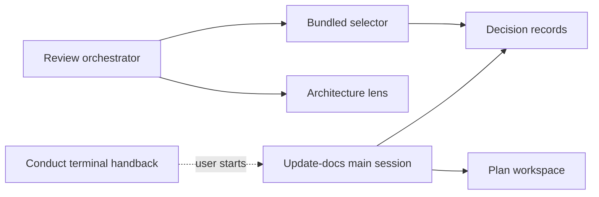
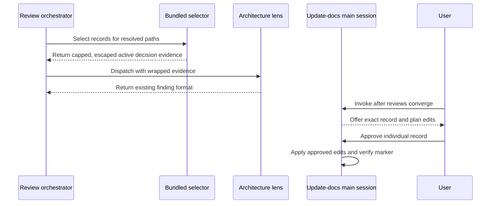

# Task: Decision records (docs/decisions)

**Status**: Not Started
**Component**: meta
**Assigned to**: Claude
**Priority**: Low
**Branch**: feature/comment-hygiene-and-decisions
**Created**: 2026-11-22
**Review Gates**: full

## Objective

Give long-lived architecture decisions one durable, checkable home: a `docs/decisions/` folder of short records with a status, promoted from dev plans at `/update-docs` time, and checked against new plans (`review-plan` architecture lens) and diffs (`deep-review` architecture lens) so contradictions and supersessions surface.

## Context

Depends on plan A (`20261122-feature-comment-hygiene.md`). Implement B after A lands (A's final commit on the shared branch) and only if A leaves the gap identified in the 2026-11-22 design discussion; Phase 0 checks both. Both plans apply to every repo that uses skein, not only to skein's own repo. A owns the AGENTS.md comment policy and the deep-review Documentation Lens. B adds the decisions layout and pointer to AGENTS.md, the conduct terminal nudge and the architecture-lens inputs. Keep A's worker prompts, documentation-lens checks, gauntlet candidate handling and shape-test assertions when extending shared files. B owns the review-plan rubric guidance and its own changelog and index entries. Promotion can use candidates a person copies into the plan.

Why the machinery rather than just a folder: `~/Code/pipecat-ai/pipecat-code-mcp` has a `docs/decisions/` with 2 records against 31 dev plans, at least 10 of which carry their own decision sections. Nothing triggered promotion, nothing checked records, and one record (`vector-backend.md`) accrued unrelated amendments because it had no status or supersession model. The other record (`docs-source.md`) has a Status line and the first does not.

Current skein behaviour (Explore, 2026-11-22):

- The plan template provides `### Architecture Decisions` (Codex `dev-plan/template.md:100-102`). Codex `grill/SKILL.md` Step 4 routes accepted decisions through `/dev-plan update` into Technical Specifications above the marker.
- The canonical marker hashing authority is `scripts/marker.py` (AGENTS.md); Codex `conduct/marker.py` is its copy and hashes the exact bytes before the real marker. Adding a promotion note in the workspace below it preserves the hash.
- Codex `review-plan/SKILL.md` Step 2 supplies plan content, Review Focus, the repo checklist and the per-attempt persistence context. Its architecture prompt spans `<!-- BEGIN GENERIC LENS PROMPT: architecture -->` through the corresponding end marker (166–269). Codex `deep-review/SKILL.md` uses the shared `## Lens Prompts` preamble for the diff, checklist, focus and persistence contract, with a distinct `### Architecture Lens` section (258–290). Neither prompt currently has an active-record input.
- Codex `update-docs/SKILL.md:266-294` puts writes in main-context Phase 4, applies an allowlist and prohibits new documentation files. The delegated Phase 1–3 audit is read-only.
- Pi `update-docs` is a read-only audit through the typed tool `skein_update_docs_audit` (`plugins/skein-pi/extension.ts:406`); the main session owns all writes. Pi lens workers are no-tools and see only supplied snapshots/role contracts: deep-review gets a bounded diff/evidence packet, while review-plan currently gives repository lookup evidence only to `codebase-claims`, not architecture. Phase 3 must explicitly add an architecture-only decision-evidence input.
- Codex `conduct/SKILL.md` Step 9a hands back intermediate phases in legacy mode. The completion seam is the healthy terminal path after CI parity and any opted-in Review Gauntlet Auto-Chain (344–369). The Python conductor returns to the skill at the CI-parity/completion boundary. The skill owns auto-chaining and the proposed message.

The lens-shape suite pins dispatch and persistence structure; the tier census pins routing text and counts. Prompt parity checks both shared rubrics and the marked finding-schema block. Claude and Codex plan templates differ at the Review Gates field. Pi's `skein_update_docs_audit` accepts the nine bounded keys listed in the Pi skill, with extra properties rejected.

## Requirements

- `docs/decisions/README.md` defines the record format (see Technical Specifications), the `Applies to` glob dialect and the promotion criteria; `docs/decisions/` records use inline header lines, no YAML frontmatter, matching the plan convention. The format also ships inside each `update-docs` skill (`references/decision-records.md`, byte-identical) so any repo using skein can adopt it.
- `scripts/check-decisions.sh` validates records: required headers present; `Status` is `active` or `superseded`; every `Supersedes` and `Superseded by` link resolves to an existing record and is reciprocal; no `active` record is superseded; every `Source plan` link resolves; `Applies to` uses only the supported glob syntax. It runs in `just ci` and ships in the `update-docs` bundle so promotion can validate the graph after writing.
- `scripts/decisions-active.sh <path>...` takes brace-expanded repo-relative paths and prints the active records whose `Applies to` globs match any of them, already escaped, in stable order, capped at 8 records or 24 KiB with a `DECISIONS-TRUNCATED` marker line. It prints nothing and exits 0 when `docs/decisions/` is absent. Both scripts share one header parser, `scripts/lib/decisions-common.sh`. Bundle the selector and parser into the `review-plan` and `deep-review` skills through the `BUNDLE_LENS` group, and the validator and parser into `update-docs`, in all mirrors; verify every copy.
- The `review-plan` architecture lens and the `deep-review` architecture lens receive the selected active records as a new input wrapped in `<untrusted-content>` (record text is repository data, never instructions; the selector escapes it), and flag plan decisions or code that contradict a record, or that should supersede one. Findings reuse an existing category and severity vocabulary; no schema change.
- `update-docs` considers the plan's `### Architecture Decisions` and decisions explicitly copied into `## Findings` after reviews converge. It offers each qualifying record and writes only on explicit approval of that offer, then adds its link to the existing below-marker `## Promoted Decisions` section or creates that heading once. The exact approved offer covers the new `docs/decisions/` record, the below-marker link and the old record's `Status` and `Superseded by` where applicable.
- `conduct` names `/update-docs` on successful terminal completion, after any selected gauntlet auto-chain. The nudge is text only. Codex supports `none`, `quick` and `full`; a quick run uses native gate 1 only, and the full run reports deferred or skipped gates explicitly.
- The dev-plan templates gain the `## Promoted Decisions` workspace section below the marker: `plugins/{skein,skein-codex}/skills/dev-plan/template.md` and `plugins/skein-pi/skills/dev-plan/references/template.md`. Pi's template and rubric are byte-compared with Codex by `tests/pi/test_plan_composition.py`.
- A's policy block in AGENTS.md is updated to name the pointer form (`see docs/decisions/<file>`); the form is defined by the folder's README, so it does not wait for the first record.
- Claude lands first and each mirror commits on its own (grilled 2026-11-22; see `### Review Waivers`): independent Codex and Pi sessions align to the committed Claude bytes, retaining Claude's `${CLAUDE_PLUGIN_ROOT}` and Codex's `"$SKILL_DIR"` anchors. Retain the existing gauntlet fixer and post-commit CI checks.

Invariants this plan must hold, each with a test:

- I1: Promotion changes only bytes below the review marker, so a signed-off plan's marker hash is identical before and after (fixture plan, marker verified before and after).
- I2: The record graph is consistent: valid status, resolving and reciprocal supersession links, no active-but-superseded record (`check-decisions.sh` on good and broken fixtures).
- I3: No record is written without user approval; Pi never writes from the audit tool.
- I4: Only active records matching `Applies to` enter lens prompts, and always inside `<untrusted-content>`.
- I5: `rubric.md` edits are byte-identical Claude vs Codex (`check-prompt-parity.sh`).

Out of scope: the retroactive audit skill (plan C); migrating existing code comments or existing plan decisions in bulk; changing `AF_FORBIDDEN_HEADINGS` (`### Architecture Decisions` stays protected); lint tooling; any model-tier change.

## Review Focus

- Marker integrity: sign the fixture once with the bundled `review-plan/scripts/write-review-marker.py` writer. Verify with the canonical APIs in `scripts/marker.py` before and after promotion, comparing the marker line and signed bytes as well as its computed hash.
- The `update-docs` file-creation exception must be narrow (only `docs/decisions/`, only on approval), not a general loosening.
- Pi: `tests/pi/test_update_docs.py` pins "No automatic writes" and the absence of `gh pr edit`; promotion on Pi must stay an audit finding the main session acts on. `validateDocAudit()` accepts findings only on supplied-document paths: locate promotion findings on `relevant_plan_path`, not a proposed new record path. Pi has no `--apply` route; approval remains per record in the main session.
- Lens cost and noise: records are selected by `Applies to`, not read wholesale; confirm the selector's behaviour on a path with no match.
- The selector escapes record closing-tag lookalikes (the same case-insensitive rule the skills use for untrusted input) before the orchestrator wraps the block, so the escape is deterministic and tested in `test-decisions-active.sh`. Pi's bundled copy must stay byte-identical. Preserve the marked prose-rule blocks, the four copies of `GENERIC FINDING SCHEMA AND MERGE` and the architecture prompt markers.
- Preserve Claude/Codex rubric byte parity. Codex architecture lenses use the harness-selected model with high reasoning when supported. Keep existing dispatch and persistence behaviour, including supported sequential execution.
- Bundle the selector, the validator and their shared parser (grilled 2026-11-22). The selector and parser go through `BUNDLE_LENS` once; the validator and parser go through a new `update-docs` bundle entry. The validator also runs through the new CI recipe.
- Pi is outside `scripts/check-prompt-parity.sh`; `just pi-tests` covers its contracts. Root `package.json` lists the skills; no Pi skill or tool registration changes are required. Pi has no fan-out, plan-view, rfc-finder, spec-compliance or in-your-own-words route to extend.

## Implementation Checklist

Each mirror-spanning phase is split into `a` (Codex), `b` (Claude) and `c` (Pi) sub-phases, and every sub-phase names its executor in its first bullet.

**Execution protocol (grilled 2026-11-22, same model as plan A): Claude lands first, and the letters do not give the run order.** The main Claude session hand-walks Phases 0, 1, 2, 3b, 4b and 5b, running each phase's test command and committing each phase on its own. `conduct` is not used for this plan: it dispatches Claude subagents only and would send the `a` and `c` phases to the wrong executor. The user then hands this plan to an independent Codex session (phases 3a, 4a, 5a) and an independent Pi session (phases 3c, 4c, 5c). Each external session reads only its own phase blocks, aligns to the Claude bytes already committed on the branch, edits only the files its phase lists, runs its phase's test command and commits its own mirror. Phase 6 runs after both external sessions finish, then `review-gauntlet` by hand (`Review Gates: full`), then `/update-docs`. If an external session is unavailable, a Claude subagent applies that block and the commit message says so. This inverts AGENTS.md's Codex-first rule; see `### Review Waivers` in `## Findings`. Parity gates (`just parity-tests`) first run in the `a` phases, because the managed Claude/Codex files only match once the Codex half lands.

### Phase 0: Gate on plan A

**Impl files:** none
**Test files:** none
**Test command:** `grep -q "non-obvious why" AGENTS.md && grep -q "Decision candidate:" plugins/skein/skills/review-gauntlet/SKILL.md`
**Goal:** Plan B starts only when plan A is complete and the gap it addresses remains.

- **Executor:** main Claude session, by hand.
- Confirm that every phase of plan A is committed on the shared branch (A's final commit is what "lands" means), that A's AGENTS.md comment-policy block exists, and that A's conduct and gauntlet handback text exists. Record in `## Findings` that the gap remains: `docs/decisions/` still has no promotion trigger or contradiction check.

### Phase 1: Folder, record format, validator and shared parser

**Impl files:** `docs/decisions/README.md, scripts/check-decisions.sh, scripts/lib/decisions-common.sh, justfile, AGENTS.md`
**Test files:** `tests/plugin/test-check-decisions.sh`
**Test command:** `bash tests/plugin/test-check-decisions.sh && just lint`
**Goal:** The record graph is validated in CI, so the folder cannot silently drift into the inconsistent state pipecat's did (invariant I2).

- **Executor:** main Claude session, by hand.
- Write `docs/decisions/README.md`: record format, filename `yyyymmdd-slug.md`, header fields (`Status`, `Date`, `Applies to`, `Supersedes`, `Superseded by`, `Source plan`), body sections (Decision, Why, Alternatives rejected, Consequences), promotion criteria (cross-file, long-lived, or constrains future work; not a local implementation detail), and an example. State the `Applies to` dialect (grilled 2026-11-22): comma-separated globs matched with bash `[[ $path == $glob ]]` semantics, where `*` may cross `/`; no `**`, no braces. State that any repo using skein may adopt the folder.
- Write `scripts/lib/decisions-common.sh`, the one shared header parser, and `scripts/check-decisions.sh` per the Requirements, sourcing it. The validator also rejects `**` and brace syntax in `Applies to`. Register the CI recipe and its fixture in `justfile`, document the recipe under AGENTS.md Commands, and add `docs/decisions/` to the AGENTS.md layout.
- Tests: good fixture passes; each of missing header, bad status, dangling `Supersedes` link, non-reciprocal link, active-but-superseded, dangling `Source plan` link and unsupported glob syntax fails with a distinct message. A folder holding only `README.md` passes and `README.md` is not parsed as a record. `Supersedes` and `Superseded by` set to `none` pass.

### Phase 2: Selector, validator bundling and bundle map

**Impl files:** `scripts/decisions-active.sh, scripts/lib/bundle-map.sh, justfile`
**Test files:** `tests/plugin/test-decisions-active.sh`
**Test command:** `bash tests/plugin/test-decisions-active.sh && just check-sync`
**Goal:** Lens prompts receive only active records whose `Applies to` matches the paths under review (invariant I4), and the scripts are bundled like the other shared scripts.

- **Executor:** main Claude session, by hand. Regenerate the bundled copies with `just bundle-appliers`.
- Write `scripts/decisions-active.sh <path>...` (grilled 2026-11-22). Inputs are already brace-expanded, repo-relative literal paths. It prints the matching active records (header plus Decision and Why sections) in stable path-sorted order, with record text already escaped: any case-insensitive `</untrusted-content ...>` lookalike becomes `<\/untrusted-content>`. Cap: 8 records or 24 KiB, whichever comes first; on overflow the last line is `DECISIONS-TRUNCATED: N of M records shown`. Superseded records are never printed. Exit codes: `0` for an empty match, a missing `docs/decisions/` (prints nothing) or a truncated block; `2` for a usage error; `3` when a record is malformed (stderr names the file). The orchestrator reports a `3`, an unavailable selector, or a truncation marker as missing or degraded coverage, never as "no applicable decisions".
- Bundling: add `decisions-active.sh` and `decisions-common.sh` to the `BUNDLE_LENS` group once (never to both `bundle_extra_for` arms) and update its comment. The validator also ships (grilled 2026-11-22): add `update-docs` to `BUNDLE_SKILLS` with its own extras (`check-decisions.sh`, `decisions-common.sh`). First verify that the generator, `check-sync` and the Pi staging handle a newly bundled skill, and record any required script change in `## Findings` before editing. Those staged trees also feed Pi.
- Tests in `tests/plugin/test-decisions-active.sh`, registered in `plugin-tests`: a glob matrix (single star, star across `/`, exact path, directory prefix, brace-expanded input) with expected results; no match; superseded exclusion; stable ordering; the record cap and the byte cap, each asserting the marker and order; absent `docs/decisions/`; a malformed record (exit 3); paths with spaces and shell metacharacters; a closing-tag lookalike escaped; the validator and selector run on the same fixtures; and presence of the selector in all six lens-skill directories, absence from `review-gauntlet`, and presence of the validator in the three `update-docs` directories.

### Phase 3b: lens checks against active records, Claude mirror

**Impl files:** `plugins/skein/skills/review-plan/SKILL.md, plugins/skein/skills/review-plan/rubric.md, plugins/skein/skills/deep-review/SKILL.md`
**Test files:** `tests/lenses/test-lens-skill-shape.sh, tests/lenses/fixtures/decisions/`
**Test command:** `just lens-tests && just reconciliation-tests`
**Goal:** An architecture-lens finding fires when a plan decision or a diff contradicts, or should supersede, an active record; record text is untrusted data and no tier changes. (Claude mirror, lands first.)

- **Executor:** main Claude session, by hand. Commit this phase on its own after the test command passes. Do not run `just parity-tests` here: `rubric.md` is a managed file and matches Codex only after phase 3a.
- Run the bundled selector in each review orchestrator from the resolved repo root before architecture dispatch, via `${CLAUDE_PLUGIN_ROOT}/skills/<skill>/scripts/decisions-active.sh`. For review-plan the orchestrator (not a script) collects paths from the plan's Impl files, Files to Modify and New Files to Create sections and expands braces before the call; for deep-review it uses paths from the already resolved review diff. Pass paths as literal arguments, allowing spaces and shell metacharacters. Apply the selector's exit-code contract: an empty match is genuine; exit `3`, an unavailable selector or a truncation marker is missing or degraded coverage.
- Add `{{ACTIVE_DECISIONS}}` solely to each architecture lens's rendered input, inside `<untrusted-content>`; the selector has already escaped the text. Reuse the same block for a lens retry. A `--continue` run that selected any active records re-runs the architecture lens (grilled 2026-11-22; no state-schema change); one that selected none reuses results as today.
- Report an active-record conflict or supersession as `Constraint` in review-plan and `Architecture` in deep-review. Keep `Contradiction` reserved for review-plan's independent Step 3 sub-step 2.5. Use the existing severity vocabulary. Edit `rubric.md` for the architecture scope; Codex aligns byte-for-byte in 3a.
- Commit the lens fixtures under `tests/lenses/fixtures/decisions/`: a conflicting active record, an unrelated path, a superseded record and a closing-tag lookalike, each with its expected result. Add Claude-scoped assertions to `test-lens-skill-shape.sh` (its existing array loops both mirrors, so use a separate Claude-only list): architecture-only input, wrapper, unchanged result shape and the `--continue` rule.

### Phase 3a: lens checks against active records, Codex mirror

**Impl files:** `plugins/skein-codex/skills/review-plan/SKILL.md, plugins/skein-codex/skills/review-plan/rubric.md, plugins/skein-codex/skills/deep-review/SKILL.md`
**Test files:** `tests/lenses/test-lens-skill-shape.sh`
**Test command:** `just lens-tests && just parity-tests && just reconciliation-tests`
**Goal:** An architecture-lens finding fires when a plan decision or a diff contradicts, or should supersede, an active record; record text is untrusted data and no tier changes. (Codex mirror, aligned to the committed Claude half.)

- **Executor:** an independent Codex session started by the user with this plan and this phase block (or `codex:rescue`). It edits only the files listed above, byte-verifies against `git diff`, runs the test command and commits the Codex half on its own.
- Align to the bytes committed in phase 3b: copy shared wording and `rubric.md` verbatim. Codex keeps `"$SKILL_DIR"` anchors and resolves the selector via `"$SKILL_DIR"/scripts/decisions-active.sh`; never collapse them with Claude's `${CLAUDE_PLUGIN_ROOT}`.
- Codex review-plan adds `{{ACTIVE_DECISIONS}}` within the marked architecture prompt and updates Step 2's allowed-input list for both dispatch modes. Codex deep-review adds the optional architecture-only input to `## Lens Prompts` and the scope bullet under `### Architecture Lens`, outside Block A. Preserve the per-attempt writer, collector and finding contract, and the four `GENERIC FINDING SCHEMA AND MERGE` copies.
- Add the Codex counterpart of the 3b shape assertions. Exercise a direct Codex review-plan and deep-review fixture run per the Testing Notes manual exercise; quick gauntlet is insufficient, and a full Codex gauntlet can also defer deep-review when its delegation prerequisites are unmet.

### Phase 3c: lens checks against active records, Pi mirror

**Impl files:** `plugins/skein-pi/skills/review-plan/SKILL.md, plugins/skein-pi/skills/review-plan/rubric.md, plugins/skein-pi/skills/deep-review/SKILL.md, plugins/skein-pi/skills/deep-review/rubric.md`
**Test files:** `tests/pi/test_review.py, tests/pi/test_deep_review.py`
**Test command:** `just pi-tests`
**Goal:** An architecture-lens finding fires when a plan decision or a diff contradicts, or should supersede, an active record; record text is untrusted data and no tier changes. (Pi mirror.)

- **Executor:** an independent Pi session started by the user (interactive, or `pi -p --no-session`) with this plan and this phase block. It edits only the files listed above, and the main session or user verifies against `git diff`, runs the test command and commits the Pi half separately (commit per platform). The file limit is a prompt instruction, not an enforced bound: the `git diff` check is the guard, and edits outside the Impl files are rejected.
- Run the bundled selector from the installed skill-relative script in each review orchestrator, from the resolved repo root before architecture dispatch. Use the same path sources, literal arguments and exit-code contract as phase 3b.
- Pi dispatch contract: update review-plan's `Lens protocol` allowed inputs, which currently says evidence is for `codebase-claims` only, to allow the selected records for architecture only; retain the factual packet unchanged. Update deep-review's packet preparation similarly. Supply installed-rubric scope plus the bounded, already-escaped selected records in the existing `skein_worker` `prompt`, never as a new tool parameter. Preserve `role`/`prompt`, category, severity, `reviewed_units`, and persistence schemas; no extension.ts lens schema change is needed. A plan-target deep-review uses plan-declared paths, while current-diff review uses resolved diff paths. If required paths/evidence cannot be resolved, show missing coverage rather than asserting no applicable decisions.
- Pi retries reuse the exact selected snapshot and report selector failure or truncation as degraded; Pi deep-review does not support `--continue` and must not gain a resume/cache feature. Use `Constraint`/`Architecture` and the existing critical/important/suggestion mapping without adding fields or categories.
- In `tests/pi/test_review.py` and `test_deep_review.py`, extend the required canonical-script sets to include `decisions-active.sh` and `decisions-common.sh`, asserting byte identity to the canonical scripts, plus packet tests for architecture-only delivery, conflict/no-match/superseded fixtures, truncation and selector-failure degradation. Keep explicit approval, no-tools and unchanged disk-first shape assertions. Pi runtime lens-quality exercises need separately approved workers; static prompt/packet tests alone do not prove detection quality.
- Apply the shared wording committed in phase 3b inside the Pi mirror's own routes. Pi is not covered by `check-prompt-parity.sh`, so the `tests/pi` assertions are its only guard.

### Phase 4b: update-docs promotion and template, Claude mirror

**Impl files:** `plugins/skein/skills/update-docs/SKILL.md, plugins/skein/skills/update-docs/references/decision-records.md, plugins/skein/skills/dev-plan/template.md, justfile`
**Test files:** `tests/plugin/test-promotion-marker.sh, tests/plugin/test-check-decisions.sh`
**Test command:** `bash tests/plugin/test-promotion-marker.sh --mirror claude && bash tests/plugin/test-check-decisions.sh`
**Goal:** Promotion is offered, never imposed, and never changes bytes above the review marker (invariants I1 and I3). (Claude mirror, lands first.)

- **Executor:** main Claude session, by hand. Commit this phase on its own after the test command passes.
- Add the promotion step to Claude `update-docs`: gather evidence from the plan's `### Architecture Decisions` and decisions copied into `## Findings`, including `Applies to` inferred from Files to Modify; offer each qualifying decision; write only on explicit per-record approval, even with `--apply`. Extend the apply-target allowlist and the file-creation rule narrowly (only `docs/decisions/`, only for the exact approved record). Re-read the live plan, require a valid real marker, and run the bundled `check-decisions.sh` after writes.
- Cross-repo behaviour (grilled 2026-11-22): the feature applies to every repo that uses skein. On the first approved promotion where `docs/decisions/` is absent, `update-docs` offers to create it with a README copied from the bundled `references/decision-records.md` (byte-identical to `docs/decisions/README.md`), as part of the same approved offer. Without an approved promotion nothing is created.
- Add `## Promoted Decisions` below the marker in the Claude template, byte-aligned with Codex's except the existing `Review Gates` header difference.
- Create `tests/plugin/test-promotion-marker.sh` with `--mirror claude|codex|both` (default `both`), registered in `plugin-tests`, in two named parts. Part one applies a scripted below-marker edit to a signed fixture (signed once with the bundled marker writer, never re-signed) and checks marker line, signed bytes and hash unchanged (I1); it also applies a scripted supersession edit to a fixture `docs/decisions/` and runs `check-decisions.sh` (pass when both records are updated, fail when only one is). Part two asserts the selected mirror's `update-docs` wording: per-record approval, `--apply` without per-record approval, the narrow creation rule and the missing, placeholder and stale marker refusals. The approve/decline behaviour itself is a manual check with its evidence recorded in Test Results.
- Add a byte-identity assertion in `tests/plugin/test-check-decisions.sh` between `docs/decisions/README.md` and each `update-docs/references/decision-records.md` that exists.

### Phase 4a: update-docs promotion and template, Codex mirror

**Impl files:** `plugins/skein-codex/skills/update-docs/SKILL.md, plugins/skein-codex/skills/update-docs/references/decision-records.md, plugins/skein-codex/skills/dev-plan/template.md, plugins/skein-pi/skills/dev-plan/references/template.md, justfile`
**Test files:** `tests/plugin/test-promotion-marker.sh, tests/pi/test_plan_composition.py`
**Test command:** `bash tests/plugin/test-promotion-marker.sh --mirror both && just parity-tests && uv run --with pytest pytest tests/pi/test_plan_composition.py`
**Goal:** Promotion is offered, never imposed, and never changes bytes above the review marker (invariants I1 and I3). (Codex mirror, aligned to the committed Claude half.)

- **Executor:** an independent Codex session started by the user with this plan and this phase block (or `codex:rescue`). It edits only the files listed above, byte-verifies against `git diff`, runs the test command and commits on its own. The Pi `references/template.md` is a byte copy of the Codex template, enforced by `tests/pi/test_plan_composition.py:64-68`, so it lands in this same commit rather than in 4c.
- Align to the bytes and wording committed in phase 4b. Codex keeps `"$SKILL_DIR"` anchors. In Codex `update-docs` (Phase 4, `SKILL.md:266-294`) extend both the apply-target allowlist and the file-creation rule for the exact approved record, and keep the Phase 3 report first. If a required path is outside the writable sandbox or the live inputs changed, surface the blocker before any write.
- Add `## Promoted Decisions` below the marker in the Codex template and copy it byte-for-byte to the Pi template. Keep the Codex-only `quick` header value and the existing per-mirror header wording intact.
- The `--mirror both` run covers the Codex wording assertions.

### Phase 4c: update-docs promotion, Pi mirror

**Impl files:** `plugins/skein-pi/skills/update-docs/SKILL.md, plugins/skein-pi/skills/update-docs/references/decision-records.md, plugins/skein-pi/extension.ts`
**Test files:** `tests/pi/test_update_docs.py, tests/pi/test_plan_composition.py`
**Test command:** `just pi-tests`
**Goal:** Promotion is offered, never imposed, and never changes bytes above the review marker (invariants I1 and I3). (Pi mirror.)

- **Executor:** an independent Pi session started by the user (interactive, or `pi -p --no-session`) with this plan and this phase block. It edits only the files listed above, and the main session or user verifies against `git diff`, runs the test command and commits the Pi half separately (commit per platform). The file limit is a prompt instruction, not an enforced bound; the `git diff` check is the guard.
- On Pi, return candidates as audit findings from the existing bounded plan snapshot. The main session verifies the live source plan and any supersession targets and offers the exact writes. Preserve the tool's closed input schema and the no-write contract.
- Extend `extension.ts::updateDocsPrompt()` with the promotion criteria and named source sections so its no-tools worker can actually offer candidates. Gather both `### Architecture Decisions` and `## Findings` in `relevant_plan` within its 30,000-character field limit and the combined 96 KiB serialized-input limit; narrow explicitly or stop, never silently omit either source section. The nine input keys stay unchanged. Put each offer in the existing finding `recommendation`/report with `location` equal to the supplied `relevant_plan_path`; a new `docs/decisions/` location is rejected by `validateDocAudit()`. Do not send unseen record contents or claim that the audit verified supersession links.
- Narrowly amend Pi SKILL.md's current "Edit only existing documentation files" rule to permit only the exact individually approved new record under `docs/decisions/` (plus the README copied from `references/decision-records.md` on first promotion), approved live supersession targets and the below-marker plan link. Preserve "No automatic writes", explicit target selection, stale-snapshot checks and the ban on PR edits; Pi still does not implement `--apply`. The main session verifies record graph inputs and the source marker before writes, runs the bundled validator after, and verifies the unchanged signed prefix.
- Extend `tests/pi/test_update_docs.py` for promotion instructions and candidate payload reaching the no-tools worker, acceptance of a source-plan-anchored recommendation, rejection of new-record locations/extra fields, preserved budgets, and no documentation writes from the tool. Cover approved/declined/stale main-session promotion contracts separately from mocked audit success. Extend `tests/pi/test_plan_composition.py` for the new below-marker heading, which 4a already placed in the Pi template, while retaining template and rubric byte identity with Codex.
- Apply the shared wording committed in phase 4b inside the Pi mirror's own routes. Pi is not covered by `check-prompt-parity.sh`, so the `tests/pi` assertions are its only guard.

### Phase 5b: conduct nudge, Claude mirror

**Impl files:** `plugins/skein/skills/conduct/SKILL.md`
**Test files:** `tests/gauntlet/test-conduct-hook.sh`
**Test command:** `just gauntlet-tests`
**Goal:** The terminal handback points at `/update-docs` so promotion does not depend on memory. (Claude mirror, lands first.)

- **Executor:** main Claude session, by hand. Commit this phase on its own after the test command passes.
- Add the text-only `/update-docs` pointer to Claude's healthy completion path only, after any selected gauntlet auto-chain. Keep it out of the intermediate summary and out of blocked, CI-failed and non-clean gauntlet handbacks. Preserve A's comment-notice handback.
- In `test-conduct-hook.sh`, assert textual placement per route: the healthy terminal path carries the nudge; the intermediate, blocked, CI-failed and non-clean gauntlet routes each have their own assertion that it is absent. Live route behaviour is a manual check.

### Phase 5a: conduct nudge, Codex mirror

**Impl files:** `plugins/skein-codex/skills/conduct/SKILL.md`
**Test files:** `tests/gauntlet/test-conduct-hook.sh`
**Test command:** `bash tests/gauntlet/test-conduct-hook.sh`
**Goal:** The terminal handback points at `/update-docs` so promotion does not depend on memory. (Codex mirror, aligned to the committed Claude half.)

- **Executor:** an independent Codex session started by the user with this plan and this phase block (or `codex:rescue`). It edits only the files listed above, byte-verifies against `git diff`, runs the test command and commits on its own.
- Align to the wording committed in phase 5b. On Codex use the `Review Gauntlet Auto-Chain` completion seam after CI parity and any opted-in `quick` or `full` run. Keep the nudge out of Step 9a's intermediate summary and out of blocked, CI-failed or non-clean gauntlet handbacks. Preserve the existing Codex capability messages and top-level dispatch.
- Extend `test-conduct-hook.sh` with one Codex assertion per route: healthy completion with no gauntlet, with `quick` and with `full` each carry the nudge; the intermediate, blocked, CI-failed and non-clean routes do not. The check is textual placement; live behaviour is a manual check. Its existing Claude-only gate assertions stay scoped to Claude, and the marker parity tests remain unchanged.

### Phase 5c: conduct nudge, Pi mirror

**Impl files:** `plugins/skein-pi/skills/conduct/SKILL.md`
**Test files:** `tests/pi/test_orchestration_routes.py`
**Test command:** `just pi-tests`
**Goal:** The terminal handback points at `/skill:skein-update-docs` so promotion does not depend on memory. (Pi mirror.)

- **Executor:** an independent Pi session started by the user (interactive, or `pi -p --no-session`) with this plan and this phase block. It edits only the files listed above, and the main session or user verifies against `git diff`, runs the test command and commits the Pi half separately (commit per platform). The file limit is a prompt instruction; the `git diff` check is the guard.
- Pi completion is sequential and main-session-owned: it has no CI-parity Python-conductor return seam or automatic gauntlet chain. Add a text-only `/skill:skein-update-docs` nudge only when all declared phases, tests/validation and approval/verification requirements are complete, not at intermediate, blocked, declined or degraded handbacks. Do not add auto-chain or `quick`/`full` modes. Extend `tests/pi/test_orchestration_routes.py` with one assertion per route and preserve A's comment-notice handback.
- Apply the shared wording committed in phase 5b inside the Pi mirror's own routes. Pi is not covered by `check-prompt-parity.sh`, so the `tests/pi` assertions are its only guard.

### Phase 6: Verify and docs

**Impl files:** `AGENTS.md, CHANGELOG.md, docs/dev_plans/README.md`
**Test files:** `tests/gauntlet/test-conduct-hook.sh`
**Test command:** `just ci`
**Goal:** The full CI is green, A's policy block names the pointer form, and B's docs are updated.

- **Executor:** main Claude session, by hand. Runs after plan A and every `a`/`b`/`c` phase above have landed; commits the docs separately.
- Update A's policy block in AGENTS.md to name the `see docs/decisions/<file>` pointer form. This is unconditional: the folder and its README ship with this plan, so the form is defined even before the first promoted record.
- Run `just ci` in a background job and wait for the exit status; record its duration in `## Findings`.
- Manual checks, with evidence recorded in Test Results: the lens fixture exercise (one run per mirror) and the approve/decline promotion run on a real plan, reviewed by the user.
- Update B's `CHANGELOG.md` entry and plans index row (draft).

After Phase 6, run `review-gauntlet` by hand and let it converge, then run `/update-docs`. Gauntlet fix commits can change what the CHANGELOG entry must say, so this step sits outside the phases.

## Technical Specifications

### Files to Modify

Verified to exist by Explore (2026-11-22):

- `AGENTS.md` — CI recipe, `docs/` layout entry and pointer form in the comment policy.
- `justfile` — validator recipe in `ci` and the fixtures in `plugin-tests`.
- `scripts/lib/bundle-map.sh` — add the selector and shared parser to `BUNDLE_LENS` (update its comment) and add `update-docs` to `BUNDLE_SKILLS` with the validator and parser as extras; generated copies come from `just bundle-appliers`.
- `plugins/{skein,skein-codex,skein-pi}/skills/review-plan/{SKILL.md,rubric.md}` — architecture lens input and scope.
- `plugins/{skein,skein-codex,skein-pi}/skills/deep-review/SKILL.md`, `plugins/skein-pi/skills/deep-review/rubric.md` — architecture lens input and scope.
- `plugins/{skein,skein-codex,skein-pi}/skills/update-docs/SKILL.md`, `plugins/{skein,skein-codex,skein-pi}/skills/update-docs/references/decision-records.md` (new, byte-identical to `docs/decisions/README.md`), `plugins/skein-pi/extension.ts` — promotion step; extend Pi audit prompt, preserve nine-key input and source-document-anchored result schema, narrow the main-session creation exception.
- `plugins/skein/skills/dev-plan/template.md`, `plugins/skein-codex/skills/dev-plan/template.md`, `plugins/skein-pi/skills/dev-plan/references/template.md` — `## Promoted Decisions` section.
- `plugins/{skein,skein-codex,skein-pi}/skills/conduct/SKILL.md` — terminal nudge.
- Tests: `tests/lenses/test-lens-skill-shape.sh`, `tests/plugin/test-check-decisions.sh`, `tests/gauntlet/test-conduct-hook.sh`, `tests/pi/test_review.py`, `tests/pi/test_deep_review.py`, `tests/pi/test_update_docs.py`, `tests/pi/test_plan_composition.py`, `tests/pi/test_orchestration_routes.py`. Keep the existing reconciliation, marker and prose-rule tests as gates.
- `CHANGELOG.md`, `docs/dev_plans/README.md`.

### New Files to Create

- `docs/decisions/README.md` — format, glob dialect and promotion criteria.
- `scripts/check-decisions.sh`, `scripts/decisions-active.sh`, `scripts/lib/decisions-common.sh` — validator, selector and shared header parser (plus bundled copies: selector and parser in the six lens-skill `scripts/` directories, validator and parser in the three `update-docs` `scripts/` directories).
- `plugins/{skein,skein-codex,skein-pi}/skills/update-docs/references/decision-records.md` — shipped copy of the format.
- `tests/plugin/test-check-decisions.sh`, `tests/plugin/test-decisions-active.sh`, `tests/plugin/test-promotion-marker.sh`, `tests/lenses/fixtures/decisions/` (fixtures for the lens exercise).

### Record format (defined in `docs/decisions/README.md`)

```
# <Decision title>

**Status**: active | superseded
**Date**: YYYY-MM-DD
**Applies to**: <comma-separated path globs; bash pattern, `*` crosses `/`, no `**`, no braces>
**Supersedes**: <record filename> | none
**Superseded by**: <record filename> | none
**Source plan**: <docs/dev_plans/... file>

## Decision
## Why
## Alternatives rejected
## Consequences
```

### Architecture Decisions

- Decision (grilled 2026-11-22; wording corrected 2026-11-22 on the user's clarification): `docs/decisions/` is the home for durable decisions in every repo that uses skein; skein's skills rely on it, and the plugins ship the format and validator so any repo can adopt it. Rejected: a skein-repo-only folder.
- Decision (grilled 2026-11-22): decisions start in the plan and are promoted late, at `/update-docs` after reviews converge, so a record captures the decision as shipped; a link note goes below the review marker and the above-marker text stays as the sign-off snapshot.
- Decision (grilled 2026-11-22): contradictions are checked at plan review (architecture lens) and at code review (`deep-review`, inherited by `review-gauntlet`).
- Decision (grilled 2026-11-22): each record carries `Applies to` so lenses select records instead of reading all of them.
- Decision (grilled 2026-11-22, accepted): selection is done by a bundled script (`decisions-active.sh`), not by the lens, so the orchestrator controls prompt size; Pi workers get the result in the evidence packet.
- Findings reuse `Constraint` for review-plan architecture findings (Codex `review-plan/SKILL.md:247` and `rubric.md:26`) and `Architecture` for deep-review (Codex `deep-review/SKILL.md:272`). The review-plan rubric reserves `Contradiction` for the separate post-reconciliation pass.
- Decision (grilled 2026-11-22, accepted): the `update-docs` file-creation exception is limited to `docs/decisions/` and requires approval of each proposed record.
- Decision (grilled 2026-11-22, accepted): `update-docs` promotes only from the plan's own `### Architecture Decisions` section plus anything copied into its `## Findings`. Plan A's "decision candidates" and `deep-review` findings persist locally and are gitignored (Claude `.deep-review/` and `.gauntlet/`, Codex `latest-codex.json`, Pi `latest-pi.json`) but are not part of the plan, so promotion reads only those two plan sections and never imports review state; they get no new persistence here. Code-comment candidates stay as comments until someone raises them. (Rationale reworded 2026-11-22: the earlier "not persisted anywhere" premise was false for all three mirrors; the outcome is unchanged.)
- Decision (grilled 2026-11-22, accepted): the feature applies to every repo using skein. The format spec and validator ship in the `update-docs` bundle; the first approved promotion in a repo creates `docs/decisions/` and its README from the bundled reference; the selector prints nothing and exits 0 when the folder is absent. Rejected: gating on a pre-existing `docs/decisions/README.md`.
- Decision (grilled 2026-11-22, accepted): Claude lands first; each mirror commits separately; the user runs independent Codex and Pi sessions afterwards; `conduct` is not used; Phase 0 gates on plan A. Rejected: Codex-first with one shared a+b commit (recorded as a waiver).
- Decision (grilled 2026-11-22, accepted): `Applies to` is comma-separated bash-pattern globs (`*` crosses `/`, no `**`, no braces). The review-plan orchestrator expands braces and takes paths from Impl files, Files to Modify and New Files to Create before calling the selector. Rejected: gitignore-style `**` globs.
- Decision (grilled 2026-11-22, accepted): the selector caps output at 8 records or 24 KiB, prints a `DECISIONS-TRUNCATED: N of M records shown` line, and the orchestrator reports truncation as degraded coverage.
- Decision (grilled 2026-11-22, accepted): the selector emits already-escaped text, and the selector, validator and a shared `scripts/lib/decisions-common.sh` parser are bundled, so there is one header parser. Rejected: orchestrator-side escaping and independent parsers.
- Decision (grilled 2026-11-22, accepted): a `deep-review --continue` that selected any active records re-runs the architecture lens; no state-schema change. Rejected: a `decisions_hash` state field.

### Dependencies

- Bash, git, `jq`-free for the new validator/selector. No new dependencies. The repo-root `package.json` (name `skein-pi`) lists Pi skills and extension.ts, with no dependency entries; there is no `plugins/skein-pi/package.json`. Existing Pi runtime dependencies remain unchanged.

### Integration Seams

| Seam | Writer (task) | Caller (task) | Contract |
|------|---------------|---------------|----------|
| Record format | `docs/decisions/README.md`, `decisions-common.sh` and `check-decisions.sh` (Phase 1) | `decisions-active.sh` (Phase 2), `update-docs` and its shipped `references/decision-records.md` (Phases 4b, 4a, 4c) | One header grammar, one shared parser; the validator is the source of truth. The shipped reference stays byte-identical to the README. |
| Selected records | `decisions-active.sh` (Phase 2) | review orchestrators, then their architecture lenses (Phases 3b, 3a, 3c) | Active-only, `Applies to`-matched, capped at 8 records or 24 KiB with a truncation marker, escaped by the selector and wrapped in `<untrusted-content>` by the orchestrator. Exit `0` empty/absent/truncated, `2` usage, `3` malformed record (reported as missing coverage). |
| Promotion note | `update-docs` (Phases 4b, 4a, 4c) | marker verification via `scripts/marker.py` | Only bytes below the marker change. The writer signs the test fixture once. |
| Nudge | `conduct` handback (Phases 5b, 5a, 5c) | `update-docs` (Phases 4b, 4a, 4c) | Text pointer only; never an invocation. |

## Architecture & Call Flow





| Step | Trigger | Enters context | Cleared/persisted | Turn boundary |
|------|---------|----------------|-------------------|---------------|
| 1 | Review resolves plan or diff paths and expands braces | Matched capped records | Same selection across retries | Before architecture dispatch |
| 2 | Architecture review | Escaped records plus existing lens data | Findings use the existing per-attempt stream | Collector receives terminal result |
| 3 | User runs update-docs | Valid signed plan and proposed record edits | Approved records and below-marker links persist | Per-record approval before writes |

## Testing Notes

### Test Approach
- [ ] Validator: good fixture, README-only folder, `none` supersession fields, and seven distinct failing fixtures (missing header, bad status, dangling link, non-reciprocal link, active-but-superseded, dangling `Source plan`, unsupported glob).
- [ ] Selector: glob matrix, no match, superseded excluded, ordering, both caps and the truncation marker, absent folder, malformed record, escaping, shared-fixture run with the validator, bundled copies in sync and in the right skills.
- [ ] Lenses, static: shape assertions per mirror for the architecture-only input, wrapper, result shape and `--continue` rule. Lenses, manual: fixtures under `tests/lenses/fixtures/decisions/` (conflicting record, unrelated path, superseded record, closing-tag lookalike), one run of each architecture lens per mirror; expect `Constraint` (review-plan) or `Architecture` (deep-review) on the conflict and nothing otherwise. Record each run's persisted lens JSONL path in Test Results; this criterion is manual-verified, not CI.
- [ ] Promotion, scripted: marker line, signed bytes and hash identical before and after a scripted below-marker edit (I1); `check-decisions.sh` passes after a two-sided supersession edit and fails after a one-sided one; per-mirror SKILL.md wording for approval and the narrow creation rule; Pi audit tool writes no documentation (I3). Promotion, manual: the approve and decline flows, evidenced in Test Results.
- [ ] Reconcile both harnesses' plan reviews before implementation, as required by AGENTS.md.
- [ ] `just ci` green.

### Test Results
- [ ] All existing tests pass
- [ ] New tests added and passing
- [ ] Manual promotion run on a real plan, reviewed by the user

### Edge Cases Tested
- [ ] A decision superseding an existing active record updates both records.
- [ ] A plan with no qualifying decisions produces no offer and no new file.
- [ ] `Applies to` matches nothing: lens prompt carries an empty decisions block, not an error.
- [ ] Repo without `docs/decisions/`: selector prints nothing and exits 0; the first approved promotion creates the folder and README.

## Acceptance Criteria

- `docs/decisions/README.md` and `check-decisions.sh` exist; the validator is in `just ci`, fails on each broken-record fixture, and ships with `update-docs` so any repo using skein can adopt the folder.
- Static, proved by tests: all three mirrors' architecture lens text carries the architecture-only input, wrapper and result shape. Manual, verified by the user: on the committed fixtures, one run per mirror flags the contradiction and flags nothing for the unrelated fixture, with the lens JSONL path recorded in Test Results.
- `update-docs` offers promotion, writes only on approval, appends the below-marker note, and the marker hash is unchanged (I1).
- The successful `conduct` terminal handback names `/update-docs` on Claude/Codex and `/skill:skein-update-docs` on Pi. In Codex, verify no-gauntlet, quick and full completion; on Pi verify completed sequential phases only. Confirm intermediate, blocked and degraded routes have no nudge in each supported runtime.
- `rubric.md` is byte-identical Claude vs Codex; no model tier changes; `tests/parity/test-spawn-tiers.sh` passes.
- Code reviewed and approved
- Tests passing (`just ci`)
- Documentation updated

<!-- reviewed: 2026-11-23 @ 0a8b9c770eabda3cc60712780ef5a16ed9d27c2e -->

<!-- /review-plan writes the marker line above. Everything below is the workspace: edits here do NOT invalidate the marker. -->

## Progress

- [x] Phase 0: Gate on plan A
- [x] Phase 1: Folder, record format, validator and shared parser
- [x] Phase 2: Selector, validator bundling and bundle map
- [x] Phase 3b: Lens checks against active records (Claude)
- [x] Phase 4b: update-docs promotion and template (Claude)
- [x] Phase 5b: conduct nudge (Claude)
- [ ] Phase 3a: Lens checks against active records (Codex session)
- [ ] Phase 4a: update-docs promotion and template (Codex session)
- [ ] Phase 5a: conduct nudge (Codex session)
- [x] Phase 3c: Lens checks against active records (Pi session)
- [x] Phase 4c: update-docs promotion (Pi session)
- [ ] Phase 5c: conduct nudge (Pi session)
- [ ] Phase 6: Verify and docs
- [ ] After Phase 6: hand-run review-gauntlet, then /update-docs

## Findings

- Phase 4c (Pi): `just pi-tests` passed (221 passed, 1 skipped); `just check-sync` passed. The promotion reference is byte-identical to Claude's committed reference and the repo format. Mocked no-tools audits cover candidate delivery, source-plan locations, rejected new-record locations/extra fields and unchanged input budgets; main-session approval/refusal/staleness contracts and a real marker-prefix fixture are checked separately.
- Phase 4c deviation: Phase 4a has not landed on this branch, contrary to this block's template precondition. Left both templates untouched (4a owns them). The new Pi heading-position guard explicitly skips while the Codex template lacks `## Promoted Decisions`, then enforces below-marker placement when 4a lands; existing template/rubric byte-parity checks still run. No Claude/Codex files were edited.

- Phase 3c (Pi): `just pi-tests` passed (216 tests); `just check-sync` passed, including the existing Pi update-docs validator bundle. Added architecture-only prompt contracts and executable selector conflict/no-match/superseded/truncation/failure fixtures. No separately approved runtime lens workers were launched: these tests do not prove model detection quality. No implementation deviation; deep-review also selects tracked staged/unstaged paths to match its existing worktree scope.

- Pi review (2026-11-22): Confirmed — extension.ts:406 registers skein_update_docs_audit with nine bounded keys and additionalProperties:false; validateDocAudit limits findings to supplied document locations and exact five-field findings; added source-plan-anchored promotion offers without schema expansion.
- Pi review (2026-11-22): Corrected — no-tools lens inputs are not uniformly evidence packets: review-plan currently limits lookup evidence to codebase-claims; added explicit architecture-only allowed input, installed-rubric scope, deep-review packet preparation and unchanged role/prompt/result contracts.
- Pi review (2026-11-22): Confirmed — Constraint and Architecture are valid existing Pi categories, worker severity maps critical/important/suggestion, and Pi deep-review has no --continue; scoped retry selection reuse without importing Codex continuation features.
- Pi review (2026-11-22): Confirmed — skill-specific bundle extras feed all six lens-script directories and exclude Pi report scripts; added explicit Pi required-script byte-identity assertions and selector/packet coverage to test_review.py and test_deep_review.py.
- Pi review (2026-11-22): Added — updateDocsPrompt currently offers only generic stale/missing-doc checks, so specified promotion criteria, both bounded plan sections, 30,000-character/96-KiB limits, unchanged nine-key schema and main-session supersession verification.
- Pi review (2026-11-22): Added — Pi's existing-document-only edit rule would block new records; assigned its narrow per-record approved exception while preserving No automatic writes, no --apply, stale checks and no PR edits in test_update_docs.py; clarified that the no-write testing invariant applies to the audit tool, not approved main-session edits.
- Pi review (2026-11-22): Confirmed — Pi template is skills/dev-plan/references/template.md, with Architecture Decisions above and Findings below the placeholder marker; test_plan_composition.py byte-compares both assets to Codex, so added heading/parity tests without changing supported Pi runtime modes.
- Pi review (2026-11-22): Corrected — Pi has no automatic gauntlet/completion seam matching Codex; specified a sequential all-phases-complete text nudge using /skill:skein-update-docs and test_orchestration_routes.py coverage, retaining A's handback policy.
- Pi review (2026-11-22): Confirmed — Pi is excluded from prompt-parity, its tests run via just pi-tests, root package.json registers the extension and eleven skills, and the five absent harness-specific skills need no changes; corrected the manifest/dependency wording.
- Pi review (2026-11-22): Wrong, protected — the grilled no-persistence claim is also false for Pi (attempt streams and latest-pi.json exist); left the decision and all Codex review log lines intact and added adjacent Pi evidence without widening promotion beyond the plan.
- Claude review (2026-11-22): Split phases 3–5 by mirror (a Codex, b Claude, c Pi) and moved AGENTS.md pointer, CHANGELOG, README and the final `just ci` into a new Phase 6 so no mirror phase owns shared docs; selector phase 2 stays single (bundler generates all six dirs). All original bullets preserved verbatim; no decision touched.
- Claude review (2026-11-22): Wrong, protected — the grilled no-persistence claim is also false for Claude (`.deep-review/lenses/`, `latest-claude.json`, `.gauntlet/*/round-N/deep-review-reconciled.json`, all gitignored); decision left untouched, adjacent evidence added, promotion boundary unchanged.
- Pi review (2026-11-22): Confirmed — A-to-B ordering and ownership are compatible on Pi: A owns worker/comment policy and advice separation, B owns architecture evidence, promotion and terminal nudge; added explicit preservation at shared handbacks.
- Pi review (2026-11-22): Unverifiable — future contradiction detection quality, approval flows and runtime gate availability need implementation and explicitly approved exercises; this source review ran no workers or full test suites.
- Codex review (2026-11-22): Confirmed — Codex's template has Architecture Decisions at 100–102, and grill Step 4 delegates accepted decisions to dev-plan update above the marker.
- Codex review (2026-11-22): Confirmed — conduct's marker hashes the signed prefix and excludes the workspace where the promotion note belongs.
- Codex review (2026-11-22): Confirmed — Codex update-docs Phase 4 owns writes and has the new-file prohibition at 294.
- Codex review (2026-11-22): Confirmed — both Claude/Codex rubric pairs match byte-for-byte, and the cited lens, reconciliation, prose-rule, marker and Pi tests exist.
- Codex review (2026-11-22): Confirmed — Codex uses high reasoning for both architecture lenses and retains the existing category and severity schemas.
- Codex review (2026-11-22): Corrected — identified actual Codex architecture prompt sections and the omitted checklist and persistence inputs.
- Codex review (2026-11-22): Corrected — kept the existing Constraint category for plan architecture findings because the review-plan rubric reserves Contradiction for its separate pass.
- Codex review (2026-11-22): Corrected — registered the selector only in the two lens skills' bundle extras, kept the validator repo-local, and assigned exact generated paths and CI fixture wiring.
- Codex review (2026-11-22): Corrected — moved the nudge from intermediate Step 9a to healthy completion for none, quick and full, with a Codex terminal-hook assertion.
- Codex review (2026-11-22): Corrected — preserved the Codex-only quick header when editing the intentionally different templates.
- Codex review (2026-11-22): Corrected — used the marker writer only for fixture setup so post-promotion verification cannot inadvertently re-sign a changed prefix.
- Codex review (2026-11-22): Corrected — reconciled same-commit mirror pairing with separate independent changes and replaced the Claude-specific Monitor instruction with the Codex conduct timeout contract.
- Codex review (2026-11-22): Corrected — added manually captured Findings to the operative promotion steps and assigned shared-file ownership after A.
- Codex review (2026-11-22): Wrong, protected — Codex deep-review already stores gitignored attempt files and latest-codex.json. The grilled wording is unchanged and the adjacent note preserves its promotion boundary.
- Codex review (2026-11-22): Added — specified anchored orchestrator selection, literal path arguments, escaped architecture-only input and visible missing coverage on selector failure.
- Codex review (2026-11-22): Added — preserved dispatch, tier and persistence inputs, bound retries and resume to their decision context, and required direct lens exercises because Codex gauntlet may skip them.
- Codex review (2026-11-22): Added — made promotion per-record approval explicit even under --apply, required live marker and writable-target checks, and kept Pi's closed snapshot and main-session write ownership.
- Codex review (2026-11-22): Added — documented the conditional call-flow section and the dual-harness plan review prerequisite.
- Codex review (2026-11-22): Unverifiable — live Codex gate availability and end-to-end approval behaviour require execution in the implementation environment.
- Claude review-plan (2026-11-22): addressed all 36 findings in one pass. Grilled: cross-repo contract (#12), execution model and Phase 0 gate (#9, #10, #11, #13, #15, #24), glob dialect and path extraction (#2, #4, #6, #7), selector cap (#5, #22), escaping and shared parser (#20, #27, #29, #33), `--continue` (#3), Decision 4 premise (#28). Standard fixes: Pi template byte copy moved into 4a (#1, Critical), per-mirror gate scoping (#14, #25, #26), cross-executor bullets removed (#15, #21, #24), validator fixtures and test paths (#17, #18, #19, #30, #31, #32, #35, #36), BUNDLE_LENS registration (#8), pointer form made unconditional (#34), Pi file-scope wording (#23), lens fixture exercise defined as manual (#16).
- Phase 0 (2026-11-24): gate passed. Plan A merged to `main` as PR #65 (`286549e`), so "A's final commit on the shared branch" is satisfied by that merge; plan B runs on `feature/decision-records`, branched from it (the `Branch` header above the marker still names the old branch and stays, since editing it would void the marker). The gate command exits 0, and the gap remains: no `docs/decisions/`, no `check-decisions.sh`, and no mention of `docs/decisions` in `plugins/`, `scripts/` or `justfile`.
- Phase 2 verification (2026-11-24, before editing): the bundler does NOT handle a newly bundled skill unchanged. `scripts/bundle-appliers.sh`, `scripts/check-sync.sh` and `tests/parity/test-applier-bundle-parity.sh` loop `BUNDLE_SKILLS` and, for each entry, ship all of `BUNDLE_SHARED` (the auto-fix pipeline) plus `bundle_applier_for <skill>`, which errors for an unknown skill; Pi bundling is hard-coded to `review-plan` and `deep-review`. Adding `update-docs` to `BUNDLE_SKILLS` would ship the pipeline into it and break "bundled == operative". Required script change: a second group in `scripts/lib/bundle-map.sh`, `BUNDLE_DOCS_SKILLS=(update-docs)` with `bundle_docs_extra_for` (`check-decisions.sh`, `lib/decisions-common.sh`), staged and byte-checked by its own loop in `bundle-appliers.sh`, `check-sync.sh` and the parity test, in all three mirrors. `BUNDLE_SKILLS` stays the pipeline group. This replaces the plan's wording "add `update-docs` to `BUNDLE_SKILLS`".
- Phase 3b (2026-11-24): `just lens-tests` and every `reconciliation-tests` script except `check-prompt-parity.sh` pass. The parity check fails by design until Phase 3a aligns Codex's `rubric.md` to the Claude edit, so 3b's test command cannot exit 0 on its own; the check runs first in 3a. Also fixed a Phase 2 defect the lens-collect test caught: `decisions-active.sh` and `check-decisions.sh` used `mapfile`, outside the bash 3.2 floor (`cae7e9b`).
- Phase 4b (2026-11-24): Claude `update-docs` has no explicit apply-target allowlist (Codex's Phase 4 does), so the narrowing lives in a new Phase 4 list item (records are never written from that list, even with `--apply`) plus a one-sentence `docs/decisions/` exception to the no-new-files rule; the step itself is a new `## Decision Promotion` section. The marker check reuses `review-plan/scripts/marker.py` via `${CLAUDE_PLUGIN_ROOT}`, since `update-docs` bundles only the validator; `test-promotion-marker.sh` runs that exact classifier block against missing, placeholder, stale and valid fixtures. `--mirror codex` part 2 fails with a clear "no Decision Promotion section" message until 4a. Codex 4a can insert the template section verbatim: the anchor (`- (append findings here as work proceeds)` then `## Issues & Solutions`) is identical in both templates.
- Open verification (resolved above): Phase 2 adds `update-docs` as a bundled skill; whether the generator, `check-sync` and Pi staging handle that unchanged is unverified and is checked first in Phase 2, with any script change recorded here.

### Review Waivers

- Codex-first ordering (AGENTS.md Mirrors; plan A finding #16, same decision here): waived by the user on 2026-11-22. Claude lands first and each mirror commits separately; Codex and Pi sessions align to committed Claude bytes. The parity gate first runs in the `a` phases.

## Issues & Solutions

(none yet)

## Final Results

[Fill this section when the work is complete]

### Summary

### Outcomes

### Learnings

### Follow-up Work
- Plan C (retroactive audit skill): deferred, possibly never.
