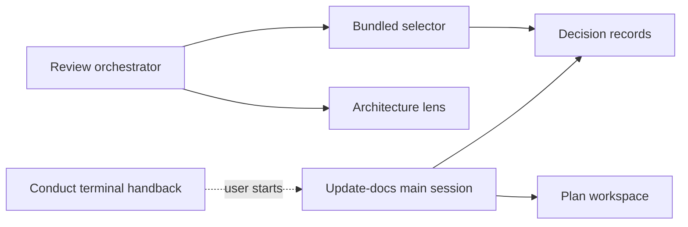
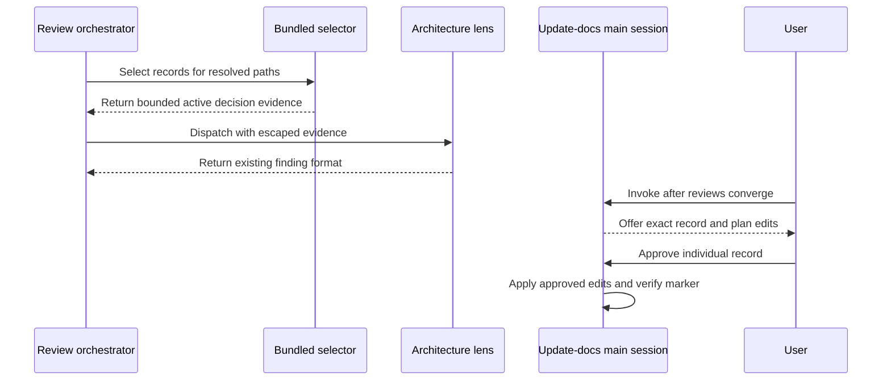

# Task: Decision records (docs/decisions)

**Status**: Not Started
**Component**: meta
**Assigned to**: Claude
**Priority**: Low
**Branch**: feature/comment-hygiene-and-decisions
**Created**: 2026-11-22
**Review Gates**: full

## Objective

Give long-lived architecture decisions one durable, checkable home: a `docs/decisions/` folder of short records with a status, promoted from dev plans at `/update-docs` time, and checked against new plans (`review-plan` architecture lens) and diffs (`deep-review` architecture lens) so contradictions and supersessions surface.

## Context

Depends on plan A (`20261122-feature-comment-hygiene.md`). Implement B after A lands and only if A leaves the gap identified in the 2026-11-22 design discussion. A owns the AGENTS.md comment policy and the deep-review Documentation Lens. B adds the decisions layout and pointer to AGENTS.md, the conduct terminal nudge and the architecture-lens inputs. Keep A's worker prompts, documentation-lens checks, gauntlet candidate handling and shape-test assertions when extending shared files. B owns the review-plan rubric guidance and its own changelog and index entries. Promotion can use candidates a person copies into the plan.

Why the machinery rather than just a folder: `~/Code/pipecat-ai/pipecat-code-mcp` has a `docs/decisions/` with 2 records against 31 dev plans, at least 10 of which carry their own decision sections. Nothing triggered promotion, nothing checked records, and one record (`vector-backend.md`) accrued unrelated amendments because it had no status or supersession model. The other record (`docs-source.md`) has a Status line and the first does not.

Current skein behaviour (Explore, 2026-11-22):

- The plan template provides `### Architecture Decisions` (Codex `dev-plan/template.md:100-102`). Codex `grill/SKILL.md` Step 4 routes accepted decisions through `/dev-plan update` into Technical Specifications above the marker.
- Codex `conduct/marker.py` hashes the exact bytes before the real marker. Adding a promotion note in the workspace below it preserves the hash.
- Codex `review-plan/SKILL.md` Step 2 supplies plan content, Review Focus, the repo checklist and the per-attempt persistence context. Its architecture prompt spans `<!-- BEGIN GENERIC LENS PROMPT: architecture -->` through the corresponding end marker (166–269). Codex `deep-review/SKILL.md` uses the shared `## Lens Prompts` preamble for the diff, checklist, focus and persistence contract, with a distinct `### Architecture Lens` section (258–290). Neither prompt currently has an active-record input.
- Codex `update-docs/SKILL.md:266-294` puts writes in main-context Phase 4, applies an allowlist and prohibits new documentation files. The delegated Phase 1–3 audit is read-only.
- Pi `update-docs` is a read-only audit through the typed tool `skein_update_docs_audit` (`plugins/skein-pi/extension.ts:406`); the main session owns all writes. Pi lens workers are no-tools and see only supplied snapshots/role contracts: deep-review gets a bounded diff/evidence packet, while review-plan currently gives repository lookup evidence only to `codebase-claims`, not architecture. Phase 3 must explicitly add an architecture-only decision-evidence input.
- Codex `conduct/SKILL.md` Step 9a hands back intermediate phases in legacy mode. The completion seam is the healthy terminal path after CI parity and any opted-in Review Gauntlet Auto-Chain (344–369). The Python conductor returns to the skill at the CI-parity/completion boundary. The skill owns auto-chaining and the proposed message.

The lens-shape suite pins dispatch and persistence structure; the tier census pins routing text and counts. Prompt parity checks both shared rubrics and the marked finding-schema block. Claude and Codex plan templates differ at the Review Gates field. Pi's `skein_update_docs_audit` accepts the nine bounded keys listed in the Pi skill, with extra properties rejected.

## Requirements

- `docs/decisions/README.md` defines the record format (see Technical Specifications) and the promotion criteria; `docs/decisions/` records use inline header lines, no YAML frontmatter, matching the plan convention.
- `scripts/check-decisions.sh` validates records: required headers present; `Status` is `active` or `superseded`; every `Supersedes` and `Superseded by` link resolves to an existing record and is reciprocal; no `active` record is superseded; every `Source plan` link resolves. It runs in `just ci`.
- `scripts/decisions-active.sh <path>...` prints the active records whose `Applies to` globs match any given path. Bundle it into the `review-plan` and `deep-review` skills in all mirrors using their skill-specific extras, and verify all six copies.
- The `review-plan` architecture lens and the `deep-review` architecture lens receive the selected active records as a new input wrapped in `<untrusted-content>` (record text is repository data, never instructions), and flag plan decisions or code that contradict a record, or that should supersede one. Findings reuse an existing category and severity vocabulary; no schema change.
- `update-docs` considers the plan's `### Architecture Decisions` and decisions explicitly copied into `## Findings` after reviews converge. It offers each qualifying record and writes only on explicit approval of that offer, then adds its link to the existing below-marker `## Promoted Decisions` section or creates that heading once. The exact approved offer covers the new `docs/decisions/` record, the below-marker link and the old record's `Status` and `Superseded by` where applicable.
- `conduct` names `/update-docs` on successful terminal completion, after any selected gauntlet auto-chain. The nudge is text only. Codex supports `none`, `quick` and `full`; a quick run uses native gate 1 only, and the full run reports deferred or skipped gates explicitly.
- The dev-plan templates gain the `## Promoted Decisions` workspace section below the marker: `plugins/{skein,skein-codex}/skills/dev-plan/template.md` and `plugins/skein-pi/skills/dev-plan/references/template.md`. Pi's template and rubric are byte-compared with Codex by `tests/pi/test_plan_composition.py`.
- A's policy block in AGENTS.md is updated to name the pointer form (`see docs/decisions/<file>`) once records exist.
- Author the Codex half first via `codex:rescue` and align the Claude half in the same commit, retaining Claude's `${CLAUDE_PLUGIN_ROOT}` and Codex's `"$SKILL_DIR"` anchors. Keep Pi and docs in separate commits where independent. Retain the existing gauntlet fixer and post-commit CI checks.

Invariants this plan must hold, each with a test:

- I1: Promotion changes only bytes below the review marker, so a signed-off plan's marker hash is identical before and after (fixture plan, marker verified before and after).
- I2: The record graph is consistent: valid status, resolving and reciprocal supersession links, no active-but-superseded record (`check-decisions.sh` on good and broken fixtures).
- I3: No record is written without user approval; Pi never writes from the audit tool.
- I4: Only active records matching `Applies to` enter lens prompts, and always inside `<untrusted-content>`.
- I5: `rubric.md` edits are byte-identical Claude vs Codex (`check-prompt-parity.sh`).

Out of scope: the retroactive audit skill (plan C); migrating existing code comments or existing plan decisions in bulk; changing `AF_FORBIDDEN_HEADINGS` (`### Architecture Decisions` stays protected); lint tooling; any model-tier change.

## Review Focus

- Marker integrity: sign the fixture once with the bundled `review-plan/scripts/write-review-marker.py` writer. Verify with the canonical APIs in `conduct/marker.py` before and after promotion, comparing the marker line and signed bytes as well as its computed hash.
- The `update-docs` file-creation exception must be narrow (only `docs/decisions/`, only on approval), not a general loosening.
- Pi: `tests/pi/test_update_docs.py` pins "No automatic writes" and the absence of `gh pr edit`; promotion on Pi must stay an audit finding the main session acts on. `validateDocAudit()` accepts findings only on supplied-document paths: locate promotion findings on `relevant_plan_path`, not a proposed new record path. Pi has no `--apply` route; approval remains per record in the main session.
- Lens cost and noise: records are selected by `Applies to`, not read wholesale; confirm the selector's behaviour on a path with no match.
- Escape record closing-tag lookalikes using each skill's existing case-insensitive untrusted-input rule before wrapping the selected block. Preserve the marked prose-rule blocks, the four copies of `GENERIC FINDING SCHEMA AND MERGE` and the architecture prompt markers.
- Preserve Claude/Codex rubric byte parity. Codex architecture lenses use the harness-selected model with high reasoning when supported. Keep existing dispatch and persistence behaviour, including supported sequential execution.
- Bundle the selector only. The validator is repo-local and runs through the new CI recipe.
- Pi is outside `scripts/check-prompt-parity.sh`; `just pi-tests` covers its contracts. Root `package.json` lists the skills; no Pi skill or tool registration changes are required. Pi has no fan-out, plan-view, rfc-finder, spec-compliance or in-your-own-words route to extend.

## Implementation Checklist

Each mirror-spanning phase is split into `a` (Codex), `b` (Claude) and `c` (Pi) sub-phases, run in that order. Every sub-phase names its executor in its first bullet. `a` and `b` land as one commit (Codex half first, Claude aligned to its bytes); `c` is a separate Pi commit.

`conduct` dispatches Claude subagents only. For `a` and `c` phases the main session performs the hand-off itself (`codex:rescue` for Codex, a non-interactive Pi run for Pi) and then runs the phase's declared test command. Whether `conduct` can pause at such a phase for an external executor is unverified; if it cannot, walk the phases in order by hand and use `conduct` only for Claude-owned phases (1, `b`, and the verify phase).

### Phase 1: Folder, record format and validator

**Impl files:** `docs/decisions/README.md, scripts/check-decisions.sh, justfile, AGENTS.md`
**Test files:** `tests/plugin/test-check-decisions.sh`
**Test command:** `bash tests/plugin/test-check-decisions.sh`
**Goal:** The record graph is validated in CI, so the folder cannot silently drift into the inconsistent state pipecat's did (invariant I2).

- Write `docs/decisions/README.md`: record format, filename `yyyymmdd-slug.md`, header fields (`Status`, `Date`, `Applies to`, `Supersedes`, `Superseded by`, `Source plan`), body sections (Decision, Why, Alternatives rejected, Consequences), promotion criteria (cross-file, long-lived, or constrains future work; not a local implementation detail), and an example.
- Write `scripts/check-decisions.sh` per the Requirements. Register its CI recipe and its fixture in `justfile`, document the recipe under AGENTS.md Commands, and add `docs/decisions/` to the AGENTS.md layout.
- Tests: good fixture passes; each of missing header, bad status, dangling link, non-reciprocal link, active-but-superseded fails with a distinct message.

### Phase 2: Active-record selector and bundling

**Impl files:** `scripts/decisions-active.sh, scripts/lib/bundle-map.sh, plugins/skein/skills/review-plan/scripts/decisions-active.sh, plugins/skein/skills/deep-review/scripts/decisions-active.sh, plugins/skein-codex/skills/review-plan/scripts/decisions-active.sh, plugins/skein-codex/skills/deep-review/scripts/decisions-active.sh, plugins/skein-pi/skills/review-plan/scripts/decisions-active.sh, plugins/skein-pi/skills/deep-review/scripts/decisions-active.sh, justfile`
**Test files:** `tests/plugin/test-decisions-active.sh`
**Test command:** `bash tests/plugin/test-decisions-active.sh && just check-sync`
**Goal:** Lens prompts receive only active records whose `Applies to` matches the paths under review (invariant I4), and the script is bundled like the other shared scripts.

- Write `scripts/decisions-active.sh`: given paths, print the matching active records (header plus Decision and Why sections) in a bounded, stable order; superseded records are never printed; no match prints nothing and exits 0.
- Register the selector via the `bundle_extra_for` arms for `review-plan` and `deep-review`, regenerate via `just bundle-appliers` and run `just check-sync`. Those staged trees also feed Pi. Check the bundle parity suite for presence in all six directories and absence from review-gauntlet. Keep the validator outside the bundle.
- Register the selector fixture in `plugin-tests`. Cover glob match, no match, superseded exclusion, stable ordering, and paths with spaces and shell metacharacters.

### Phase 3a: lens checks against active records, Codex mirror

**Impl files:** `plugins/skein-codex/skills/review-plan/SKILL.md, plugins/skein-codex/skills/review-plan/rubric.md, plugins/skein-codex/skills/deep-review/SKILL.md`
**Test files:** `tests/lenses/test-lens-skill-shape.sh`
**Test command:** `just lens-tests`
**Goal:** An architecture-lens finding fires when a plan decision or a diff contradicts, or should supersede, an active record; record text is untrusted data and no tier changes. (Codex mirror.)

- **Executor:** Codex. The main Claude session invokes `codex:rescue` with this phase block as the brief; Codex edits only the files listed above. The main session byte-verifies against `git diff`, runs the test command, and does not commit: the commit is shared with the matching `b` phase.
- Run the bundled selector in each review orchestrator from the resolved repo root before architecture dispatch. Use `"$SKILL_DIR"/scripts/decisions-active.sh` on Codex, `${CLAUDE_PLUGIN_ROOT}/skills/<skill>/scripts/decisions-active.sh` on Claude and the installed skill-relative script on Pi. Use plan-declared repo-relative paths for review-plan and paths from the already resolved review diff for deep-review. Pass paths as literal arguments, allowing spaces and shell metacharacters. Distinguish a genuine empty match from an unavailable or failed selector and surface the latter as missing coverage.
- Add `{{ACTIVE_DECISIONS}}` solely to each architecture lens's rendered input. Codex review-plan adds it within the marked architecture prompt and updates Step 2's allowed-input list for both dispatch modes. Codex deep-review adds the optional architecture-only input to `## Lens Prompts` and the scope bullet under `### Architecture Lens`, outside Block A. Pi adds the main-session evidence step to both SKILL.md files and the lens scope to both rubrics.
- Reuse the selected block for a lens retry. A resumed Codex deep-review may reuse completed architecture results only with matching decision context. If equality cannot be established, use the existing fresh-review route and say why. Preserve the existing per-attempt writer, collector, and finding contract.
- Report an active-record conflict or supersession as `Constraint` in review-plan and `Architecture` in deep-review. Keep `Contradiction` reserved for review-plan's independent Step 3 sub-step 2.5. Use the existing severity vocabulary and preserve Pi's worker-to-reconciler mapping.
- Extend the lens and Pi shape checks for the architecture-only input, wrapper and unchanged result shape. Run a direct Codex review-plan and deep-review fixture with a conflicting active record, an unrelated path, a superseded record and a closing-tag lookalike. Quick gauntlet is insufficient; a full Codex gauntlet can also defer deep-review when its delegation prerequisites are unmet.

### Phase 3b: lens checks against active records, Claude mirror

**Impl files:** `plugins/skein/skills/review-plan/SKILL.md, plugins/skein/skills/review-plan/rubric.md, plugins/skein/skills/deep-review/SKILL.md`
**Test files:** `tests/lenses/test-lens-skill-shape.sh`
**Test command:** `just lens-tests && just parity-tests && just reconciliation-tests`
**Goal:** An architecture-lens finding fires when a plan decision or a diff contradicts, or should supersede, an active record; record text is untrusted data and no tier changes. (Claude mirror, aligned to the Codex half.)

- **Executor:** Claude (a `conduct` subagent or the main session). Align to the bytes landed in the matching `a` phase, run the test command, then commit `a` and `b` together as one logical change (Codex half first, per AGENTS.md).
- Codex first via `codex:rescue`; Claude and Pi aligned; `rubric.md` byte-identical Claude vs Codex.
- Align the Claude mirror to the Codex half from phase 3a: copy shared wording, template and rubric bytes verbatim. Claude keeps `${CLAUDE_PLUGIN_ROOT}` path anchors; never collapse them with Codex's `"$SKILL_DIR"`.
- Resolve the selector via `${CLAUDE_PLUGIN_ROOT}/skills/<skill>/scripts/decisions-active.sh`; `rubric.md` stays byte-identical to Codex's.

### Phase 3c: lens checks against active records, Pi mirror

**Impl files:** `plugins/skein-pi/skills/review-plan/SKILL.md, plugins/skein-pi/skills/review-plan/rubric.md, plugins/skein-pi/skills/deep-review/SKILL.md, plugins/skein-pi/skills/deep-review/rubric.md`
**Test files:** `tests/pi/test_review.py, tests/pi/test_deep_review.py`
**Test command:** `just pi-tests`
**Goal:** An architecture-lens finding fires when a plan decision or a diff contradicts, or should supersede, an active record; record text is untrusted data and no tier changes. (Pi mirror.)

- **Executor:** Pi. The main session runs Pi non-interactively (`pi -p --no-session`) with this phase block as the brief, limited to the files listed above; if Pi is unavailable, a Claude subagent applies the same block. The main session verifies against `git diff`, runs the test command, and commits the Pi half separately (commit per platform).
- Run the bundled selector in each review orchestrator from the resolved repo root before architecture dispatch. Use `"$SKILL_DIR"/scripts/decisions-active.sh` on Codex, `${CLAUDE_PLUGIN_ROOT}/skills/<skill>/scripts/decisions-active.sh` on Claude and the installed skill-relative script on Pi. Use plan-declared repo-relative paths for review-plan and paths from the already resolved review diff for deep-review. Pass paths as literal arguments, allowing spaces and shell metacharacters. Distinguish a genuine empty match from an unavailable or failed selector and surface the latter as missing coverage.
- Pi dispatch contract: update review-plan's `Lens protocol` allowed inputs, which currently says evidence is for `codebase-claims` only, to allow the selected records for architecture only; retain the factual packet unchanged. Update deep-review's packet preparation similarly. Supply installed-rubric scope plus bounded escaped selected records in the existing `skein_worker` `prompt`, never as a new tool parameter. Preserve `role`/`prompt`, category, severity, `reviewed_units`, and persistence schemas; no extension.ts lens schema change is needed. A plan-target deep-review uses plan-declared paths, while current-diff review uses resolved diff paths. If required paths/evidence cannot be resolved, show missing coverage rather than asserting no applicable decisions.
- Pi retries reuse the exact selected snapshot and report selector failure as degraded; Pi deep-review does not support `--continue` and must not gain a resume/cache feature from the Codex requirement. Use `Constraint`/`Architecture` and the existing critical/important/suggestion mapping without adding fields or categories.
- In `tests/pi/test_review.py` and `test_deep_review.py`, extend the required canonical-script sets to include `decisions-active.sh`, asserting byte identity to canonical scripts, plus packet tests for architecture-only delivery, conflict/no-match/superseded fixtures and closing-tag lookalikes. Keep explicit approval, no-tools and unchanged disk-first shape assertions. Pi runtime lens-quality exercises need separately approved workers; static prompt/packet tests alone do not prove detection quality.
- Apply the shared wording from phase 3a inside the Pi mirror's own routes. Pi is not covered by `check-prompt-parity.sh`, so the `tests/pi` assertions are its only guard.

### Phase 4a: update-docs promotion and template, Codex mirror

**Impl files:** `plugins/skein-codex/skills/update-docs/SKILL.md, plugins/skein-codex/skills/dev-plan/template.md, justfile`
**Test files:** `tests/plugin/test-promotion-marker.sh`
**Test command:** `bash tests/plugin/test-promotion-marker.sh`
**Goal:** Promotion is offered, never imposed, and never changes bytes above the review marker (invariants I1 and I3). (Codex mirror.)

- **Executor:** Codex. The main Claude session invokes `codex:rescue` with this phase block as the brief; Codex edits only the files listed above. The main session byte-verifies against `git diff`, runs the test command, and does not commit: the commit is shared with the matching `b` phase.
- Gather evidence in the read-only audit and offer each qualifying decision in main-context Phase 4 (Codex `SKILL.md:266-294`), including `Applies to` inferred from Files to Modify. Extend both the apply-target allowlist and the file-creation rule for the exact approved record, and keep the Phase 3 report first. Re-read the live plan and targets, require a valid real marker, and obtain explicit per-record approval even with `--apply`. If a required path is outside the writable sandbox or the live inputs changed, surface the blocker before any write.
- Add the `## Promoted Decisions` workspace section below the marker in all three templates. Keep the Codex-only `quick` header value and the existing per-mirror header wording intact.
- Register the promotion fixture in `plugin-tests`. Capture the exact signed prefix and marker on a signed fixture, then verify both after promotion without running the marker writer again. Exercise approved, declined, repeated and `--apply` without per-record approval paths, and missing, placeholder and stale markers.

### Phase 4b: update-docs promotion and template, Claude mirror

**Impl files:** `plugins/skein/skills/update-docs/SKILL.md, plugins/skein/skills/dev-plan/template.md`
**Test files:** `tests/plugin/test-promotion-marker.sh`
**Test command:** `just parity-tests && bash tests/plugin/test-promotion-marker.sh`
**Goal:** Promotion is offered, never imposed, and never changes bytes above the review marker (invariants I1 and I3). (Claude mirror, aligned to the Codex half.)

- **Executor:** Claude (a `conduct` subagent or the main session). Align to the bytes landed in the matching `a` phase, run the test command, then commit `a` and `b` together as one logical change (Codex half first, per AGENTS.md).
- Align the Claude mirror to the Codex half from phase 4a: copy shared wording, template and rubric bytes verbatim. Claude keeps `${CLAUDE_PLUGIN_ROOT}` path anchors; never collapse them with Codex's `"$SKILL_DIR"`.
- Add `## Promoted Decisions` below the marker in the Claude template, byte-aligned with Codex's except the existing `Review Gates` header difference.

### Phase 4c: update-docs promotion and template, Pi mirror

**Impl files:** `plugins/skein-pi/skills/update-docs/SKILL.md, plugins/skein-pi/extension.ts, plugins/skein-pi/skills/dev-plan/references/template.md`
**Test files:** `tests/pi/test_update_docs.py, tests/pi/test_plan_composition.py`
**Test command:** `just pi-tests`
**Goal:** Promotion is offered, never imposed, and never changes bytes above the review marker (invariants I1 and I3). (Pi mirror.)

- **Executor:** Pi. The main session runs Pi non-interactively (`pi -p --no-session`) with this phase block as the brief, limited to the files listed above; if Pi is unavailable, a Claude subagent applies the same block. The main session verifies against `git diff`, runs the test command, and commits the Pi half separately (commit per platform).
- On Pi, return candidates as audit findings from the existing bounded plan snapshot. The main session verifies the live source plan and any supersession targets and offers the exact writes. Preserve the tool's closed input schema and the no-write contract.
- Extend `extension.ts::updateDocsPrompt()` with the promotion criteria and named source sections so its no-tools worker can actually offer candidates. Gather both `### Architecture Decisions` and `## Findings` in `relevant_plan` within its 30,000-character field limit and the combined 96 KiB serialized-input limit; narrow explicitly or stop, never silently omit either source section. The nine input keys stay unchanged. Put each offer in the existing finding `recommendation`/report with `location` equal to the supplied `relevant_plan_path`; a new `docs/decisions/` location is rejected by `validateDocAudit()`. Do not send unseen record contents or claim that the audit verified supersession links.
- Narrowly amend Pi SKILL.md's current "Edit only existing documentation files" rule to permit only the exact individually approved new record under `docs/decisions/`, plus approved live supersession targets and the below-marker plan link. Preserve "No automatic writes", explicit target selection, stale-snapshot checks and the ban on PR edits; Pi still does not implement `--apply`. Main session verifies record graph inputs and source marker before writes and verifies the unchanged signed prefix afterward.
- Extend `tests/pi/test_update_docs.py` for promotion instructions and candidate payload reaching the no-tools worker, acceptance of a source-plan-anchored recommendation, rejection of new-record locations/extra fields, preserved budgets, and no documentation writes from the tool. Cover approved/declined/stale main-session promotion contracts separately from mocked audit success. Extend `tests/pi/test_plan_composition.py` for the new below-marker heading while retaining template/rubric byte identity with Codex; Pi inherits Codex template bytes, including its header values, without acquiring unsupported conduct routes.
- Apply the shared wording from phase 4a inside the Pi mirror's own routes. Pi is not covered by `check-prompt-parity.sh`, so the `tests/pi` assertions are its only guard.
- Add `## Promoted Decisions` to the Pi template (`references/template.md`), keeping template byte identity with Codex.

### Phase 5a: conduct nudge, Codex mirror

**Impl files:** `plugins/skein-codex/skills/conduct/SKILL.md`
**Test files:** `tests/gauntlet/test-conduct-hook.sh`
**Test command:** `bash tests/gauntlet/test-conduct-hook.sh`
**Goal:** The terminal handback points at `/update-docs` so promotion does not depend on memory, and the full CI is green. (Codex mirror.)

- **Executor:** Codex. The main Claude session invokes `codex:rescue` with this phase block as the brief; Codex edits only the files listed above. The main session byte-verifies against `git diff`, runs the test command, and does not commit: the commit is shared with the matching `b` phase.
- Add the text to the successful terminal handback. On Codex use the `Review Gauntlet Auto-Chain` completion seam after CI parity and any opted-in `quick` or `full` run. Keep the nudge out of Step 9a's intermediate summary and out of blocked, CI-failed or non-clean gauntlet handbacks. Preserve the existing Codex capability messages and top-level dispatch. Align Claude's healthy completion path and Pi's `Handback contract` using their own supported routes.
- Extend `test-conduct-hook.sh` with a Codex-specific terminal-seam check. Its existing Claude-only gate assertions stay scoped to Claude. The marker parity tests guard byte identity and remain unchanged.

### Phase 5b: conduct nudge, Claude mirror

**Impl files:** `plugins/skein/skills/conduct/SKILL.md`
**Test files:** `tests/gauntlet/test-conduct-hook.sh`
**Test command:** `just gauntlet-tests`
**Goal:** The terminal handback points at `/update-docs` so promotion does not depend on memory, and the full CI is green. (Claude mirror, aligned to the Codex half.)

- **Executor:** Claude (a `conduct` subagent or the main session). Align to the bytes landed in the matching `a` phase, run the test command, then commit `a` and `b` together as one logical change (Codex half first, per AGENTS.md).
- Align the Claude mirror to the Codex half from phase 5a: copy shared wording, template and rubric bytes verbatim. Claude keeps `${CLAUDE_PLUGIN_ROOT}` path anchors; never collapse them with Codex's `"$SKILL_DIR"`.
- Add the text-only `/update-docs` pointer to Claude's healthy completion path only.

### Phase 5c: conduct nudge, Pi mirror

**Impl files:** `plugins/skein-pi/skills/conduct/SKILL.md`
**Test files:** `tests/pi/test_orchestration_routes.py`
**Test command:** `just pi-tests`
**Goal:** The terminal handback points at `/update-docs` so promotion does not depend on memory, and the full CI is green. (Pi mirror.)

- **Executor:** Pi. The main session runs Pi non-interactively (`pi -p --no-session`) with this phase block as the brief, limited to the files listed above; if Pi is unavailable, a Claude subagent applies the same block. The main session verifies against `git diff`, runs the test command, and commits the Pi half separately (commit per platform).
- Pi completion is sequential and main-session-owned: it has no CI-parity Python-conductor return seam or automatic gauntlet chain. Add a text-only `/skill:skein-update-docs` nudge only when all declared phases, tests/validation and approval/verification requirements are complete, not at intermediate, blocked, declined or degraded handbacks. Do not add auto-chain or `quick`/`full` modes. Extend `tests/pi/test_orchestration_routes.py` for those conditions and preserve A's comment-notice handback.
- Apply the shared wording from phase 5a inside the Pi mirror's own routes. Pi is not covered by `check-prompt-parity.sh`, so the `tests/pi` assertions are its only guard.

### Phase 6: Verify and docs

**Impl files:** `AGENTS.md, CHANGELOG.md, docs/dev_plans/README.md`
**Test files:** `tests/gauntlet/test-conduct-hook.sh`
**Test command:** `just ci`
**Goal:** The full CI is green, A's policy block names the pointer form, and B's docs are updated.

- **Executor:** Claude (a `conduct` subagent or the main session). Align to the bytes landed in the matching `a` phase, run the test command, then commit `a` and `b` together as one logical change (Codex half first, per AGENTS.md).: Claude (main session). Runs after every `a`/`b`/`c` phase above has landed.
- Update A's policy block in AGENTS.md to name the `see docs/decisions/<file>` pointer form.
- Run `just ci` in a background job and wait for the exit status. Use a sufficient Codex conduct `--test-timeout` for the declared command. Update B's `CHANGELOG.md` entry and plans index row, then run `/update-docs` after reviews converge.

## Technical Specifications

### Files to Modify

Verified to exist by Explore (2026-11-22):

- `AGENTS.md` — CI recipe, `docs/` layout entry and pointer form in the comment policy.
- `justfile` — validator recipe in `ci` and the three fixtures in `plugin-tests`.
- `scripts/lib/bundle-map.sh` — register the selector.
- `plugins/{skein,skein-codex,skein-pi}/skills/review-plan/{SKILL.md,rubric.md}` — architecture lens input and scope.
- `plugins/{skein,skein-codex,skein-pi}/skills/deep-review/SKILL.md`, `plugins/skein-pi/skills/deep-review/rubric.md` — architecture lens input and scope.
- `plugins/{skein,skein-codex,skein-pi}/skills/update-docs/SKILL.md`, `plugins/skein-pi/extension.ts` — promotion step; extend Pi audit prompt, preserve nine-key input and source-document-anchored result schema, narrow the main-session creation exception.
- `plugins/skein/skills/dev-plan/template.md`, `plugins/skein-codex/skills/dev-plan/template.md`, `plugins/skein-pi/skills/dev-plan/references/template.md` — `## Promoted Decisions` section.
- `plugins/{skein,skein-codex,skein-pi}/skills/conduct/SKILL.md` — terminal nudge.
- Tests: `tests/lenses/test-lens-skill-shape.sh`, `tests/gauntlet/test-conduct-hook.sh`, `tests/pi/test_review.py`, `tests/pi/test_deep_review.py`, `tests/pi/test_update_docs.py`, `tests/pi/test_plan_composition.py`, `tests/pi/test_orchestration_routes.py`. Keep the existing reconciliation, marker and prose-rule tests as gates.
- `CHANGELOG.md`, `docs/dev_plans/README.md`.

### New Files to Create

- `docs/decisions/README.md` — format and promotion criteria.
- `scripts/check-decisions.sh`, `scripts/decisions-active.sh` — validator and selector (plus bundled copies in the six skill `scripts/` directories).
- `tests/plugin/test-check-decisions.sh`, `tests/plugin/test-decisions-active.sh`, `tests/plugin/test-promotion-marker.sh`.

### Record format (defined in `docs/decisions/README.md`)

```
# <Decision title>

**Status**: active | superseded
**Date**: YYYY-MM-DD
**Applies to**: <comma-separated path globs>
**Supersedes**: <record filename> | none
**Superseded by**: <record filename> | none
**Source plan**: <docs/dev_plans/... file>

## Decision
## Why
## Alternatives rejected
## Consequences
```

### Architecture Decisions

- Decision (grilled 2026-11-22): `docs/decisions/` is the home for durable decisions; skein only.
- Decision (grilled 2026-11-22): decisions start in the plan and are promoted late, at `/update-docs` after reviews converge, so a record captures the decision as shipped; a link note goes below the review marker and the above-marker text stays as the sign-off snapshot.
- Decision (grilled 2026-11-22): contradictions are checked at plan review (architecture lens) and at code review (`deep-review`, inherited by `review-gauntlet`).
- Decision (grilled 2026-11-22): each record carries `Applies to` so lenses select records instead of reading all of them.
- Decision (grilled 2026-11-22, accepted): selection is done by a bundled script (`decisions-active.sh`), not by the lens, so the orchestrator controls prompt size; Pi workers get the result in the evidence packet.
- Findings reuse `Constraint` for review-plan architecture findings (Codex `review-plan/SKILL.md:247` and `rubric.md:26`) and `Architecture` for deep-review (Codex `deep-review/SKILL.md:272`). The review-plan rubric reserves `Contradiction` for the separate post-reconciliation pass.
- Decision (grilled 2026-11-22, accepted): the `update-docs` file-creation exception is limited to `docs/decisions/` and requires approval of each proposed record.
- Decision (grilled 2026-11-22, accepted): `update-docs` promotes only from the plan's own `### Architecture Decisions` section plus anything copied into its `## Findings`. Plan A's "decision candidates" and `deep-review` findings are not persisted anywhere durable today (phase summaries, gauntlet run directories), so they get no new persistence here; code-comment candidates stay as comments until someone raises them.

Current Codex evidence for the promotion boundary: deep-review does persist local lens results and `.deep-review/latest-codex.json`. Promotion still reads only the named plan sections. B adds no import from the local review state or gauntlet reports.

Current Pi evidence for the same protected wording: deep-review persists attempt files and `.deep-review/latest-pi.json`. This contradicts the literal claim of no persistence in the grilled decision above; leave that decision untouched and retain its operative boundary: promotion uses only the two named plan sections, never imports Pi review state. A's informational candidate advice remains separate from B's manually captured promotion inputs.

Current Claude evidence for the same protected wording: deep-review persists per-run lens state under `.deep-review/lenses/<run_id>/`, plus `.deep-review/latest-claude.json` (keys: run_id, diff_hash, base/head commit, lenses), and gauntlet keeps `deep-review-reconciled.json` per round under `.gauntlet/<run>/round-N/`. Findings carry `category: Architecture` (47 of 114 in the local sample). All of it is local and gitignored, so "not durable or shared" holds and "no persistence" does not. The operative boundary is unchanged: promotion reads only the two named plan sections and never imports `.deep-review/` or `.gauntlet/` state.

### Dependencies

- Bash, git, `jq`-free for the new validator/selector. No new dependencies. The repo-root `package.json` (name `skein-pi`) lists Pi skills and extension.ts, with no dependency entries; there is no `plugins/skein-pi/package.json`. Existing Pi runtime dependencies remain unchanged.

### Integration Seams

| Seam | Writer (task) | Caller (task) | Contract |
|------|---------------|---------------|----------|
| Record format | `docs/decisions/README.md` and `check-decisions.sh` (Phase 1) | `decisions-active.sh` (Phase 2), `update-docs` (Phases 4a–4c) | One header grammar; the validator is the source of truth, the others parse the same fields. |
| Selected records | `decisions-active.sh` (Phase 2) | review orchestrators, then their architecture lenses (Phases 3a–3c) | Active-only, `Applies to`-matched, bounded, escaped and delivered inside `<untrusted-content>`. |
| Promotion note | `update-docs` (Phases 4a–4c) | marker verification via `marker.py` | Only bytes below the marker change. The writer signs the test fixture once. |
| Nudge | `conduct` handback (Phases 5a–5c) | `update-docs` (Phases 4a–4c) | Text pointer only; never an invocation. |

## Architecture & Call Flow





| Step | Trigger | Enters context | Cleared/persisted | Turn boundary |
|------|---------|----------------|-------------------|---------------|
| 1 | Review resolves plan or diff paths | Matched bounded records | Same selection across retries | Before architecture dispatch |
| 2 | Architecture review | Escaped records plus existing lens data | Findings use the existing per-attempt stream | Collector receives terminal result |
| 3 | User runs update-docs | Valid signed plan and proposed record edits | Approved records and below-marker links persist | Per-record approval before writes |

## Testing Notes

### Test Approach
- [ ] Validator: good fixture and five distinct failing fixtures.
- [ ] Selector: match, no match, superseded excluded, ordering, bundled copies in sync.
- [ ] Lenses: contradicting fixture yields a finding, unrelated fixture yields none; records wrapped as untrusted.
- [ ] Promotion: marker hash identical before and after (I1); Pi audit tool writes no documentation, while only the main session applies individually approved promotion edits (I3).
- [ ] Reconcile both harnesses' plan reviews before implementation, as required by AGENTS.md.
- [ ] `just ci` green.

### Test Results
- [ ] All existing tests pass
- [ ] New tests added and passing
- [ ] Manual promotion run on a real plan, reviewed by the user

### Edge Cases Tested
- [ ] A decision superseding an existing active record updates both records.
- [ ] A plan with no qualifying decisions produces no offer and no new file.
- [ ] `Applies to` matches nothing: lens prompt carries an empty decisions block, not an error.

## Acceptance Criteria

- `docs/decisions/README.md` and `check-decisions.sh` exist; the validator is in `just ci` and fails on each broken-record fixture.
- Both architecture lenses flag a fixture contradiction in all three mirrors and flag nothing for an unrelated fixture.
- `update-docs` offers promotion, writes only on approval, appends the below-marker note, and the marker hash is unchanged (I1).
- The successful `conduct` terminal handback names `/update-docs` on Claude/Codex and `/skill:skein-update-docs` on Pi. In Codex, verify no-gauntlet, quick and full completion; on Pi verify completed sequential phases only. Confirm intermediate, blocked and degraded routes have no nudge in each supported runtime.
- `rubric.md` is byte-identical Claude vs Codex; no model tier changes; `test-spawn-tiers.sh` passes.
- Code reviewed and approved
- Tests passing (`just ci`)
- Documentation updated

<!-- reviewed: YYYY-MM-DD @ <hash> -->
<!-- /review-plan writes the marker line above. Everything below is the workspace: edits here do NOT invalidate the marker. -->

## Progress

- [ ] Phase 1: Folder, record format and validator
- [ ] Phase 2: Active-record selector and bundling
- [ ] Phase 3a: Lens checks against active records (Codex)
- [ ] Phase 3b: Lens checks against active records (Claude)
- [ ] Phase 3c: Lens checks against active records (Pi)
- [ ] Phase 4a: update-docs promotion and template (Codex)
- [ ] Phase 4b: update-docs promotion and template (Claude)
- [ ] Phase 4c: update-docs promotion and template (Pi)
- [ ] Phase 5a: conduct nudge (Codex)
- [ ] Phase 5b: conduct nudge (Claude)
- [ ] Phase 5c: conduct nudge (Pi)
- [ ] Phase 6: Verify and docs

## Findings

- Pi review (2026-11-22): Confirmed — extension.ts:406 registers skein_update_docs_audit with nine bounded keys and additionalProperties:false; validateDocAudit limits findings to supplied document locations and exact five-field findings; added source-plan-anchored promotion offers without schema expansion.
- Pi review (2026-11-22): Corrected — no-tools lens inputs are not uniformly evidence packets: review-plan currently limits lookup evidence to codebase-claims; added explicit architecture-only allowed input, installed-rubric scope, deep-review packet preparation and unchanged role/prompt/result contracts.
- Pi review (2026-11-22): Confirmed — Constraint and Architecture are valid existing Pi categories, worker severity maps critical/important/suggestion, and Pi deep-review has no --continue; scoped retry selection reuse without importing Codex continuation features.
- Pi review (2026-11-22): Confirmed — skill-specific bundle extras feed all six lens-script directories and exclude Pi report scripts; added explicit Pi required-script byte-identity assertions and selector/packet coverage to test_review.py and test_deep_review.py.
- Pi review (2026-11-22): Added — updateDocsPrompt currently offers only generic stale/missing-doc checks, so specified promotion criteria, both bounded plan sections, 30,000-character/96-KiB limits, unchanged nine-key schema and main-session supersession verification.
- Pi review (2026-11-22): Added — Pi's existing-document-only edit rule would block new records; assigned its narrow per-record approved exception while preserving No automatic writes, no --apply, stale checks and no PR edits in test_update_docs.py; clarified that the no-write testing invariant applies to the audit tool, not approved main-session edits.
- Pi review (2026-11-22): Confirmed — Pi template is skills/dev-plan/references/template.md, with Architecture Decisions above and Findings below the placeholder marker; test_plan_composition.py byte-compares both assets to Codex, so added heading/parity tests without changing supported Pi runtime modes.
- Pi review (2026-11-22): Corrected — Pi has no automatic gauntlet/completion seam matching Codex; specified a sequential all-phases-complete text nudge using /skill:skein-update-docs and test_orchestration_routes.py coverage, retaining A's handback policy.
- Pi review (2026-11-22): Confirmed — Pi is excluded from prompt-parity, its tests run via just pi-tests, root package.json registers the extension and eleven skills, and the five absent harness-specific skills need no changes; corrected the manifest/dependency wording.
- Pi review (2026-11-22): Wrong, protected — the grilled no-persistence claim is also false for Pi (attempt streams and latest-pi.json exist); left the decision and all Codex review log lines intact and added adjacent Pi evidence without widening promotion beyond the plan.
- Claude review (2026-11-22): Split phases 3–5 by mirror (a Codex, b Claude, c Pi) and moved AGENTS.md pointer, CHANGELOG, README and the final `just ci` into a new Phase 6 so no mirror phase owns shared docs; selector phase 2 stays single (bundler generates all six dirs). All original bullets preserved verbatim; no decision touched.
- Claude review (2026-11-22): Wrong, protected — the grilled no-persistence claim is also false for Claude (`.deep-review/lenses/`, `latest-claude.json`, `.gauntlet/*/round-N/deep-review-reconciled.json`, all gitignored); decision left untouched, adjacent evidence added, promotion boundary unchanged.
- Pi review (2026-11-22): Confirmed — A-to-B ordering and ownership are compatible on Pi: A owns worker/comment policy and advice separation, B owns architecture evidence, promotion and terminal nudge; added explicit preservation at shared handbacks.
- Pi review (2026-11-22): Unverifiable — future contradiction detection quality, approval flows and runtime gate availability need implementation and explicitly approved exercises; this source review ran no workers or full test suites.
- Codex review (2026-11-22): Confirmed — Codex's template has Architecture Decisions at 100–102, and grill Step 4 delegates accepted decisions to dev-plan update above the marker.
- Codex review (2026-11-22): Confirmed — conduct's marker hashes the signed prefix and excludes the workspace where the promotion note belongs.
- Codex review (2026-11-22): Confirmed — Codex update-docs Phase 4 owns writes and has the new-file prohibition at 294.
- Codex review (2026-11-22): Confirmed — both Claude/Codex rubric pairs match byte-for-byte, and the cited lens, reconciliation, prose-rule, marker and Pi tests exist.
- Codex review (2026-11-22): Confirmed — Codex uses high reasoning for both architecture lenses and retains the existing category and severity schemas.
- Codex review (2026-11-22): Corrected — identified actual Codex architecture prompt sections and the omitted checklist and persistence inputs.
- Codex review (2026-11-22): Corrected — kept the existing Constraint category for plan architecture findings because the review-plan rubric reserves Contradiction for its separate pass.
- Codex review (2026-11-22): Corrected — registered the selector only in the two lens skills' bundle extras, kept the validator repo-local, and assigned exact generated paths and CI fixture wiring.
- Codex review (2026-11-22): Corrected — moved the nudge from intermediate Step 9a to healthy completion for none, quick and full, with a Codex terminal-hook assertion.
- Codex review (2026-11-22): Corrected — preserved the Codex-only quick header when editing the intentionally different templates.
- Codex review (2026-11-22): Corrected — used the marker writer only for fixture setup so post-promotion verification cannot inadvertently re-sign a changed prefix.
- Codex review (2026-11-22): Corrected — reconciled same-commit mirror pairing with separate independent changes and replaced the Claude-specific Monitor instruction with the Codex conduct timeout contract.
- Codex review (2026-11-22): Corrected — added manually captured Findings to the operative promotion steps and assigned shared-file ownership after A.
- Codex review (2026-11-22): Wrong, protected — Codex deep-review already stores gitignored attempt files and latest-codex.json. The grilled wording is unchanged and the adjacent note preserves its promotion boundary.
- Codex review (2026-11-22): Added — specified anchored orchestrator selection, literal path arguments, escaped architecture-only input and visible missing coverage on selector failure.
- Codex review (2026-11-22): Added — preserved dispatch, tier and persistence inputs, bound retries and resume to their decision context, and required direct lens exercises because Codex gauntlet may skip them.
- Codex review (2026-11-22): Added — made promotion per-record approval explicit even under --apply, required live marker and writable-target checks, and kept Pi's closed snapshot and main-session write ownership.
- Codex review (2026-11-22): Added — documented the conditional call-flow section and the dual-harness plan review prerequisite.
- Codex review (2026-11-22): Unverifiable — live Codex gate availability and end-to-end approval behaviour require execution in the implementation environment.

## Issues & Solutions

(none yet)

## Final Results

[Fill this section when the work is complete]

### Summary

### Outcomes

### Learnings

### Follow-up Work
- Plan C (retroactive audit skill): deferred, possibly never.
